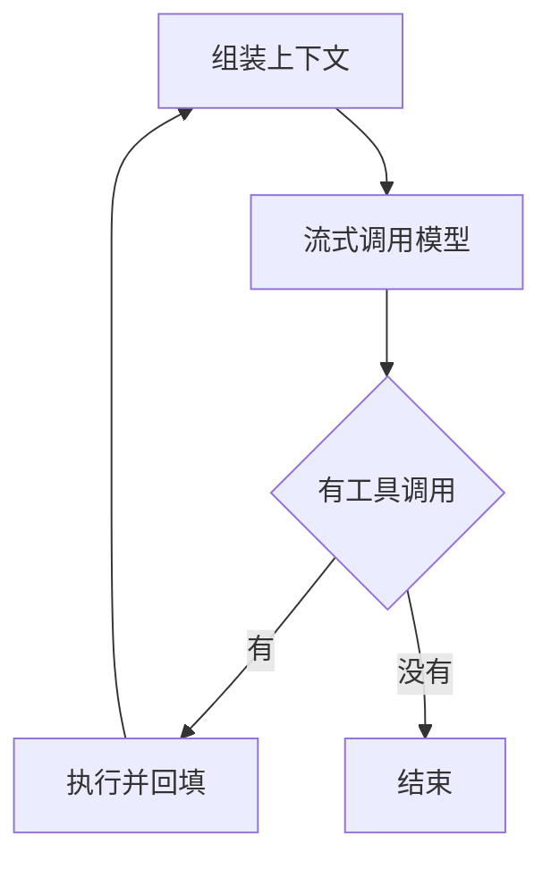
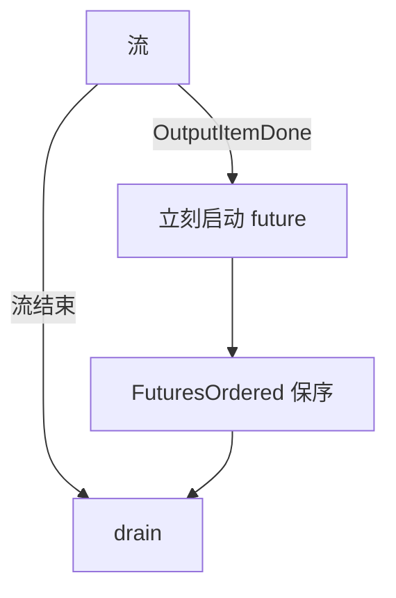
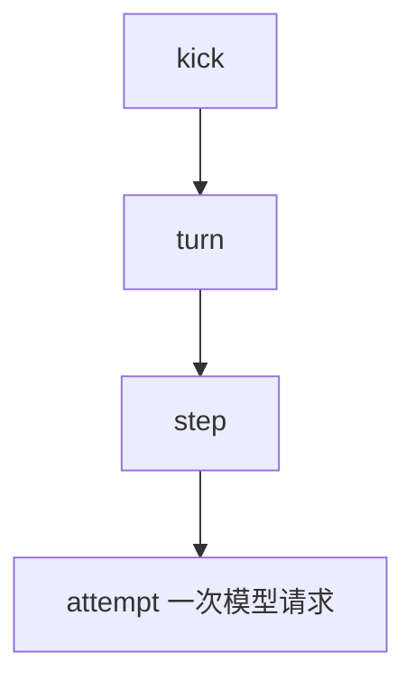

> 来源是 Ryan 的研究 bot 做的 canvas，核对过小红书笔记「不同harness的agent loop是怎么做的」和各家源码。源码快照是 2026-10-28 至 10-29（东京时间）。canvas 里每条结论标了「已核实 / 未核实 / 推断 / 需修正」，这里照用。Claude Code 闭源，调度细节只能当推断。

## 先看结论

六家的 [[agent-loop]] 是同一条骨架。差别不在「有没有循环」，而在四件事放在哪一层：谁决定继续，工具何时开跑，失败怎么恢复，[[fact-source|状态的事实源]]是什么。

长任务内核可以先拿原文的 8 条当检查清单。其中两条是对笔记的修正：oh my pi 的重复调用不是硬拦截；OpenCode 崩溃后是状态还在，不是自动把工具跑完。

## 机制



四件差事：

- 谁决定继续：循环、钩子，或插件。
- 工具何时开跑：流中，或流后。
- 失败怎么恢复：重试、压缩，或提权。
- 事实源：内存、JSONL、事件日志，或数据库。

## 讲解

这一节只讲机制。提交号、对照表和 8 条清单在「参考」。

### Pi 的两层循环

Pi（pi-mono，e65b3b8）求极简。循环是两层 while。

内层在还有工具调用，或还有 steering 消息时继续。外层在要停时再拉一次 follow-up，有就塞回去继续。<span class="mark ok">已核实</span>

### Pi 不放进循环的东西

loop 只露出三个钩子：prepareNextTurn、prepareRequest、finishTurn。压缩、重试、模型路由挂在 AgentSession 上。<span class="mark ok">已核实</span>

工具默认并行。一批里只要有一个工具声明 [[sequential]]，整批改成串行。

[[length-stop]] 时，整批工具调用直接判失败，不执行可能被截断的参数。

```ts
// 示意图，不是 pi-mono 的源码。条件是正文里的原句。
if (stopReason === "length") {
  // 整批工具调用直接判失败。
  // 不执行可能被截断的参数。
}
```

不内置子 agent，也没有 plan mode。这是 README 的原话，<span class="mark ok">已核实</span>。能读，能嵌进别的程序。安全和编排都靠扩展。

### oh my pi 把循环用来纠偏

oh my pi（b075692）是 Pi 的 fork。loop 从 959 行涨到 4146 行，多出来的几乎都是纠偏和中断。

工具可以声明 [[interruptible]]。用户插话只硬中断可中断工具。还没开始的可中断工具被跳过。不可中断的工作永不跳过。<span class="mark ok">已核实</span>

流里还有一套规则：正则命中就中止流，把规则注成 system reminder，再从原处重试。

### 重复调用不是硬拦截

笔记写的「重复调用拦截」<span class="mark fix">需修正</span>。实际是 [[loop-guard]]：检测到重复后注入纠偏提示。[[advisor]] 的内部循环要模型无视一次纠偏，才 abort。

另有 task 工具：在独立 [[worktree]] 里扇出子 agent，返回经过 schema 校验的结构化结果。

### Claude Code 把扩展放在外壳

Claude Code 闭源。被描述成经典单层 ReAct，<span class="mark open">未核实</span>，但和 tool use 协议一致。「读并行写串行」来自社区逆向，<span class="mark open">未核实</span>。

<span class="mark ok">已核实</span>的是外壳：权限模式 default / acceptEdits / plan / bypassPermissions。钩子有 PreToolUse、PostToolUse、Stop、SubagentStop、PreCompact。还有子 agent、/compact 和自动压缩、--resume。

循环本身好预期。扩展点放在 hooks 上，适合企业治理。调度细节只能当<span class="mark guess">推断</span>。

### Codex 在流里就把工具跑起来

Codex（8fdf647）把沙箱和延迟放在前面。run_turn 以一次采样请求为单位循环，靠 needs_follow_up 决定还走不走。<span class="mark ok">已核实</span>



[[output-item-done|OutputItemDone]] 一出现，这次工具调用就作为 future 启动，放进 [[futures-ordered]]，流结束再 drain。<span class="mark ok">已核实</span> 不必等整段流结束才开工。流若中断，已经启动的工具要另外收尾。

并发用 [[rwlock]]。支持并行的工具拿读锁，否则拿写锁独占。

orchestrator 负责审批、选沙箱，以及沙箱拒绝后的提权重试。提权要重新审批。延迟最低，安全模型最完整。

### DeepSeek 用日志当事实源

DeepSeek Harness（f3803c96）把日志当成事实源。[[turn]]、[[step]]、[[attempt]] 三层。<span class="mark ok">已核实</span>



```ts
// 示意图，不是源码。这一行是正文里的原句。
while (await this.turn()) {
  // 一次 turn 里有多个 step。
  // 每一次模型请求是一个 attempt。
  // 失败、重试、取消都写成 assistant/attempt 事件。
}
```

```ts
deriveMessages();
// 模型看得见的内容，都要能从 append-only 会话日志重建。示意图，不是源码。
```

[[derive-messages|deriveMessages()]] 要求：模型看得见的内容，都要能从 append-only 会话日志重建出来。

策略全靠插件的 waterfall 钩子。压缩也是插件：先剪工具结果，再做摘要。

崩溃后的 resume 不续跑半截工具。它给中途崩溃的 turn 追加 [[turn-closers]]，把闭合事件补上。

默认没有步数预算。这句是第三方分析，不是源码注释。

可以重放，可以 fork。遥测和 UI 共用一个事实源。代价是插件的注册顺序变成隐式控制流。

和 [Super-agent 那篇](/items/deepseek-harness-super-agent/) 是同一个团队。那篇讲会话外面的多会话架构，这篇是单个会话的内核。

### OpenCode 把状态放进库

OpenCode（f023f7c）用 Effect 和 SQLite。外层按 step 走，每个 step 里再有 attempt 重试。step / attempt 不是 DeepSeek 独有。

step 开始前异步拍一份 Git 快照，结束再拍一份，用来 diff 和 revert。

笔记说「崩溃后能接着跑」，<span class="mark fix">需修正</span>。代码里是 [[stale-compactions]]：进程死掉后仍标着 running 的压缩，被改成 interrupted。状态不丢，会话能从库里恢复。未完成的工具不会自动续跑。

[[max-steps]] 到顶之后禁用工具，强制模型写出总结和还没做的任务。

## 参考

对照时先看标签。已核实、未核实、推断、需修正的用法和文首那段一样。Claude Code 的调度细节保持推断。

### 循环、开跑时机、事实源

| 维度 | Pi | oh my pi | Claude Code | Codex | DeepSeek | OpenCode |
| --- | --- | --- | --- | --- | --- | --- |
| 循环层级 | 双层 while | 双层+纠偏 | 单层（推断） | turn→采样 | turn→step→attempt | step→attempt |
| 工具开跑 | 流后 | 流后 | 流后（推断） | 流中即启动 | 流后整批 | attempt 内 |
| 事实源 | JSONL | 会话+stats DB | JSONL（推断） | rollout 文件 | append-only 事件日志 | SQLite+Git 快照 |

提交：Pi e65b3b8，oh my pi b075692，Codex 8fdf647，DeepSeek Harness f3803c96，OpenCode f023f7c。快照 2026-10-28 至 10-29（东京时间）。

### 长任务的 8 条

原文的 8 条，顺序没改：

1. 事实源用 append-only 事件日志。模型请求一律从日志派生。resume、fork、审计、回放共用这一套。
2. 把 step 和 attempt 分开。重试不重复认领用户输入，不重跑 pre-step 钩子。
3. 崩溃修复写成显式的补闭合事件。不要假设能把跑到一半的工具调用续完。
4. 工具声明副作用：能不能并行，能不能中断，能不能提权。编排器按声明调度。
5. 长任务加硬预算。OpenCode 的 max-steps 会强制总结。
6. 纠偏用注入，不用硬拦截。必要时再 abort。
7. 被截断的工具调用，整批判失败。
8. 子 agent 放到独立 worktree，返回 schema 化的结果。

## 用在自己的项目

- 长任务控制：第 1、3、5 条合在一起，就是事件日志、补闭合、步数预算。
- 多 agent 编排：第 4、8 条是调度的底子，工具要声明副作用，子 agent 用 worktree 隔离并返回结构化结果。可以和 Super-agent 的 Router / Worker 拼：Super-agent 管会话之间，这六家管会话之内。
- 交易自动化：下单类工具应声明成不可中断、不可并行，类似 Codex 的写锁。行情查询可以并行。截断的参数整批判失败，对下单参数尤其要紧。
- 内容创作：「笔记说法」和「源码核对」并列，本身就是一个技术选题的写法。

## 动手练习

### 练习 1. 最小的 turn / step / attempt

写一个大约 200 行的 loop。所有事件追加写进 JSONL。发给模型的请求只从这份日志派生。在工具执行过程中杀掉进程，resume 时补上一条 interrupted 闭合事件。

完成标准：

- 循环大约 200 行。
- 事件只追加进一份 JSONL。
- 模型请求只从这份日志派生。
- 杀掉进程之后，resume 会补上 interrupted 闭合事件。

### 练习 2. 用声明来调度

给工具加上 `parallelSafe` 和 `interruptible`。用读写锁调度。插话只能中断标了可中断的工具。

完成标准：

- 工具上有 `parallelSafe` 和 `interruptible`。
- 调度用的是读写锁。
- 插话不会中断没标 `interruptible` 的工具。

### 练习 3. 自己核对一处需修正

clone oh-my-pi 或 opencode。找到 ToolCallLoopGuard 或 settleStaleCompactions。用代码核对 canvas 的结论。再挑一处未核实的说法，试着找证据。

完成标准：

- 在 oh-my-pi 或 opencode 里找到 ToolCallLoopGuard 或 settleStaleCompactions。
- 用这段代码核对 canvas 里对应的那条需修正。
- 对某一条未核实的结论，写下找到的证据，或者写明还是没找到。

## 自测

先写一句，或勾选「已经想过」。这两件事都没做，答案打不开。你写的句子留在这台浏览器里。

### 六家的共同骨架是什么？差别在哪四件事？

<div class="try" data-try="skeleton">
  <label class="try-label" for="try-skeleton">你的回答</label>
  <textarea id="try-skeleton" data-try-input rows="4"></textarea>
  <label class="try-thought"><input type="checkbox" data-try-thought /> 我已经想过，直接看答案</label>
  <button type="button" data-try-reveal disabled>看答案</button>
  <div class="try-answer" hidden>
    <p>共同骨架是「组装上下文 → 调用模型（流式）→ 有工具调用就执行并回填 → 否则结束」。差别在：谁决定继续（循环、钩子还是插件）、工具何时开跑（流中还是流后）、失败如何恢复（重试、压缩、提权）、状态的事实源是什么（内存、JSONL、事件日志、数据库）。</p>
  </div>
</div>

### Codex 为什么延迟更低？流中断时多了什么麻烦？

<div class="try" data-try="latency">
  <label class="try-label" for="try-latency">你的回答</label>
  <textarea id="try-latency" data-try-input rows="4"></textarea>
  <label class="try-thought"><input type="checkbox" data-try-thought /> 我已经想过，直接看答案</label>
  <button type="button" data-try-reveal disabled>看答案</button>
  <div class="try-answer" hidden>
    <p>流里一出现完整工具调用（OutputItemDone）就立即作为 future 启动，放入 FuturesOrdered 保序，流结束再 drain，不必等整个流结束才开跑工具。代价是流中断时，已启动的工具需要额外收尾。</p>
  </div>
</div>

### 把 step 和 attempt 分开，避免了哪类重复副作用？

<div class="try" data-try="layers">
  <label class="try-label" for="try-layers">你的回答</label>
  <textarea id="try-layers" data-try-input rows="4"></textarea>
  <label class="try-thought"><input type="checkbox" data-try-thought /> 我已经想过，直接看答案</label>
  <button type="button" data-try-reveal disabled>看答案</button>
  <div class="try-answer" hidden>
    <p>重试只发生在 attempt 层，不会重复认领用户输入，也不会重跑 pre-step 钩子。</p>
  </div>
</div>

### 「崩溃后自动续跑」和「状态落库、可以恢复」差在哪？为什么要补闭合事件？

<div class="try" data-try="crash">
  <label class="try-label" for="try-crash">你的回答</label>
  <textarea id="try-crash" data-try-input rows="4"></textarea>
  <label class="try-thought"><input type="checkbox" data-try-thought /> 我已经想过，直接看答案</label>
  <button type="button" data-try-reveal disabled>看答案</button>
  <div class="try-answer" hidden>
    <p>状态落库可恢复是指状态不丢、可从库恢复会话（如 OpenCode 把 running 压缩标为 interrupted），并不会自动续跑未完成的工具。推荐把崩溃修复写成显式的「补闭合事件」（如 DeepSeek Harness 的 interruptedTurnClosers），而不是假设能续跑到一半的工具调用，这样日志保持完整，可从日志重建。</p>
  </div>
</div>

### 纠偏为什么先注入提示，而不是先硬拦截？

<div class="try" data-try="nudge">
  <label class="try-label" for="try-nudge">你的回答</label>
  <textarea id="try-nudge" data-try-input rows="4"></textarea>
  <label class="try-thought"><input type="checkbox" data-try-thought /> 我已经想过，直接看答案</label>
  <button type="button" data-try-reveal disabled>看答案</button>
  <div class="try-answer" hidden>
    <p>原文启示是「纠偏用注入而非硬拦截，必要时再 abort」。oh my pi 的 ToolCallLoopGuard 检测到重复后注入纠偏提示，模型无视一次纠偏才 abort，先给模型自行修正的机会。</p>
  </div>
</div>

## 原文链接

- Canvas：[六家 Agent Loop 源码核对](https://cursor.com/canvas/store-06ca8338-e99b-408a-bd34-c87c04403daf/644b94d8-e808-4a1a-9c7d-5af5e51170bb)
- 源头：小红书笔记「不同harness的agent loop是怎么做的」（canvas 未给出链接）
- 源码：[pi-mono](https://github.com/badlogic/pi-mono)
- 源码：[oh-my-pi](https://github.com/can1357/oh-my-pi)
- 源码：[codex](https://github.com/openai/codex)
- 源码：[deepseek-harness](https://github.com/deepseek-ai/deepseek-harness)
- 源码：[opencode](https://github.com/sst/opencode)
- 文档：[Claude Code](https://code.claude.com/docs)
