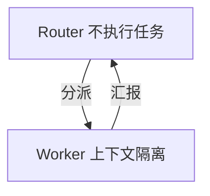
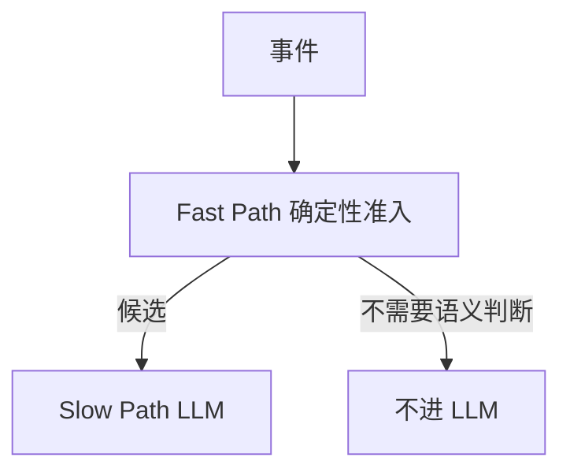
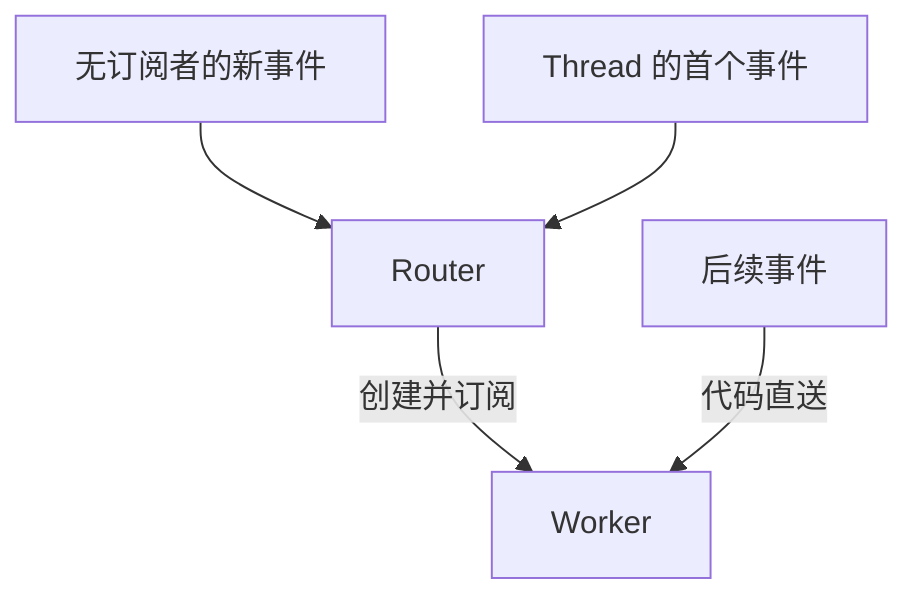

> DeepSeek Harness 团队的 X 长文，Yujia Qiao 实现与执笔，2026-11-01 20:37（东京时间）。文章说的是架构思路，不是 DeepSeek Harness 现有功能介绍。原型在 [dsh-superagent-prototype](https://github.com/deepseek-ai/dsh-superagent-prototype)，不是官方产品。

## 先看结论

单任务已经不太要人盯。多任务卡住的是人的注意力：一个人同时只能跟大约 3 到 5 个活跃会话。

[[super-agent]] 要同时做到连续、能并行、会主动、还常驻。一个 ReAct 循环做不到。文中的做法是外围两级：[[router|Router]] 只分派，[[worker|Worker]] 才执行。

## 机制



连续性放在长寿命的 Router。吞吐放在一任务一个 Worker。

## 讲解

数字表和开放问题在「参考」。这里只讲结构怎么接。

### 瓶颈从模型转到注意力

主流设计仍以单个会话为工作单元，会话之间互相隔离。作者的经验是，一个人同时只能跟 3 到 5 个活跃会话。

单任务受模型能力限制。多任务受人类注意力限制。

给单会话 agent 接上 CLI 或 MCP，只能让它收消息。它仍然同步阻塞，上下文混在一起，设备一离线就停。

### 两种极端都站不住

所有事件进一个会话：上下文最连续。但 ReAct 一步一步走，吞吐低，多任务的细节互相污染。

每个事件一个新会话：吞吐最高。但没有全局上下文，好几个会话各自回复用户，很乱。

### Router 和 Worker 各拿一层

[[router]] 长寿命。它负责全部人类交互、全局协调和记忆。自己不执行任务，甚至可以没有 Bash 工具。

[[worker]] 一任务一个，上下文隔开。工具配满，用最强模型。不直接对人说话，只向 Router 汇报。

和 [[agent-team]] 的差别：Team Lead 要拆解单个复杂任务，还得频繁协调，推理负担重。Router 只分派，在高层追踪任务之间的关系，不拆解任务。作者的经验是，Router 的活比想象的简单，轻量模型通常就够。

### 突发时靠批处理摊薄

Router 为什么不会先堵死，靠的是 [[batching]]。

一次推理期间到达的 [[trigger|事件]] 先排队，下一轮合并注入。Router 是长输入、短输出。合并后的 Trigger 在 Prefill 阶段并行计算，所以单次请求变慢的速度，远跟不上批变大的速度。

实验：每分钟要决策的事件从 1 个加到 40 个。平均批大小从 1.0 到 2.8。单次请求从 2.5 秒到 3.9 秒。摊到每个决策，从 6.4 秒降到 1.6 秒。

这个效应的上限，原文没有给明确数字。开放问题里写了 Router 何时要分片。

### 先用代码过滤，再问模型

[[fast-path]] 用确定性代码，按来源、群组、白名单做准入。每个来源可以设成三档：只响应明确请求、作为候选、忽略。



[[slow-path]] 只接收需要语义判断的候选。语义策略写成 prompt，人可以随时用自然语言增删。

### 订阅之后，代码把后续事件直送

同一条 PR、同一个 IM 话题或同一条邮件链上的连续事件，叫做 [[thread]]。



Router 为 Thread 的第一个事件创建 Worker。Worker 直接订阅这个 Thread。后面的事件由代码直送 Worker，这是 Fast Path。Router 只处理还没有订阅者的新事件，这是 Slow Path。

[[pass-through|订阅]] 是多对多。多个 Worker 订阅同一 Thread 时会同时收到事件，不必点对点通信，也能发现并处理冲突。

### 窗口里放什么，窗口外留什么

把上下文窗口当缓存。

[[inline]]：很快会用到的信息直接放进窗口，省掉工具往返。

[[spill]]：超预算的内容留在窗口外，只留引用或摘要。

按局部性一点一点加。先给对象 ID 和摘要。再内联相关对象的 ID，以及时空上挨着的内容，例如前 50 字、回复链、相邻评论。超长的内容截断，并留下指针。

### 用 ID 一跳一跳召回

[[chain-of-recall]]：Trigger、Thread、Worker Session 都有唯一 ID。注入时把相邻对象的 ID 一并放进窗口，形成引用图。

每次召回的结果也按 Inline 和 Spill 来：带下一跳的摘要和 ID。模型可以从当前事件逐跳往回走。例子是 Thread，到相关 Worker，再到另一个 code review Thread。

### 先做，用不上就丢

[[acting-ahead]] 是按环境信号提前在后台干活。用得上就交付，用不上就丢弃。

例子：收到会议邀请，先查日历冲突，并起草回复。内部群若配了「静默复现并修复」，就先确认问题、找到简单修复才出声，否则全程沉默。

### 工具改成异步，渠道分开写

把耗时的工具调用改成异步的 start() 和 stop()。start() 立刻返回 "Started"。做完之后，结果作为新事件送回会话。模型可以 stop() 掉跑太久的命令。

这样后台任务还在跑，会话仍能接新指令。DeepSeek Harness 已经实现这个机制，默认没有打开。

```ts
// 示意图，不是源码。start 和 stop 是正文里的名字。
start(); // 立刻返回 "Started"。完成后，结果作为新事件送回会话。
stop(); // 模型可以停掉跑太久的命令。
// 后台任务还在跑时，会话仍能接新指令。
// DeepSeek Harness 已实现，默认未开启。
```

渠道按场合分开。IM 要轻，少打扰，只在需要决策或签核时通知。硬规则是每条回复不超过 100 词。GitHub、邮件、文档这些异步渠道，输出结构化的、密度高的内容。

### 计算、状态、环境拆开

第一层：Agent Loop 的计算无状态，跑在弹性云容器里。会话这类持久状态放数据库。本地设备休眠，不影响 agent。

第二层：执行环境难同步。里面有未提交的改动、私有凭据、内网依赖、特定硬件。所以环境留在原地。每个端点只跑一个无状态的轻量 daemon，执行命令，把结果返回去。

这就是 [[byom]]。设备断断续续在线时，重新上线之后，云端自动开跑需要这台设备的任务。

作者指出，Anthropic 的 “Decoupling the brain from the hands” 思路相同。对方侧重托管沙箱和客户 VPC。文中引用见原文链接。

### Watchdog 看的是有没有实质进展

很多异常不是崩溃。模型会陷进无效循环，或者偏离目标。

所以要有主系统之外的独立控制回路。[[watchdog]] 由定时消息驱动。它处理 API 错误、状态恢复失败这类基础设施问题，也用模型判断每个 Worker 有没有实质进展、有没有偏离目标。

它自己是满配工具的 agent。维护者可以用自然语言问它为什么失败，也可以让它在运行中改 prompt 和触发规则。

### 实验在比什么

作者自己说，下面的数字只供参考：合成负载，环境做了简化。每次大约 300 条消息，其中大约 20 条是工作请求。编码用耗时工具模拟。每种设计跑 5 次。

中性 prompt 下，5 次都没调 subagent。委派优先的 prompt 下，5 次里有 4 次委派。剩下一次，模型觉得活「小」，就自己做了，拖出长尾。

单会话要靠 prompt 和模型当场判断要不要委派。两级架构在系统层面拿掉了这个不确定。代价是用更多 token，换更短、更稳的完成时间。

去掉 Pass-through，时间差不多。Router 的决策大约多 30%，token 大约多 37%。完成时间主要看 Worker 在干活。

表在下一节。

## 参考

### 五种设计的数字

| 设计 | 完成时间 p50/p95（分钟） | 每次运行 cache-read tokens |
| --- | --- | --- |
| Super-agent | 12.4/15.7 | 23.2M |
| 无 Pass-through | 12.6/15.5 | 31.8M |
| 单会话+Subagent 工具，中性 prompt | 20.4/29.5 | 6.1M |
| 单会话+Subagent 工具，委派优先 prompt | 13.8/29.0 | 10.8M |

批处理那段的另一组数：每分钟 1 到 40 个需决策事件，平均批大小 1.0 到 2.8，单请求 2.5 秒到 3.9 秒，每个决策 6.4 秒到 1.6 秒。

### 原文列的开放问题

Router 何时分片。Worker 之间何时直连。数月这么长的记忆是主要瓶颈。没有会话之后，产品形态怎么设计。A2A 和上下文边界。

安全与隐私：云端 Agent Loop 一旦被入侵，或被提示注入，所有接进来的端点都可能被接管。凭据进了上下文就可能泄露。需要一种「用凭据，但看不到凭据」的机制。

## 用在自己的项目

- 多 agent 编排：可以把这套结构当成个人 agent 系统的参考架构。现在用多个 bot 分工，研究 bot、学习 bot 之类，本质是手工版的 Worker。缺的是一个只分派、不执行的 Router，以及 Thread 订阅。
- 长任务控制：Watchdog 判断有没有实质进展、有没有跑偏。再加上异步的 start / stop。这两处对上长任务卡住、跑偏的问题。
- 小模型微调：文中写明 Router 用轻量模型就够，并把「专门为 Router 的工作训练模型」列为方向。要训练的是判断事件、批量分派、召回上下文。边界清楚，数据可以从日志里自动出来。
- 交易自动化：行情、新闻、成交回报就是 Trigger 流。Fast Path 用确定性规则过滤，例如价格阈值、来源白名单。Slow Path 才交给 LLM。推测执行可以预先准备分析，但不下单。文中的安全警告在这里就是：交易所 API key 这类凭据不能进模型上下文。
- 内容创作：渠道分开写，IM 有 100 词上限，文档可以写长。可以直接搬到不同平台的输出。

## 动手练习

### 练习 1. 两段式过滤器

选一个你真实的事件源，例如 Telegram 群或 GitHub 通知。Fast Path 用来源、白名单、关键词，分成三档：明确请求、候选、忽略。Slow Path 用小模型判断要不要行动。统计一周里有多少比例的事件在 Fast Path 被丢掉。

完成标准：

- Fast Path 有三档：明确请求、候选、忽略。
- 只有候选会进 Slow Path。
- 有一周的统计：Fast Path 丢掉的事件占多少。

### 练习 2. 最小的 Router、Worker 和订阅

Router 不给执行工具。它把新 Thread 分派给 Worker。Worker 订阅之后，后面的消息由代码直送。按文中的消融，对比有直通和没有直通时，Router 的调用次数和 token。

完成标准：

- Router 没有执行工具。
- 新 Thread 由 Router 分派，订阅后的消息由代码直送。
- 有一组对比：有直通、无直通各自的 Router 调用次数和 token。

### 练习 3. Watchdog 和异步工具

把一个耗时工具改成 start() / stop()。再写一个定时的 Watchdog，读 Worker 最近 N 步日志，让模型输出「有进展 / 在循环 / 跑偏」。后两种情况注入纠偏提示。

完成标准：

- 耗时工具有 start() 和 stop()。
- Watchdog 按时间读取最近 N 步日志。
- 模型的判断是这三档之一：有进展、在循环、跑偏。
- 在循环或跑偏时，会注入纠偏提示。

## 自测

先写一句，或勾选「已经想过」。没做这两件事，答案打不开。

### 为什么「全进一个会话」和「一个事件一个会话」都不行？连续性和吞吐各从哪一层来？

<div class="try" data-try="split">
  <label class="try-label" for="try-split">你的回答</label>
  <textarea id="try-split" data-try-input rows="4"></textarea>
  <label class="try-thought"><input type="checkbox" data-try-thought /> 我已经想过，直接看答案</label>
  <button type="button" data-try-reveal disabled>看答案</button>
  <div class="try-answer" hidden>
    <p>单会话上下文最连续，但 ReAct 一步一步走，吞吐低，多任务细节互相污染。每事件一个会话吞吐最高，但缺全局上下文，多个会话各自回复用户很混乱。两级架构由长寿命的 Router 负责人类交互、全局协调与记忆，提供连续性；由一任务一 Worker、上下文隔离的 Worker 层提供吞吐。</p>
  </div>
</div>

### Router 在事件突发时，为什么摊到每个决策反而更便宜？上限由什么卡住？

<div class="try" data-try="batch">
  <label class="try-label" for="try-batch">你的回答</label>
  <textarea id="try-batch" data-try-input rows="4"></textarea>
  <label class="try-thought"><input type="checkbox" data-try-thought /> 我已经想过，直接看答案</label>
  <button type="button" data-try-reveal disabled>看答案</button>
  <div class="try-answer" hidden>
    <p>靠批处理：一次推理期间到达的事件排队，下一轮合并注入。Router 是「长输入短输出」，合并的 Trigger 在 Prefill 阶段并行计算，单次请求耗时增长远慢于批大小（实验中每个决策从 6.4 秒摊薄到 1.6 秒）。上限原文未给出明确结论；按原文机制推断，受单次请求耗时随批大小增长的速度限制，开放问题中也提到 Router 何时需要分片。</p>
  </div>
</div>

### 订阅和直通省掉了什么？为什么实验里它没让任务更快，却省了很多 token？

<div class="try" data-try="direct">
  <label class="try-label" for="try-direct">你的回答</label>
  <textarea id="try-direct" data-try-input rows="4"></textarea>
  <label class="try-thought"><input type="checkbox" data-try-thought /> 我已经想过，直接看答案</label>
  <button type="button" data-try-reveal disabled>看答案</button>
  <div class="try-answer" hidden>
    <p>省掉了 Router 对同一 Thread 后续事件的处理：Worker 订阅 Thread 后，后续事件由代码直送 Worker，Router 只处理无订阅者的新事件。完成时间主要由 Worker 干活决定，所以去掉直通时间差不多；但 Router 决策多约 30%，token 多约 37%。</p>
  </div>
</div>

### Inline 和 Spill 各去掉哪一种浪费？Chain of Recall 怎么靠 ID 多跳？

<div class="try" data-try="cache">
  <label class="try-label" for="try-cache">你的回答</label>
  <textarea id="try-cache" data-try-input rows="4"></textarea>
  <label class="try-thought"><input type="checkbox" data-try-thought /> 我已经想过，直接看答案</label>
  <button type="button" data-try-reveal disabled>看答案</button>
  <div class="try-answer" hidden>
    <p>Inline 把很快会用到的信息直接放进窗口，省掉工具往返。Spill 把超预算的内容留在窗口外，只留引用或摘要，避免占满窗口。Chain of Recall 给 Trigger、Thread、Worker Session 唯一 ID，注入时内联相邻对象 ID，形成引用图。召回结果也带下一跳的摘要和 ID，模型可以从当前事件逐跳回溯。</p>
  </div>
</div>

### 单会话加上 Subagent 工具，为什么完成时间不稳？prompt 约束和架构约束差在哪？

<div class="try" data-try="delegate">
  <label class="try-label" for="try-delegate">你的回答</label>
  <textarea id="try-delegate" data-try-input rows="4"></textarea>
  <label class="try-thought"><input type="checkbox" data-try-thought /> 我已经想过，直接看答案</label>
  <button type="button" data-try-reveal disabled>看答案</button>
  <div class="try-answer" hidden>
    <p>是否委派要靠 prompt 和模型临场判断：中性 prompt 下 5 次都没调 subagent；委派优先 prompt 下仍有一次模型判断活「小」就自己做，造成长尾。靠 prompt 只能影响概率，两级架构在系统层面消除了这个不确定性，代价是更多 token。</p>
  </div>
</div>

## 原文链接

- X 原帖：[DeepSeek Harness 的 Super-agent 长文](https://x.com/DeepSeekHarness/status/2116857257245987236)
- 原型代码：[dsh-superagent-prototype](https://github.com/deepseek-ai/dsh-superagent-prototype)
- 文中引用：[Decoupling the brain from the hands](https://www.anthropic.com/research/managed-agents)
