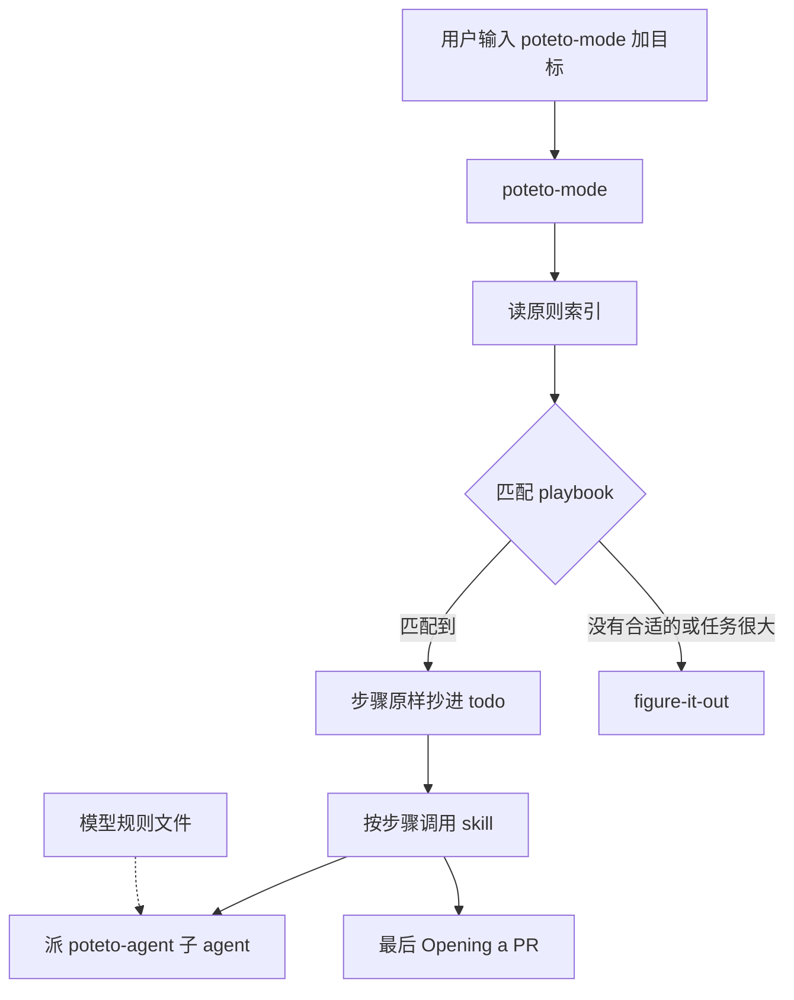
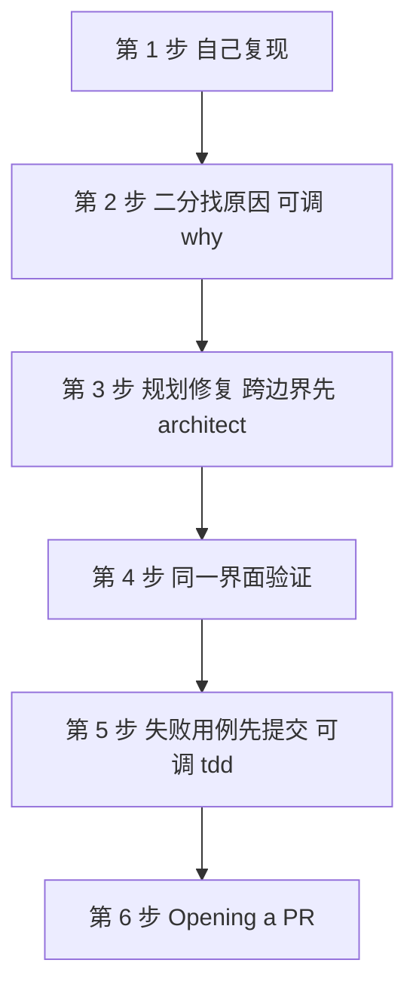
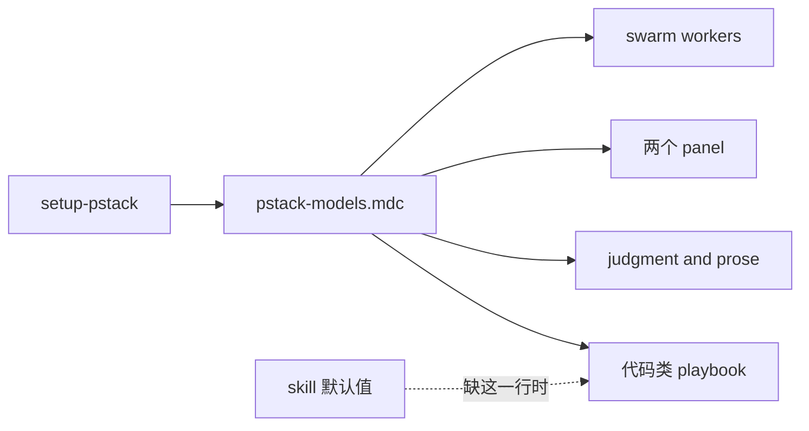

> 来源是本机安装的 pstack 插件，版本 0.15.43，和公开仓库 cursor/plugins 的 main 分支上 plugin.json 的版本一致。快照是 2026-11-17（东京时间）。
> 我只读了 Markdown 文本：README、docs/guide、docs/harness、agents、全部 SKILL.md、playbooks 和 references。scripts 下的 TypeScript 和 statechart 的测试语料没读。英文引文都逐字取自原文件，标「推断」的是我的判断。

<div class="bi-switch" data-bi-switch role="group" aria-label="中英对照的显示方式"><span class="bi-switch-label">对照方式</span><button type="button" data-bi-mode="stack" aria-pressed="true">上下</button><button type="button" data-bi-mode="side" aria-pressed="false">并排</button><button type="button" data-bi-mode="zh" aria-pressed="false">只看中文</button><button type="button" data-bi-mode="en" aria-pressed="false">只看英文</button></div>

## 先看结论

pstack 是一个插件：58 个 skill 目录、2 个子 agent 定义、一本 10 页的指南。日常只用一个入口 `/poteto-mode`。它把任务匹配到 22 个 [[ps-playbook|playbook]] 之一，把步骤抄进 todo，再按步骤调用别的 skill。

24 条原则各占一个 skill，每个 9 到 21 行。poteto-mode 内联了它们的索引，并要求回复里点名用了哪条原则、改了哪个决定。

写法上，除 setup-pstack 外每个 skill 都设了 [[ps-dmi|disable-model-invocation]]，只在被点名时加载。

description 写触发条件，正文是命令式短句，例子和细节下放到 references/，跨 skill 用「the **name** skill」点名，不复述。

模型按[[ps-role|角色]]配：setup-pstack 写一个规则文件，每行覆盖一个角色的默认模型。想直接看每个文件，去下面的「参考：pstack 目录浏览器」。

## 机制



一句话：入口只做路由，playbook 管顺序，skill 管单项做法，原则管判断，子 agent 干活，规则文件管用哪个模型。

## 讲解：目录分成哪几层

### 插件清单只声明两个目录

`.cursor-plugin/plugin.json` 写着 `"skills": "./skills/"` 和 `"agents": "./agents/"`。

插件清单注册的只有这两类：skills/ 下的 58 个目录，agents/ 下的 2 个子 agent。docs/ 是给人读的指南，automations/benny 是一套默认不注册的自动化包。<span class="mark ok">已核实</span>

<div class="bi"><blockquote class="bi-en" lang="en"><p>that's it. the other skills are situational, and the mode skill uses them for you as needed.</p><p class="bi-src"><a href="https://github.com/cursor/plugins/blob/main/pstack/README.md" target="_blank" rel="noopener noreferrer">README.md</a></p></blockquote><div class="bi-zh"><p>README 的定位很直接：入门只要两步，先 /setup-pstack，再 /poteto-mode。其余 skill 是「看情况用」的，多数时候由 mode skill 替你调。</p></div></div>

### 五层，按文件归纳

下面的分层是我按目录和指南章节归纳的，pstack 原文没有「五层」这个说法。<span class="mark guess">推断</span>

| 层 | 文件 | 谁触发 |
| --- | --- | --- |
| 入口与配置 | poteto-mode、poteto-help、setup-pstack | 用户输入斜杠命令 |
| playbook | skills/poteto-mode/playbooks/ 下 22 个 .md | poteto-mode 匹配 |
| 原则 | 24 个 principle-* | poteto-mode 读索引，用到再读全文 |
| 工作流 skill | 理解、设计与审查、构建与文字、验证、个人化，共 31 个 | playbook 步骤点名，或用户直接输入 |
| 子 agent | agents/poteto-agent.md、agents/comment-sicko.md，加 worker.md | 父 agent 派出 |

### playbook 不是 skill

<div class="bi"><blockquote class="bi-en" lang="en"><p>Playbooks are step lists inside <code>/poteto-mode</code>, not skills, so they have no slash command.</p><p class="bi-src"><a href="https://github.com/cursor/plugins/blob/main/pstack/skills/poteto-help/SKILL.md" target="_blank" rel="noopener noreferrer">skills/poteto-help/SKILL.md</a></p></blockquote><div class="bi-zh"><p>playbook 只是 poteto-mode 目录里的 Markdown 步骤表。它没有 frontmatter，也不会出现在斜杠菜单里，只能由 poteto-mode 按任务匹配后打开。</p></div></div>

<div class="bi"><blockquote class="bi-en" lang="en"><p>Match the task to a playbook and open its steps at <code>playbooks/&lt;title&gt;.md</code>, with the title in kebab case. Copy its steps into the todolist tool first. Large, cross-cutting, or unattended work, or a task no playbook fits, routes to the <strong>figure-it-out</strong> skill.</p><p class="bi-src"><a href="https://github.com/cursor/plugins/blob/main/pstack/skills/poteto-mode/SKILL.md" target="_blank" rel="noopener noreferrer">skills/poteto-mode/SKILL.md</a></p></blockquote><div class="bi-zh"><p>路由规则就这三句：按标题的 kebab-case 找文件，先把步骤抄进 todo，匹配不上或任务太大就交给 figure-it-out 现场设计一份。</p></div></div>

### 原则是一条一个文件

[[ps-principle|原则 skill]] 为什么拆成一条一个文件，README 自己给了理由：

<div class="bi"><blockquote class="bi-en" lang="en"><p>twenty-four short skills, one principle each. <code>poteto-mode</code> indexes them inline and reads that index at task start. the standalone files are there so other skills can reference a principle by name, and so the index can point at the full rule for each.</p><p class="bi-src"><a href="https://github.com/cursor/plugins/blob/main/pstack/README.md" target="_blank" rel="noopener noreferrer">README.md</a></p></blockquote><div class="bi-zh"><p>拆成单独文件有两个用处：别的 skill 能按名字引用一条原则；poteto-mode 里的索引只写一行触发条件，完整规则留在叶子文件里。</p></div></div>

<div class="bi"><blockquote class="bi-en" lang="en"><p>The Principles section below grounds every trigger. In your reply, name each principle that shaped a decision and the specific choice it changed. Cite only principles whose leaf SKILL.md you read this session.</p><p class="bi-src"><a href="https://github.com/cursor/plugins/blob/main/pstack/skills/poteto-mode/SKILL.md" target="_blank" rel="noopener noreferrer">skills/poteto-mode/SKILL.md</a></p></blockquote><div class="bi-zh"><p>要求点名原则，还要说出它改变了哪个具体选择；而且只许引用这次会话里真读过全文的原则。这样原则名字就没法当装饰用。</p></div></div>

指南第 8 页把原则名字当成转向用的词：在对话里说一句「apply prove it works」，就能让 agent 回去跑真实流程。原则按 core、architecture、verification、delegation、meta 五组排列。<span class="mark ok">已核实</span>

## 讲解：一个任务怎么跑

### 进门：匹配、抄步骤、调 skill

<div class="bi"><blockquote class="bi-en" lang="en"><p>1. matches your task to a playbook and opens a todo list whose first items are its steps, copied in verbatim.</p><p>2. routes to the other skills as the steps fire.</p><p>3. writes unslopped replies framed for the consumer and the maintainer.</p><p class="bi-src"><a href="https://github.com/cursor/plugins/blob/main/pstack/README.md" target="_blank" rel="noopener noreferrer">README.md</a></p></blockquote><div class="bi-zh"><p>三步：匹配 playbook 并把步骤原样放进 todo 的最前面；步骤走到哪一步就调哪个 skill；回复过一遍 unslop。</p></div></div>

指南说，提示词里只要有目标和能判对错的完成条件就够了，不要自己列 skill 顺序。

<div class="bi"><blockquote class="bi-en" lang="en"><p><strong>Pitfall:</strong> don't enumerate skills in your prompt ("use /architect, then /arena, then /interrogate..."). The playbook already sequences them, and a hand-written sequence usually reorders or drops steps the playbook would have kept.</p><p class="bi-src"><a href="https://github.com/cursor/plugins/blob/main/pstack/docs/guide/02-poteto-mode.md" target="_blank" rel="noopener noreferrer">docs/guide/02-poteto-mode.md</a></p></blockquote><div class="bi-zh"><p>顺序由 playbook 持有，用户的话只负责意图。手写顺序反而会打乱或漏掉 playbook 原本会走的步骤。</p></div></div>

### Non-negotiables：一张触发表

poteto-mode 的第一节是一串「情况 → 动作」。下面挑三条。

<div class="bi"><blockquote class="bi-en" lang="en"><p>- Code → name the data shape first. Across a function boundary → <strong>architect</strong>. Fan-out → <strong>swarm</strong>. Bakeoff → <strong>arena</strong>. Contested design → <strong>interrogate</strong>.</p><p>- Prose, your reply included → <strong>unslop</strong>. Docs, PR descriptions, commit messages → <strong>technical-writing</strong>.</p><p>- A number you measured → <strong>benchmark-checklist</strong>.</p><p class="bi-src"><a href="https://github.com/cursor/plugins/blob/main/pstack/skills/poteto-mode/SKILL.md" target="_blank" rel="noopener noreferrer">skills/poteto-mode/SKILL.md</a></p></blockquote><div class="bi-zh"><p>每一行左边是一个可观察的情况，右边是一个 skill 名。路由不靠模型自由发挥，而是查表。设计类分成四种：跨函数边界、扇出、比稿、有争议的设计，各对应一个 skill。</p></div></div>

### 以 Bug fix 为例



<div class="bi"><blockquote class="bi-en" lang="en"><p>4. Verify on the same surface. The original repro now passes. "Inconclusive" or wrong-surface is not a pass. Flag it. Unit tests show branch behavior, not bug absence.</p><p class="bi-src"><a href="https://github.com/cursor/plugins/blob/main/pstack/skills/poteto-mode/playbooks/bug-fix.md" target="_blank" rel="noopener noreferrer">skills/poteto-mode/playbooks/bug-fix.md</a></p></blockquote><div class="bi-zh"><p>验证必须回到复现时的同一个界面。「不确定」和在别的界面上通过都不算通过；单元测试只说明分支行为，不说明 bug 不在了。</p></div></div>

每个 playbook 结尾都有一行 **Reply:**，规定回复要交代什么。Bug fix 要求把失败和通过的复现输出原样贴出来。<span class="mark ok">已核实</span>

### 派子 agent

主对话自己跑 playbook，干活的交给子 agent。

<div class="bi"><blockquote class="bi-en" lang="en"><p><code>/poteto-mode</code> runs in the chat that receives it. that chat owns the playbook, the todo list, and every subagent spawn.</p><p class="bi-src"><a href="https://github.com/cursor/plugins/blob/main/pstack/README.md" target="_blank" rel="noopener noreferrer">README.md</a></p></blockquote><div class="bi-zh"><p>收到 /poteto-mode 的那个对话是唯一的调度者：playbook、todo 和所有派生都归它管。</p></div></div>

<div class="bi"><blockquote class="bi-en" lang="en"><p>- Starting any agent, whether a Task subagent or a Project worker → the first line of its kickoff is <code>Read &lt;path&gt;/worker.md before anything else.</code>, with <code>&lt;path&gt;</code> the absolute path of this skill's folder. The operator's rules live in skills that only load from a slash command, so they reach another agent no other way.</p><p class="bi-src"><a href="https://github.com/cursor/plugins/blob/main/pstack/skills/poteto-mode/SKILL.md" target="_blank" rel="noopener noreferrer">skills/poteto-mode/SKILL.md</a></p></blockquote><div class="bi-zh"><p>这条把两个设计连起来了：skill 只在斜杠命令下加载，所以子 agent 天然看不到它们。解决办法是让每份 kickoff 的第一行指向 worker.md，规则靠文件路径传下去。</p></div></div>

[[ps-worker-md|worker.md]] 是一段开场加 9 条短规则，其中两条决定了子 agent 的边界：

<div class="bi"><blockquote class="bi-en" lang="en"><p>- The bar in your kickoff is the whole bar. Add no check, gate, sign-off or review round above it.</p><p>- Never call a tool that shows a person a question. Make any choice you can undo, then say what you chose and why. Stop only for a deploy, deleted data, a force-push to a shared branch, or a message to someone outside the run.</p><p class="bi-src"><a href="https://github.com/cursor/plugins/blob/main/pstack/skills/poteto-mode/worker.md" target="_blank" rel="noopener noreferrer">skills/poteto-mode/worker.md</a></p></blockquote><div class="bi-zh"><p>子 agent 不自己加关卡，也不向人提问；可撤销的选择自己做，然后说明。只有部署、删数据、强推共享分支、对外发消息才停。</p></div></div>

子 agent 默认用 [[ps-poteto-agent|poteto-agent]] 这个定义：

<div class="bi"><blockquote class="bi-en" lang="en"><p>Reads the <code>poteto-mode</code> skill's <code>SKILL.md</code> in full before any work, including its inline Principles index. Substituting <code>generalPurpose</code> skips that read and drifts.</p><p class="bi-src"><a href="https://github.com/cursor/plugins/blob/main/pstack/agents/poteto-agent.md" target="_blank" rel="noopener noreferrer">agents/poteto-agent.md</a></p></blockquote><div class="bi-zh"><p>poteto-agent 的全部作用就是保证这次「先读」。换成通用子 agent，就丢了原则索引和规则。</p></div></div>

<div class="bi"><blockquote class="bi-en" lang="en"><p><strong>Fresh subagents by default.</strong> Give a fix round, a follow-up, a retry, or the next queue item to a fresh subagent with the original brief, every later directive, and the prior agent's report and branch.</p><p>You own every subagent's work. Review the diff and write your own summary. A second opinion is the same prompt on another vendor's model.</p><p class="bi-src"><a href="https://github.com/cursor/plugins/blob/main/pstack/skills/poteto-mode/SKILL.md" target="_blank" rel="noopener noreferrer">skills/poteto-mode/SKILL.md</a></p></blockquote><div class="bi-zh"><p>重试和修复默认开新的子 agent，带上原始任务、后续指示和上一个的报告与分支。父 agent 对结果负责：自己看 diff、自己写总结；要第二意见，就把同一份提示交给另一家厂商的模型。</p></div></div>

### 审查与并行：三个 skill 怎么分工

<div class="bi"><blockquote class="bi-en" lang="en"><p>- <code>/arena</code> gives every worker the same brief and merges the best parts. <code>/swarm</code> splits work into slices or a race and returns one report.</p><p>- <code>/interrogate</code> reviews the diff. <code>/blast-radius</code> looks for breakage outside the diff and proves the one fact that makes the change safe.</p><p class="bi-src"><a href="https://github.com/cursor/plugins/blob/main/pstack/skills/poteto-help/SKILL.md" target="_blank" rel="noopener noreferrer">skills/poteto-help/SKILL.md</a></p></blockquote><div class="bi-zh"><p>arena 是同题多做再嫁接；swarm 是切片或竞速，汇总成一份报告；interrogate 审 diff 本身；blast-radius 看 diff 之外。</p></div></div>

三者共用一个规矩：结论要有跑出来的证据。interrogate 的对手只报告自己跑过的问题；swarm 的报告只有 `PASS`、`ISSUES`、`BLOCKED` 三种，缺了的切片记为缺口，不算通过。<span class="mark ok">已核实</span>

<div class="bi"><blockquote class="bi-en" lang="en"><p>Read the terminal results. Drop a result that does not record the SHAs and method its brief names, and respawn that worker once. After a second miss, record a gap. A gap does not count as a pass.</p><p class="bi-src"><a href="https://github.com/cursor/plugins/blob/main/pstack/skills/swarm/SKILL.md" target="_blank" rel="noopener noreferrer">skills/swarm/SKILL.md</a></p></blockquote><div class="bi-zh"><p>汇总时先查格式：没记下 SHA 和方法的结果直接丢掉，重派一次；还不行就记成缺口。缺口不能算通过。</p></div></div>

### 验证：什么算证据

<div class="bi"><blockquote class="bi-en" lang="en"><p>Verify every output by checking the real thing directly: run the feature, read the actual value, inspect the diff. Proxies (file mtimes, self-reports, cached output, "it compiles") do not count. When a check fails, suspect the observation method before the system.</p><p class="bi-src"><a href="https://github.com/cursor/plugins/blob/main/pstack/skills/principle-prove-it-works/SKILL.md" target="_blank" rel="noopener noreferrer">skills/principle-prove-it-works/SKILL.md</a></p></blockquote><div class="bi-zh"><p>只认真实产物。文件时间、自我汇报、缓存输出、「能编译」都是代理指标。检查失败时，先怀疑观察方法，再怀疑系统。</p></div></div>

<div class="bi"><blockquote class="bi-en" lang="en"><p>- A verdict is VERIFIED, NOT VERIFIED, or INCONCLUSIVE. Inconclusive is not a pass. Don't hide a negative.</p><p class="bi-src"><a href="https://github.com/cursor/plugins/blob/main/pstack/skills/figure-it-out/SKILL.md" target="_blank" rel="noopener noreferrer">skills/figure-it-out/SKILL.md</a></p></blockquote><div class="bi-zh"><p>结论只有三种，「不确定」单列，不能并进通过。</p></div></div>

验证类 skill 把这套要求落到项目里：create-verification-skill 生成一个能驱动真实应用的 verify-<app> skill，create-formal-verification-skill 处理测试够不到的并发、重试和状态机。<span class="mark ok">已核实</span>

## 讲解：模型和角色怎么配



<div class="bi"><blockquote class="bi-en" lang="en"><p>Write <code>~/.cursor/rules/pstack-models.mdc</code>, an always-applied rule that sets pstack's model per role.</p><p class="bi-src"><a href="https://github.com/cursor/plugins/blob/main/pstack/skills/setup-pstack/SKILL.md" target="_blank" rel="noopener noreferrer">skills/setup-pstack/SKILL.md</a></p></blockquote><div class="bi-zh"><p>配置不是改 skill，而是另写一个始终生效的规则文件。skill 里保留默认值，规则只覆盖你改过的角色。</p></div></div>

setup-pstack 给出的规则文件形状，原样照抄：

```text
---
description: pstack per-role model choices (overrides skill defaults)
alwaysApply: true
---
# pstack model configuration. One line per role. Delete a line to fall back to the skill default.
# `inherit-parent` or `auto` as a value: the role runs on the parent chat model (omit Task `model` and spawn `generalPurpose`). Alias entries in a panel list still count toward its fan-out.
# defaults: 3
# budget: large (xhigh)
feature, refactoring: claude-opus-5-5-xhigh-fast
bug-fix: claude-opus-5-5-xhigh-fast
perf-issue: claude-opus-5-5-xhigh-fast
hillclimb: claude-opus-5-5-xhigh-fast
judgment and prose: claude-opus-5-5-xhigh-fast
arena runners: claude-fable-5-2-high, claude-opus-5-5-high-fast, gemini-4-carbon-high
arena cross-judge pool: claude-opus-5-5-high-fast, gemini-4-carbon-high
swarm workers: claude-opus-5-5-high-fast
interrogate reviewers: claude-fable-5-2-high, claude-opus-5-5-high-fast, gemini-4-carbon-high
```

### 预算只挪档位

setup-pstack 先问一个预算：large、medium、small。它不换模型家族，只把每个角色的推理档位往下挪 0、1 或 2 档，档位顺序是 xhigh、high、medium、low，任何角色都不超过 xhigh。<span class="mark ok">已核实</span>

### 哪些规则写死在 poteto-mode 里

<div class="bi"><blockquote class="bi-en" lang="en"><p>Verification always runs on the <code>swarm workers</code> model, <code>claude-opus-5-5-high-fast</code> by default.</p><p><strong>Fable 5.2 is an exception.</strong> It runs outside a panel only when the user named it for this task or two Opus 5.5 xhigh runs of the same brief failed its check. Say which. Difficulty alone never qualifies.</p><p class="bi-src"><a href="https://github.com/cursor/plugins/blob/main/pstack/skills/poteto-mode/SKILL.md" target="_blank" rel="noopener noreferrer">skills/poteto-mode/SKILL.md</a></p></blockquote><div class="bi-zh"><p>验证固定用 swarm workers 那一档。Fable 5.2 只在两种情况下出 panel 之外：用户点名，或同一任务在 Opus 5.5 xhigh 上失败两次。「任务难」不算理由。</p></div></div>

这里的 [[ps-panel|panel]] 指 arena runners 和 interrogate reviewers 这类多模型席位。arena 的交叉评审还有一条厂商规则：评审者不能和父 agent 同一厂商，Fable 也算 Claude。<span class="mark ok">已核实</span>

## 讲解：skill 之间怎么互相引用

### 三种引用写法

正文里有三种写法：粗体名字加「skill」，如 the **arena** skill；斜杠命令，如 `/architect`；相对路径，如 `../poteto-mode/SKILL.md`。

原则用 the **prove-it-works** principle skill 这种写法。<span class="mark ok">已核实</span>

<div class="bi"><blockquote class="bi-en" lang="en"><p>Bundled skills live at <code>../&lt;name&gt;/SKILL.md</code> from this file, so put this file's absolute path in every <code>poteto-agent</code> prompt.</p><p>Each leaf is the <strong>principle-&lt;title&gt;</strong> skill, with the title in kebab case, hyphens kept and other punctuation dropped, unless the entry gives its name.</p><p class="bi-src"><a href="https://github.com/cursor/plugins/blob/main/pstack/skills/poteto-mode/SKILL.md" target="_blank" rel="noopener noreferrer">skills/poteto-mode/SKILL.md</a></p></blockquote><div class="bi-zh"><p>名字到文件的映射是确定的：skill 名就是目录名，原则标题转成 kebab-case 再加 principle- 前缀。所以正文只写名字，读的一方自己能找到文件。</p></div></div>

Claude Code 适配文件把这个约定写成了一行映射，说明「点名」本身就是协议：

<div class="bi"><blockquote class="bi-en" lang="en"><p>Run another pstack skill (<code>/name</code> or "the <strong>name</strong> skill")</p><p><code>Read</code> <code>&lt;pstack&gt;/skills/&lt;name&gt;/SKILL.md</code> and follow it.</p><p class="bi-src"><a href="https://github.com/cursor/plugins/blob/main/pstack/docs/harness/claude-code.md" target="_blank" rel="noopener noreferrer">docs/harness/claude-code.md</a></p></blockquote><div class="bi-zh"><p>看到 <code>/name</code> 或「the <strong>name</strong> skill」，就去读对应的 SKILL.md 并照做。</p></div></div>

### 引用而不复述

<div class="bi"><blockquote class="bi-en" lang="en"><p>Run Phase A steps 3 and 4 and Phase B of the <strong>arena</strong> skill, with four changes.</p><p class="bi-src"><a href="https://github.com/cursor/plugins/blob/main/pstack/skills/interrogate/SKILL.md" target="_blank" rel="noopener noreferrer">skills/interrogate/SKILL.md</a></p></blockquote><div class="bi-zh"><p>interrogate 不重写分发逻辑，直接借 arena 的第几阶段第几步，再列出四处改动。arena 一改，interrogate 跟着变。</p></div></div>

<div class="bi"><blockquote class="bi-en" lang="en"><p>Rule numbers are stable ids that other skills cite. A removed rule leaves a gap.</p><p class="bi-src"><a href="https://github.com/cursor/plugins/blob/main/pstack/skills/unslop/SKILL.md" target="_blank" rel="noopener noreferrer">skills/unslop/SKILL.md</a></p></blockquote><div class="bi-zh"><p>unslop 的规则编号是给别的 skill 引用的稳定 id，删一条就留空号，不重新编号。现在的 28 条从 3 号开始，1、2、4、6、21 号是空的。</p></div></div>

### 谁被引用得最多

我写了一个脚本，在每个文件里匹配 `**name**`、`/name`、`../name/` 这些写法，统计点名关系。

共 203 条。被点名最多的是 architect（10 次），然后是 arena、poteto-mode、unslop、principle-sequence-verifiable-units 和 Opening a PR（各 9 次）。<span class="mark guess">推断</span>

这是脚本按写法匹配的结果，别的说法提到的会漏掉。poteto-help 一个文件就点名了 30 多个 skill，因为它本身就是一张路由表。

## 讲解：SKILL.md 怎么写

### frontmatter：description 写触发条件

pstack 的 frontmatter 很少：`name`、`description`，加 `disable-model-invocation: true`。

例外只有三处：poteto-mode 多了 `icon` 和 `color`，typescript-best-practices 多了 `paths`，setup-pstack 没设 disable-model-invocation。<span class="mark ok">已核实</span>

description 的常见写法是「做什么 + Use for 触发词」。24 条原则的 description 全部以「Apply」开头，其中 18 条是「Apply when」，先说在什么情况下用。

<div class="bi"><blockquote class="bi-en" lang="en"><p>description: "Spawn N parallel candidates at the same task, pick a base, graft the strongest parts of the losers into it. Use for /arena, 'arena this', 'throw it in the arena', or when one attempt at a non-trivial artifact would lock in the wrong shape."</p><p class="bi-src"><a href="https://github.com/cursor/plugins/blob/main/pstack/skills/arena/SKILL.md" target="_blank" rel="noopener noreferrer">skills/arena/SKILL.md</a></p></blockquote><div class="bi-zh"><p>前半句是机制，后半句列出触发它的原话和一个场景。用户怎么说、什么情况下该用，都写进 description。</p></div></div>

<div class="bi"><blockquote class="bi-en" lang="en"><p>Installing changes nothing until the user invokes a skill. Only <code>/setup-pstack</code> loads from the user's words.</p><p class="bi-src"><a href="https://github.com/cursor/plugins/blob/main/pstack/skills/poteto-help/SKILL.md" target="_blank" rel="noopener noreferrer">skills/poteto-help/SKILL.md</a></p></blockquote><div class="bi-zh"><p>装上插件不改变任何行为。除了 setup-pstack，description 不会让 skill 自动加载，它的用处是帮用户和 poteto-help 选对 skill。</p></div></div>

automate-me 在教人写自己的 mode skill 时，把这两条写成了规则：

<div class="bi"><blockquote class="bi-en" lang="en"><p>- Frontmatter <code>description</code>: trigger on their name + <code>/&lt;handle&gt;-mode</code> + "work in their style", not on generic keywords like "write code" or "review PR".</p><p>- Frontmatter <code>disable-model-invocation: true</code> by default. Opt out only if the user explicitly wants their mode to apply on every turn.</p><p class="bi-src"><a href="https://github.com/cursor/plugins/blob/main/pstack/skills/automate-me/SKILL.md" target="_blank" rel="noopener noreferrer">skills/automate-me/SKILL.md</a></p></blockquote><div class="bi-zh"><p>description 用专属触发词，不用「写代码」这种泛词；默认关掉自动调用，除非用户就想让它每轮都生效。</p></div></div>

reflect 也把「该触发没触发」归到 description：

<div class="bi"><blockquote class="bi-en" lang="en"><p>A skill that should have fired gets its description tuned. What a lint, script or check could enforce goes to the backlog, not into prose.</p><p class="bi-src"><a href="https://github.com/cursor/plugins/blob/main/pstack/skills/reflect/SKILL.md" target="_blank" rel="noopener noreferrer">skills/reflect/SKILL.md</a></p></blockquote><div class="bi-zh"><p>漏触发就改 description；能用 lint、脚本或检查落实的，进待办，不写成更多文字。</p></div></div>

### 正文结构

正文一般是「一句定位 + 分阶段的步骤 + 输出规定」。arena 和 swarm 一开头就要求把阶段列进 todo。22 个 playbook 里有 19 个以一句粗体的「You own …」开头，交代主 agent 负责什么。<span class="mark ok">已核实</span>

<div class="bi"><blockquote class="bi-en" lang="en"><p>Open a todolist with one entry per phase (Frame, Fan out, Cross-judge, Pick, Graft, Verify) before launching anything.</p><p class="bi-src"><a href="https://github.com/cursor/plugins/blob/main/pstack/skills/arena/SKILL.md" target="_blank" rel="noopener noreferrer">skills/arena/SKILL.md</a></p></blockquote><div class="bi-zh"><p>先把六个阶段放进 todo，再开始派人。阶段名用字母编号，别的 skill 才能写「arena Phase F」来引用。</p></div></div>

结尾的 **Reply:** 或 **Output** 一节规定交付物的内容，比如 interrogate 要求列出意图、通过验证的发现，以及每个对手被丢掉的发现数和原因。<span class="mark ok">已核实</span>

### references 拆分

有 references/ 的只有 6 个 skill：create-verification-skill、poteto-help、poteto-mode、show-me-your-work、statechart、typescript-best-practices。

主文件只留规则，用一句话指过去。<span class="mark ok">已核实</span>

<div class="bi"><blockquote class="bi-en" lang="en"><p>Examples: <code>references/patterns.md</code>.</p><p class="bi-src"><a href="https://github.com/cursor/plugins/blob/main/pstack/skills/typescript-best-practices/SKILL.md" target="_blank" rel="noopener noreferrer">skills/typescript-best-practices/SKILL.md</a></p></blockquote><div class="bi-zh"><p>规则表在 SKILL.md，例子整份放到 references。主文件 31 行，例子文件单独 9KB。</p></div></div>

<div class="bi"><blockquote class="bi-en" lang="en"><p>Verify each claim against the code per <code>../references/bugbot-triage.md</code>.</p><p class="bi-src"><a href="https://github.com/cursor/plugins/blob/main/pstack/skills/poteto-mode/playbooks/babysit.md" target="_blank" rel="noopener noreferrer">skills/poteto-mode/playbooks/babysit.md</a></p></blockquote><div class="bi-zh"><p>playbook 也能指向 skill 的 references：babysit 需要分辨 Bugbot 评论时，才去读那份分诊说明。</p></div></div>

另有 3 个 skill 带 scripts/：poteto-mode 的 PR 观察脚本等、show-me-your-work 的写日志脚本 log.sh、statechart 的一套 TypeScript 脚本。<span class="mark ok">已核实</span>

指南第 8 页讲 Build the Lever 时说：一个步骤脚本每次都能同样做，就用脚本，agent 留给需要判断的地方。

### 写给 agent 的文字

<div class="bi"><blockquote class="bi-en" lang="en"><p>Agent-facing prose has a higher bar than human prose, because an unhelpful sentence becomes an instruction some future agent follows.</p><p class="bi-src"><a href="https://github.com/cursor/plugins/blob/main/pstack/docs/guide/09-make-it-yours.md" target="_blank" rel="noopener noreferrer">docs/guide/09-make-it-yours.md</a></p></blockquote><div class="bi-zh"><p>给 agent 读的每一句都会被当成指令执行，所以多余的句子是有代价的。</p></div></div>

<div class="bi"><blockquote class="bi-en" lang="en"><p>When in doubt, delete. Keep only prose that changes a decision. Tell it to do the thing and skip the reason. Explain only when the rule is confusing without one. Match tone to scope. Point at structural sources (types, READMEs, config) per the <strong>encode-lessons-in-structure</strong> principle skill. Delegate to other skills by path. Don't restate.</p><p class="bi-src"><a href="https://github.com/cursor/plugins/blob/main/pstack/skills/poteto-mode/playbooks/authoring-a-skill.md" target="_blank" rel="noopener noreferrer">skills/poteto-mode/playbooks/authoring-a-skill.md</a></p></blockquote><div class="bi-zh"><p>这是 pstack 写 skill 的总纲：拿不准就删，只留改变决定的句子；直接下指令，不讲理由，除非没有理由规则就看不懂；指向类型、README 和配置这些结构性来源；按路径委托给别的 skill，不复述。</p></div></div>

<div class="bi"><blockquote class="bi-en" lang="en"><p><strong>Corollary:</strong> If the fix is structural, only use the structural fix. The instruction is the symptom.</p><p class="bi-src"><a href="https://github.com/cursor/plugins/blob/main/pstack/skills/principle-encode-lessons-in-structure/SKILL.md" target="_blank" rel="noopener noreferrer">skills/principle-encode-lessons-in-structure/SKILL.md</a></p></blockquote><div class="bi-zh"><p>能用结构解决，就只用结构；需要再写一条指令，本身就说明问题还在。</p></div></div>

句子层面有两份规范。unslop 是 AI 腔清单，technical-writing 是分层标准，并且把 unslop 当底层：

<div class="bi"><blockquote class="bi-en" lang="en"><p>- Apply the <strong>unslop</strong> skill to every doc this skill touches. That skill owns the slop-pattern catalog: AI vocabulary, filler, hedging, formatting tells.</p><p class="bi-src"><a href="https://github.com/cursor/plugins/blob/main/pstack/skills/technical-writing/SKILL.md" target="_blank" rel="noopener noreferrer">skills/technical-writing/SKILL.md</a></p></blockquote><div class="bi-zh"><p>清单只有一份，归 unslop 所有；technical-writing 只引用它，不再抄一遍。</p></div></div>

poteto-mode 对回复的要求也只有四句：

<div class="bi"><blockquote class="bi-en" lang="en"><p>Write short declarative sentences with no long dash and no colon as a connector. Lead with what changes for the user. Give each claim its evidence or a label (measured, inferred, or guess). Never hand the human a check you could run.</p><p class="bi-src"><a href="https://github.com/cursor/plugins/blob/main/pstack/skills/poteto-mode/SKILL.md" target="_blank" rel="noopener noreferrer">skills/poteto-mode/SKILL.md</a></p></blockquote><div class="bi-zh"><p>短陈述句，不用长破折号，不用冒号连接分句；先说对用户有什么变化；每个说法给证据或标签（测得、推断、猜测）；自己能跑的检查不推给人。</p></div></div>

## 讲解：四个 skill 逐段拆

### poteto-mode：路由器

110 行。一句路径约定之后是六个 h2：Non-negotiables、Principles、Autonomy、Subagents、Writing the reply、Playbooks。前面讲了路由、子 agent 和回复，这里只看 Autonomy。<span class="mark ok">已核实</span>

<div class="bi"><blockquote class="bi-en" lang="en"><p><strong>Always pause</strong> for irreversible writes: force-push to shared branches, deploys, data deletion, customer messages.</p><p><strong>No is an acceptable answer.</strong> Asked whether to do something, invited to add scope, or shown an approach, reply with your real judgment.</p><p class="bi-src"><a href="https://github.com/cursor/plugins/blob/main/pstack/skills/poteto-mode/SKILL.md" target="_blank" rel="noopener noreferrer">skills/poteto-mode/SKILL.md</a></p></blockquote><div class="bi-zh"><p>自主边界按「可不可逆」划线，和 worker.md 的停止清单一致。另一条要求 agent 敢说不：被问要不要做、要不要加范围时，给真实判断，不默认同意。</p></div></div>

### principle-build-the-lever：原则叶子

14 行。frontmatter 的 description 自带完整规则，正文是一段定义加四条要点。

<div class="bi"><blockquote class="bi-en" lang="en"><p>- Applying this produces a file. No script, codemod, generator, or delegate skill in the diff means you didn't apply it. Commit it when the work outlives the session.</p><p>- A deterministic tool beats fan-out. When you do fan out, write the recipe, the verification contract, and the fences as one skill the delegates read and cannot edit.</p><p class="bi-src"><a href="https://github.com/cursor/plugins/blob/main/pstack/skills/principle-build-the-lever/SKILL.md" target="_blank" rel="noopener noreferrer">skills/principle-build-the-lever/SKILL.md</a></p></blockquote><div class="bi-zh"><p>这条原则给了自己的检验方法：diff 里没有脚本或 skill，就等于没用这条原则。第二条直接讲多 agent：能用确定性工具就别扇出；要扇出，就把做法、验收和边界写成子 agent 只读、不能改的 skill。</p></div></div>

### interrogate：在 arena 上改四处

31 行，四节：Frame、Fan out、Verify、Output。前面引过它借用 arena 的那一句，这里看它给对手的任务书。

<div class="bi"><blockquote class="bi-en" lang="en"><p>&gt; Break this change. Prove each finding with a run against the real code, such as a failing test, a repro script, or command output that shows the wrong behavior.</p><p>Skip arena Phases C, D, and E. Adversaries find different failures, so the verdict keeps every verified finding, not one adversary's list.</p><p class="bi-src"><a href="https://github.com/cursor/plugins/blob/main/pstack/skills/interrogate/SKILL.md" target="_blank" rel="noopener noreferrer">skills/interrogate/SKILL.md</a></p></blockquote><div class="bi-zh"><p>对手的任务书是引用块，原样交给子 agent。它跳过 arena 的评审、选底稿和嫁接三步，因为审查要的是所有验证过的问题的并集，不是挑一份最好的。</p></div></div>

### unslop：被引用的规则清单

40 行，一句定位加 28 条编号规则。它没有步骤，也不引用别的 skill，是最底层的叶子。

<div class="bi"><blockquote class="bi-en" lang="en"><p>26. No abstract metaphor nouns: substrate, wedge, vector, nexus, primitive, harness, surface, scaffolding, paradigm, ratchet, north star, flywheel. Use the concrete word.</p><p>27. Say what it does, not how it feels. Name the mechanism or the number. Cut a sentence that could appear unchanged in another project's docs.</p><p class="bi-src"><a href="https://github.com/cursor/plugins/blob/main/pstack/skills/unslop/SKILL.md" target="_blank" rel="noopener noreferrer">skills/unslop/SKILL.md</a></p></blockquote><div class="bi-zh"><p>规则是可以逐条检查的禁用词和句式。第 27 条给了一个好用的测试：一句话原样搬到别的项目文档里也成立，就删掉。</p></div></div>

## 参考：pstack 目录浏览器

按实际目录分组。点一个名字，旁边的面板显示它的类型、行数、公开副本链接、英文原文节选和中文解读，以及它点名引用了谁、被谁点名引用。点引用里的名字可以跳过去。

英文节选：skill 和子 agent 取 frontmatter 的 description，playbook 取 README 里 playbook 表的说明，worker.md 取第一段。分组名是我按指南章节起的。<span class="mark guess">推断</span>

<div class="explorer" data-explorer><div class="explorer-bar"><label class="explorer-filter">筛选 <input type="search" data-explorer-filter placeholder="输入名字，如 arena" autocomplete="off" /></label><p class="explorer-count" data-explorer-count></p></div><div class="explorer-tree"><section class="explorer-group" data-group="entry"><p class="explorer-group-title">入口与配置 <span>3</span></p><p class="explorer-where"><code>skills/</code></p><ul><li><button type="button" class="explorer-node" data-node="skill:poteto-mode" aria-pressed="false">poteto-mode</button></li><li><button type="button" class="explorer-node" data-node="skill:poteto-help" aria-pressed="false">poteto-help</button></li><li><button type="button" class="explorer-node" data-node="skill:setup-pstack" aria-pressed="false">setup-pstack</button></li></ul></section><section class="explorer-group" data-group="playbook"><p class="explorer-group-title">playbook（poteto-mode 内的步骤清单） <span>22</span></p><p class="explorer-where"><code>skills/poteto-mode/playbooks/</code></p><ul><li><button type="button" class="explorer-node" data-node="playbook:authoring-a-skill" aria-pressed="false">authoring-a-skill</button></li><li><button type="button" class="explorer-node" data-node="playbook:autonomous-run" aria-pressed="false">autonomous-run</button></li><li><button type="button" class="explorer-node" data-node="playbook:autopilot-full" aria-pressed="false">autopilot-full</button></li><li><button type="button" class="explorer-node" data-node="playbook:autopilot-stack" aria-pressed="false">autopilot-stack</button></li><li><button type="button" class="explorer-node" data-node="playbook:babysit" aria-pressed="false">babysit</button></li><li><button type="button" class="explorer-node" data-node="playbook:bug-fix" aria-pressed="false">bug-fix</button></li><li><button type="button" class="explorer-node" data-node="playbook:eval" aria-pressed="false">eval</button></li><li><button type="button" class="explorer-node" data-node="playbook:feature" aria-pressed="false">feature</button></li><li><button type="button" class="explorer-node" data-node="playbook:hillclimb" aria-pressed="false">hillclimb</button></li><li><button type="button" class="explorer-node" data-node="playbook:investigation" aria-pressed="false">investigation</button></li><li><button type="button" class="explorer-node" data-node="playbook:multi-phase-plan" aria-pressed="false">multi-phase-plan</button></li><li><button type="button" class="explorer-node" data-node="playbook:opening-a-pr" aria-pressed="false">opening-a-pr</button></li><li><button type="button" class="explorer-node" data-node="playbook:pause-safely" aria-pressed="false">pause-safely</button></li><li><button type="button" class="explorer-node" data-node="playbook:perf-issue" aria-pressed="false">perf-issue</button></li><li><button type="button" class="explorer-node" data-node="playbook:prototype" aria-pressed="false">prototype</button></li><li><button type="button" class="explorer-node" data-node="playbook:refactoring" aria-pressed="false">refactoring</button></li><li><button type="button" class="explorer-node" data-node="playbook:runtime-forensics" aria-pressed="false">runtime-forensics</button></li><li><button type="button" class="explorer-node" data-node="playbook:session-pickup" aria-pressed="false">session-pickup</button></li><li><button type="button" class="explorer-node" data-node="playbook:shipping" aria-pressed="false">shipping</button></li><li><button type="button" class="explorer-node" data-node="playbook:trace-forensics" aria-pressed="false">trace-forensics</button></li><li><button type="button" class="explorer-node" data-node="playbook:visual-parity" aria-pressed="false">visual-parity</button></li><li><button type="button" class="explorer-node" data-node="playbook:worktree-cleanup" aria-pressed="false">worktree-cleanup</button></li></ul></section><section class="explorer-group" data-group="agent"><p class="explorer-group-title">子 agent 与 worker 规则 <span>3</span></p><p class="explorer-where"><code>agents/ · skills/poteto-mode/worker.md</code></p><ul><li><button type="button" class="explorer-node" data-node="agent:poteto-agent" aria-pressed="false">poteto-agent</button></li><li><button type="button" class="explorer-node" data-node="agent:comment-sicko" aria-pressed="false">comment-sicko</button></li><li><button type="button" class="explorer-node" data-node="worker:worker" aria-pressed="false">worker</button></li></ul></section><section class="explorer-group" data-group="p-core"><p class="explorer-group-title">原则 · core <span>10</span></p><p class="explorer-where"><code>skills/principle-*</code></p><ul><li><button type="button" class="explorer-node" data-node="skill:principle-laziness-protocol" aria-pressed="false">laziness-protocol</button></li><li><button type="button" class="explorer-node" data-node="skill:principle-foundational-thinking" aria-pressed="false">foundational-thinking</button></li><li><button type="button" class="explorer-node" data-node="skill:principle-redesign-from-first-principles" aria-pressed="false">redesign-from-first-principles</button></li><li><button type="button" class="explorer-node" data-node="skill:principle-attack-the-premise" aria-pressed="false">attack-the-premise</button></li><li><button type="button" class="explorer-node" data-node="skill:principle-subtract-before-you-add" aria-pressed="false">subtract-before-you-add</button></li><li><button type="button" class="explorer-node" data-node="skill:principle-minimize-reader-load" aria-pressed="false">minimize-reader-load</button></li><li><button type="button" class="explorer-node" data-node="skill:principle-outcome-oriented-execution" aria-pressed="false">outcome-oriented-execution</button></li><li><button type="button" class="explorer-node" data-node="skill:principle-experience-first" aria-pressed="false">experience-first</button></li><li><button type="button" class="explorer-node" data-node="skill:principle-exhaust-the-design-space" aria-pressed="false">exhaust-the-design-space</button></li><li><button type="button" class="explorer-node" data-node="skill:principle-build-the-lever" aria-pressed="false">build-the-lever</button></li></ul></section><section class="explorer-group" data-group="p-arch"><p class="explorer-group-title">原则 · architecture <span>6</span></p><p class="explorer-where"><code>skills/principle-*</code></p><ul><li><button type="button" class="explorer-node" data-node="skill:principle-model-the-domain" aria-pressed="false">model-the-domain</button></li><li><button type="button" class="explorer-node" data-node="skill:principle-boundary-discipline" aria-pressed="false">boundary-discipline</button></li><li><button type="button" class="explorer-node" data-node="skill:principle-type-system-discipline" aria-pressed="false">type-system-discipline</button></li><li><button type="button" class="explorer-node" data-node="skill:principle-make-operations-idempotent" aria-pressed="false">make-operations-idempotent</button></li><li><button type="button" class="explorer-node" data-node="skill:principle-migrate-callers-then-delete-legacy-apis" aria-pressed="false">migrate-callers-then-delete-legacy-apis</button></li><li><button type="button" class="explorer-node" data-node="skill:principle-separate-before-serializing-shared-state" aria-pressed="false">separate-before-serializing-shared-state</button></li></ul></section><section class="explorer-group" data-group="p-verify"><p class="explorer-group-title">原则 · verification <span>5</span></p><p class="explorer-where"><code>skills/principle-*</code></p><ul><li><button type="button" class="explorer-node" data-node="skill:principle-prove-it-works" aria-pressed="false">prove-it-works</button></li><li><button type="button" class="explorer-node" data-node="skill:principle-fix-root-causes" aria-pressed="false">fix-root-causes</button></li><li><button type="button" class="explorer-node" data-node="skill:principle-sequence-verifiable-units" aria-pressed="false">sequence-verifiable-units</button></li><li><button type="button" class="explorer-node" data-node="skill:principle-test-behavior-not-implementation" aria-pressed="false">test-behavior-not-implementation</button></li><li><button type="button" class="explorer-node" data-node="skill:principle-explain-the-number" aria-pressed="false">explain-the-number</button></li></ul></section><section class="explorer-group" data-group="p-deleg"><p class="explorer-group-title">原则 · delegation 与 meta <span>3</span></p><p class="explorer-where"><code>skills/principle-*</code></p><ul><li><button type="button" class="explorer-node" data-node="skill:principle-guard-the-context-window" aria-pressed="false">guard-the-context-window</button></li><li><button type="button" class="explorer-node" data-node="skill:principle-never-block-on-the-human" aria-pressed="false">never-block-on-the-human</button></li><li><button type="button" class="explorer-node" data-node="skill:principle-encode-lessons-in-structure" aria-pressed="false">encode-lessons-in-structure</button></li></ul></section><section class="explorer-group" data-group="understand"><p class="explorer-group-title">理解类（指南第 2、3、10 页） <span>9</span></p><p class="explorer-where"><code>skills/</code></p><ul><li><button type="button" class="explorer-node" data-node="skill:how" aria-pressed="false">how</button></li><li><button type="button" class="explorer-node" data-node="skill:why" aria-pressed="false">why</button></li><li><button type="button" class="explorer-node" data-node="skill:teach" aria-pressed="false">teach</button></li><li><button type="button" class="explorer-node" data-node="skill:recall" aria-pressed="false">recall</button></li><li><button type="button" class="explorer-node" data-node="skill:in-your-own-words" aria-pressed="false">in-your-own-words</button></li><li><button type="button" class="explorer-node" data-node="skill:sharpen" aria-pressed="false">sharpen</button></li><li><button type="button" class="explorer-node" data-node="skill:ketchup" aria-pressed="false">ketchup</button></li><li><button type="button" class="explorer-node" data-node="skill:ketchup-video" aria-pressed="false">ketchup-video</button></li><li><button type="button" class="explorer-node" data-node="skill:bro" aria-pressed="false">bro</button></li></ul></section><section class="explorer-group" data-group="design"><p class="explorer-group-title">设计、并行与审查（指南第 4 页） <span>6</span></p><p class="explorer-where"><code>skills/</code></p><ul><li><button type="button" class="explorer-node" data-node="skill:architect" aria-pressed="false">architect</button></li><li><button type="button" class="explorer-node" data-node="skill:arena" aria-pressed="false">arena</button></li><li><button type="button" class="explorer-node" data-node="skill:swarm" aria-pressed="false">swarm</button></li><li><button type="button" class="explorer-node" data-node="skill:interrogate" aria-pressed="false">interrogate</button></li><li><button type="button" class="explorer-node" data-node="skill:blast-radius" aria-pressed="false">blast-radius</button></li><li><button type="button" class="explorer-node" data-node="skill:figure-it-out" aria-pressed="false">figure-it-out</button></li></ul></section><section class="explorer-group" data-group="build"><p class="explorer-group-title">构建与文字（指南第 5 页） <span>5</span></p><p class="explorer-where"><code>skills/</code></p><ul><li><button type="button" class="explorer-node" data-node="skill:tdd" aria-pressed="false">tdd</button></li><li><button type="button" class="explorer-node" data-node="skill:no-comments" aria-pressed="false">no-comments</button></li><li><button type="button" class="explorer-node" data-node="skill:unslop" aria-pressed="false">unslop</button></li><li><button type="button" class="explorer-node" data-node="skill:technical-writing" aria-pressed="false">technical-writing</button></li><li><button type="button" class="explorer-node" data-node="skill:typescript-best-practices" aria-pressed="false">typescript-best-practices</button></li></ul></section><section class="explorer-group" data-group="verify"><p class="explorer-group-title">验证与长任务（指南第 6、7 页） <span>7</span></p><p class="explorer-where"><code>skills/</code></p><ul><li><button type="button" class="explorer-node" data-node="skill:create-verification-skill" aria-pressed="false">create-verification-skill</button></li><li><button type="button" class="explorer-node" data-node="skill:maintain-verification-skill" aria-pressed="false">maintain-verification-skill</button></li><li><button type="button" class="explorer-node" data-node="skill:create-formal-verification-skill" aria-pressed="false">create-formal-verification-skill</button></li><li><button type="button" class="explorer-node" data-node="skill:maintain-formal-verification-skill" aria-pressed="false">maintain-formal-verification-skill</button></li><li><button type="button" class="explorer-node" data-node="skill:statechart" aria-pressed="false">statechart</button></li><li><button type="button" class="explorer-node" data-node="skill:benchmark-checklist" aria-pressed="false">benchmark-checklist</button></li><li><button type="button" class="explorer-node" data-node="skill:show-me-your-work" aria-pressed="false">show-me-your-work</button></li></ul></section><section class="explorer-group" data-group="yours"><p class="explorer-group-title">个人化与改进 skill（指南第 9 页） <span>4</span></p><p class="explorer-where"><code>skills/</code></p><ul><li><button type="button" class="explorer-node" data-node="skill:automate-me" aria-pressed="false">automate-me</button></li><li><button type="button" class="explorer-node" data-node="skill:reflect" aria-pressed="false">reflect</button></li><li><button type="button" class="explorer-node" data-node="skill:correct" aria-pressed="false">correct</button></li><li><button type="button" class="explorer-node" data-node="skill:make-bot-ui" aria-pressed="false">make-bot-ui</button></li></ul></section></div><div class="explorer-panels" aria-live="polite"><article class="explorer-panel" data-panel="skill:poteto-mode"><p class="explorer-kind">skill · 110 行 · 同目录还有 playbooks, references, scripts, worker.md · <a href="https://github.com/cursor/plugins/blob/main/pstack/skills/poteto-mode/SKILL.md" target="_blank" rel="noopener noreferrer">skills/poteto-mode/SKILL.md</a></p><p class="explorer-name">poteto-mode</p><div class="bi"><blockquote class="bi-en" lang="en"><p>poteto's agent style for concise, detailed responses, deliberate subagents, unslopped prose, simple code, and verified work. Use for poteto, /poteto-mode, or requests to work in this style.</p><p class="bi-src">frontmatter description · <a href="https://github.com/cursor/plugins/blob/main/pstack/skills/poteto-mode/SKILL.md" target="_blank" rel="noopener noreferrer">skills/poteto-mode/SKILL.md</a></p></blockquote><div class="bi-zh"><p>总入口。读请求，挑一个 playbook，把步骤抄进 todo，再按步骤调其他 skill。正文里内联了 24 条原则的索引、子 agent 的模型默认值和回复写法。</p></div></div><p class="explorer-note">另外，它的 Playbooks 一节按名字列出全部 22 个 playbook，按 <code>playbooks/&lt;title&gt;.md</code> 打开。下面的引用只算正文里点名的。</p><p class="explorer-label">它点名引用</p><ul class="explorer-chips"><li><button type="button" class="explorer-chip" data-goto="skill:architect">architect</button></li><li><button type="button" class="explorer-chip" data-goto="skill:arena">arena</button></li><li><button type="button" class="explorer-chip" data-goto="playbook:babysit">babysit</button></li><li><button type="button" class="explorer-chip" data-goto="skill:benchmark-checklist">benchmark-checklist</button></li><li><button type="button" class="explorer-chip" data-goto="skill:figure-it-out">figure-it-out</button></li><li><button type="button" class="explorer-chip" data-goto="skill:interrogate">interrogate</button></li><li><button type="button" class="explorer-chip" data-goto="skill:no-comments">no-comments</button></li><li><button type="button" class="explorer-chip" data-goto="agent:poteto-agent">poteto-agent</button></li><li><button type="button" class="explorer-chip" data-goto="skill:principle-attack-the-premise">principle-attack-the-premise</button></li><li><button type="button" class="explorer-chip" data-goto="skill:principle-boundary-discipline">principle-boundary-discipline</button></li><li><button type="button" class="explorer-chip" data-goto="skill:principle-build-the-lever">principle-build-the-lever</button></li><li><button type="button" class="explorer-chip" data-goto="skill:principle-encode-lessons-in-structure">principle-encode-lessons-in-structure</button></li><li><button type="button" class="explorer-chip" data-goto="skill:principle-exhaust-the-design-space">principle-exhaust-the-design-space</button></li><li><button type="button" class="explorer-chip" data-goto="skill:principle-experience-first">principle-experience-first</button></li><li><button type="button" class="explorer-chip" data-goto="skill:principle-explain-the-number">principle-explain-the-number</button></li><li><button type="button" class="explorer-chip" data-goto="skill:principle-fix-root-causes">principle-fix-root-causes</button></li><li><button type="button" class="explorer-chip" data-goto="skill:principle-foundational-thinking">principle-foundational-thinking</button></li><li><button type="button" class="explorer-chip" data-goto="skill:principle-guard-the-context-window">principle-guard-the-context-window</button></li><li><button type="button" class="explorer-chip" data-goto="skill:principle-laziness-protocol">principle-laziness-protocol</button></li><li><button type="button" class="explorer-chip" data-goto="skill:principle-make-operations-idempotent">principle-make-operations-idempotent</button></li><li><button type="button" class="explorer-chip" data-goto="skill:principle-migrate-callers-then-delete-legacy-apis">principle-migrate-callers-then-delete-legacy-apis</button></li><li><button type="button" class="explorer-chip" data-goto="skill:principle-minimize-reader-load">principle-minimize-reader-load</button></li><li><button type="button" class="explorer-chip" data-goto="skill:principle-model-the-domain">principle-model-the-domain</button></li><li><button type="button" class="explorer-chip" data-goto="skill:principle-never-block-on-the-human">principle-never-block-on-the-human</button></li><li><button type="button" class="explorer-chip" data-goto="skill:principle-outcome-oriented-execution">principle-outcome-oriented-execution</button></li><li><button type="button" class="explorer-chip" data-goto="skill:principle-prove-it-works">principle-prove-it-works</button></li><li><button type="button" class="explorer-chip" data-goto="skill:principle-redesign-from-first-principles">principle-redesign-from-first-principles</button></li><li><button type="button" class="explorer-chip" data-goto="skill:principle-separate-before-serializing-shared-state">principle-separate-before-serializing-shared-state</button></li><li><button type="button" class="explorer-chip" data-goto="skill:principle-sequence-verifiable-units">principle-sequence-verifiable-units</button></li><li><button type="button" class="explorer-chip" data-goto="skill:principle-subtract-before-you-add">principle-subtract-before-you-add</button></li><li><button type="button" class="explorer-chip" data-goto="skill:principle-test-behavior-not-implementation">principle-test-behavior-not-implementation</button></li><li><button type="button" class="explorer-chip" data-goto="skill:principle-type-system-discipline">principle-type-system-discipline</button></li><li><button type="button" class="explorer-chip" data-goto="playbook:prototype">prototype</button></li><li><button type="button" class="explorer-chip" data-goto="skill:setup-pstack">setup-pstack</button></li><li><button type="button" class="explorer-chip" data-goto="playbook:shipping">shipping</button></li><li><button type="button" class="explorer-chip" data-goto="skill:show-me-your-work">show-me-your-work</button></li><li><button type="button" class="explorer-chip" data-goto="skill:swarm">swarm</button></li><li><button type="button" class="explorer-chip" data-goto="skill:technical-writing">technical-writing</button></li><li><button type="button" class="explorer-chip" data-goto="skill:unslop">unslop</button></li><li><button type="button" class="explorer-chip" data-goto="worker:worker">worker</button></li></ul><p class="explorer-label">被谁点名引用</p><ul class="explorer-chips"><li><button type="button" class="explorer-chip" data-goto="skill:arena">arena</button></li><li><button type="button" class="explorer-chip" data-goto="skill:automate-me">automate-me</button></li><li><button type="button" class="explorer-chip" data-goto="skill:figure-it-out">figure-it-out</button></li><li><button type="button" class="explorer-chip" data-goto="skill:no-comments">no-comments</button></li><li><button type="button" class="explorer-chip" data-goto="agent:poteto-agent">poteto-agent</button></li><li><button type="button" class="explorer-chip" data-goto="skill:poteto-help">poteto-help</button></li><li><button type="button" class="explorer-chip" data-goto="skill:recall">recall</button></li><li><button type="button" class="explorer-chip" data-goto="skill:show-me-your-work">show-me-your-work</button></li><li><button type="button" class="explorer-chip" data-goto="skill:swarm">swarm</button></li></ul></article><article class="explorer-panel" data-panel="skill:poteto-help"><p class="explorer-kind">skill · 162 行 · 同目录还有 references · <a href="https://github.com/cursor/plugins/blob/main/pstack/skills/poteto-help/SKILL.md" target="_blank" rel="noopener noreferrer">skills/poteto-help/SKILL.md</a></p><p class="explorer-name">poteto-help</p><div class="bi"><blockquote class="bi-en" lang="en"><p>Guides users through pstack setup, /poteto-mode, and picking the skill, playbook, or principle for a task. Type /poteto-help with a question.</p><p class="bi-src">frontmatter description · <a href="https://github.com/cursor/plugins/blob/main/pstack/skills/poteto-help/SKILL.md" target="_blank" rel="noopener noreferrer">skills/poteto-help/SKILL.md</a></p></blockquote><div class="bi-zh"><p>帮助入口。只回答「怎么用 pstack」，给一句可以直接发的提示词，并链接答案来自哪个文件；问题是帮助时它不开始干活。</p></div></div><p class="explorer-label">它点名引用</p><ul class="explorer-chips"><li><button type="button" class="explorer-chip" data-goto="skill:architect">architect</button></li><li><button type="button" class="explorer-chip" data-goto="skill:arena">arena</button></li><li><button type="button" class="explorer-chip" data-goto="skill:automate-me">automate-me</button></li><li><button type="button" class="explorer-chip" data-goto="skill:benchmark-checklist">benchmark-checklist</button></li><li><button type="button" class="explorer-chip" data-goto="skill:blast-radius">blast-radius</button></li><li><button type="button" class="explorer-chip" data-goto="skill:bro">bro</button></li><li><button type="button" class="explorer-chip" data-goto="skill:correct">correct</button></li><li><button type="button" class="explorer-chip" data-goto="skill:create-formal-verification-skill">create-formal-verification-skill</button></li><li><button type="button" class="explorer-chip" data-goto="skill:create-verification-skill">create-verification-skill</button></li><li><button type="button" class="explorer-chip" data-goto="skill:figure-it-out">figure-it-out</button></li><li><button type="button" class="explorer-chip" data-goto="skill:how">how</button></li><li><button type="button" class="explorer-chip" data-goto="skill:in-your-own-words">in-your-own-words</button></li><li><button type="button" class="explorer-chip" data-goto="skill:interrogate">interrogate</button></li><li><button type="button" class="explorer-chip" data-goto="skill:ketchup">ketchup</button></li><li><button type="button" class="explorer-chip" data-goto="skill:ketchup-video">ketchup-video</button></li><li><button type="button" class="explorer-chip" data-goto="skill:maintain-formal-verification-skill">maintain-formal-verification-skill</button></li><li><button type="button" class="explorer-chip" data-goto="skill:maintain-verification-skill">maintain-verification-skill</button></li><li><button type="button" class="explorer-chip" data-goto="skill:make-bot-ui">make-bot-ui</button></li><li><button type="button" class="explorer-chip" data-goto="playbook:multi-phase-plan">multi-phase-plan</button></li><li><button type="button" class="explorer-chip" data-goto="skill:no-comments">no-comments</button></li><li><button type="button" class="explorer-chip" data-goto="agent:poteto-agent">poteto-agent</button></li><li><button type="button" class="explorer-chip" data-goto="skill:poteto-mode">poteto-mode</button></li><li><button type="button" class="explorer-chip" data-goto="skill:recall">recall</button></li><li><button type="button" class="explorer-chip" data-goto="skill:reflect">reflect</button></li><li><button type="button" class="explorer-chip" data-goto="skill:setup-pstack">setup-pstack</button></li><li><button type="button" class="explorer-chip" data-goto="skill:sharpen">sharpen</button></li><li><button type="button" class="explorer-chip" data-goto="skill:show-me-your-work">show-me-your-work</button></li><li><button type="button" class="explorer-chip" data-goto="skill:statechart">statechart</button></li><li><button type="button" class="explorer-chip" data-goto="skill:swarm">swarm</button></li><li><button type="button" class="explorer-chip" data-goto="skill:tdd">tdd</button></li><li><button type="button" class="explorer-chip" data-goto="skill:teach">teach</button></li><li><button type="button" class="explorer-chip" data-goto="skill:technical-writing">technical-writing</button></li><li><button type="button" class="explorer-chip" data-goto="skill:typescript-best-practices">typescript-best-practices</button></li><li><button type="button" class="explorer-chip" data-goto="skill:unslop">unslop</button></li><li><button type="button" class="explorer-chip" data-goto="skill:why">why</button></li></ul><p class="explorer-label">被谁点名引用</p><p class="explorer-none">无</p></article><article class="explorer-panel" data-panel="skill:setup-pstack"><p class="explorer-kind">skill · 78 行 · <a href="https://github.com/cursor/plugins/blob/main/pstack/skills/setup-pstack/SKILL.md" target="_blank" rel="noopener noreferrer">skills/setup-pstack/SKILL.md</a></p><p class="explorer-name">setup-pstack</p><div class="bi"><blockquote class="bi-en" lang="en"><p>Configure which models pstack uses per role and at what reasoning budget. Detects your available models and writes an always-applied rule that overrides the skill defaults. Use for /setup-pstack, "configure pstack models", "pstack budget", or changing pstack's model choices.</p><p class="bi-src">frontmatter description · <a href="https://github.com/cursor/plugins/blob/main/pstack/skills/setup-pstack/SKILL.md" target="_blank" rel="noopener noreferrer">skills/setup-pstack/SKILL.md</a></p></blockquote><div class="bi-zh"><p>配置入口。探测可用模型，问一个推理预算，写出 ~/.cursor/rules/pstack-models.mdc，按角色覆盖各 skill 里的默认模型。全套里只有它没设 disable-model-invocation。</p></div></div><p class="explorer-label">它点名引用</p><ul class="explorer-chips"><li><button type="button" class="explorer-chip" data-goto="skill:arena">arena</button></li><li><button type="button" class="explorer-chip" data-goto="skill:create-formal-verification-skill">create-formal-verification-skill</button></li><li><button type="button" class="explorer-chip" data-goto="skill:create-verification-skill">create-verification-skill</button></li></ul><p class="explorer-label">被谁点名引用</p><ul class="explorer-chips"><li><button type="button" class="explorer-chip" data-goto="skill:poteto-help">poteto-help</button></li><li><button type="button" class="explorer-chip" data-goto="skill:poteto-mode">poteto-mode</button></li></ul></article><article class="explorer-panel" data-panel="playbook:authoring-a-skill"><p class="explorer-kind">playbook · 12 行 · <a href="https://github.com/cursor/plugins/blob/main/pstack/skills/poteto-mode/playbooks/authoring-a-skill.md" target="_blank" rel="noopener noreferrer">skills/poteto-mode/playbooks/authoring-a-skill.md</a></p><p class="explorer-name">authoring-a-skill</p><div class="bi"><blockquote class="bi-en" lang="en"><p>writing or editing a SKILL.md.</p><p class="bi-src">README 的 playbook 表 · <a href="https://github.com/cursor/plugins/blob/main/pstack/README.md" target="_blank" rel="noopener noreferrer">README.md</a></p></blockquote><div class="bi-zh"><p>写或改一个 SKILL.md：走 Cursor 内建 create-skill，校验 frontmatter 和链接，再开 PR。</p></div></div><p class="explorer-label">它点名引用</p><ul class="explorer-chips"><li><button type="button" class="explorer-chip" data-goto="playbook:opening-a-pr">opening-a-pr</button></li><li><button type="button" class="explorer-chip" data-goto="skill:principle-encode-lessons-in-structure">principle-encode-lessons-in-structure</button></li></ul><p class="explorer-label">被谁点名引用</p><p class="explorer-none">无</p></article><article class="explorer-panel" data-panel="playbook:autonomous-run"><p class="explorer-kind">playbook · 13 行 · <a href="https://github.com/cursor/plugins/blob/main/pstack/skills/poteto-mode/playbooks/autonomous-run.md" target="_blank" rel="noopener noreferrer">skills/poteto-mode/playbooks/autonomous-run.md</a></p><p class="explorer-name">autonomous-run</p><div class="bi"><blockquote class="bi-en" lang="en"><p>drive a long task to completion without stopping.</p><p class="bi-src">README 的 playbook 表 · <a href="https://github.com/cursor/plugins/blob/main/pstack/README.md" target="_blank" rel="noopener noreferrer">README.md</a></p></blockquote><div class="bi-zh"><p>把一个长任务不停地推到完成条件。</p></div></div><p class="explorer-label">它点名引用</p><ul class="explorer-chips"><li><button type="button" class="explorer-chip" data-goto="skill:principle-sequence-verifiable-units">principle-sequence-verifiable-units</button></li><li><button type="button" class="explorer-chip" data-goto="skill:show-me-your-work">show-me-your-work</button></li></ul><p class="explorer-label">被谁点名引用</p><ul class="explorer-chips"><li><button type="button" class="explorer-chip" data-goto="playbook:hillclimb">hillclimb</button></li></ul></article><article class="explorer-panel" data-panel="playbook:autopilot-full"><p class="explorer-kind">playbook · 25 行 · <a href="https://github.com/cursor/plugins/blob/main/pstack/skills/poteto-mode/playbooks/autopilot-full.md" target="_blank" rel="noopener noreferrer">skills/poteto-mode/playbooks/autopilot-full.md</a></p><p class="explorer-name">autopilot-full</p><div class="bi"><blockquote class="bi-en" lang="en"><p>run independent prs to merged with one owner per pr. a swarm verifies each code-ready head, and every later change to the patch gets a fresh check.</p><p class="bi-src">README 的 playbook 表 · <a href="https://github.com/cursor/plugins/blob/main/pstack/README.md" target="_blank" rel="noopener noreferrer">README.md</a></p></blockquote><div class="bi-zh"><p>一批互相独立的 PR 各配一个负责人跑到合并；由没写过代码的 swarm 验证每个 code-ready head。</p></div></div><p class="explorer-label">它点名引用</p><ul class="explorer-chips"><li><button type="button" class="explorer-chip" data-goto="playbook:babysit">babysit</button></li><li><button type="button" class="explorer-chip" data-goto="skill:ketchup">ketchup</button></li><li><button type="button" class="explorer-chip" data-goto="skill:no-comments">no-comments</button></li><li><button type="button" class="explorer-chip" data-goto="playbook:opening-a-pr">opening-a-pr</button></li><li><button type="button" class="explorer-chip" data-goto="playbook:shipping">shipping</button></li><li><button type="button" class="explorer-chip" data-goto="skill:show-me-your-work">show-me-your-work</button></li><li><button type="button" class="explorer-chip" data-goto="skill:swarm">swarm</button></li></ul><p class="explorer-label">被谁点名引用</p><p class="explorer-none">无</p></article><article class="explorer-panel" data-panel="playbook:autopilot-stack"><p class="explorer-kind">playbook · 8 行 · <a href="https://github.com/cursor/plugins/blob/main/pstack/skills/poteto-mode/playbooks/autopilot-stack.md" target="_blank" rel="noopener noreferrer">skills/poteto-mode/playbooks/autopilot-stack.md</a></p><p class="explorer-name">autopilot-stack</p><div class="bi"><blockquote class="bi-en" lang="en"><p>autopilot-full without the merge. build and verify prs for the operator to review and land, stacking a pr only on a pr it builds on.</p><p class="bi-src">README 的 playbook 表 · <a href="https://github.com/cursor/plugins/blob/main/pstack/README.md" target="_blank" rel="noopener noreferrer">README.md</a></p></blockquote><div class="bi-zh"><p>autopilot-full 去掉合并这一步，交给你审完自己合。</p></div></div><p class="explorer-label">它点名引用</p><ul class="explorer-chips"><li><button type="button" class="explorer-chip" data-goto="playbook:opening-a-pr">opening-a-pr</button></li></ul><p class="explorer-label">被谁点名引用</p><p class="explorer-none">无</p></article><article class="explorer-panel" data-panel="playbook:babysit"><p class="explorer-kind">playbook · 10 行 · <a href="https://github.com/cursor/plugins/blob/main/pstack/skills/poteto-mode/playbooks/babysit.md" target="_blank" rel="noopener noreferrer">skills/poteto-mode/playbooks/babysit.md</a></p><p class="explorer-name">babysit</p><div class="bi"><blockquote class="bi-en" lang="en"><p>drive a pr or a stack to merge-ready: conflicts, review threads, ci.</p><p class="bi-src">README 的 playbook 表 · <a href="https://github.com/cursor/plugins/blob/main/pstack/README.md" target="_blank" rel="noopener noreferrer">README.md</a></p></blockquote><div class="bi-zh"><p>把一个 PR 或一叠 PR 推到可合并：冲突、评审线程、CI。默认不合并。</p></div></div><p class="explorer-label">它点名引用</p><p class="explorer-none">无</p><p class="explorer-label">被谁点名引用</p><ul class="explorer-chips"><li><button type="button" class="explorer-chip" data-goto="playbook:autopilot-full">autopilot-full</button></li><li><button type="button" class="explorer-chip" data-goto="skill:poteto-mode">poteto-mode</button></li></ul></article><article class="explorer-panel" data-panel="playbook:bug-fix"><p class="explorer-kind">playbook · 15 行 · <a href="https://github.com/cursor/plugins/blob/main/pstack/skills/poteto-mode/playbooks/bug-fix.md" target="_blank" rel="noopener noreferrer">skills/poteto-mode/playbooks/bug-fix.md</a></p><p class="explorer-name">bug-fix</p><div class="bi"><blockquote class="bi-en" lang="en"><p>reproduce a defect, root-cause it, and fix with runtime evidence.</p><p class="bi-src">README 的 playbook 表 · <a href="https://github.com/cursor/plugins/blob/main/pstack/README.md" target="_blank" rel="noopener noreferrer">README.md</a></p></blockquote><div class="bi-zh"><p>先复现，二分找根因，用运行时证据修，验证在同一个界面上通过。</p></div></div><p class="explorer-label">它点名引用</p><ul class="explorer-chips"><li><button type="button" class="explorer-chip" data-goto="skill:architect">architect</button></li><li><button type="button" class="explorer-chip" data-goto="skill:interrogate">interrogate</button></li><li><button type="button" class="explorer-chip" data-goto="playbook:opening-a-pr">opening-a-pr</button></li><li><button type="button" class="explorer-chip" data-goto="skill:principle-sequence-verifiable-units">principle-sequence-verifiable-units</button></li><li><button type="button" class="explorer-chip" data-goto="skill:tdd">tdd</button></li><li><button type="button" class="explorer-chip" data-goto="skill:why">why</button></li></ul><p class="explorer-label">被谁点名引用</p><p class="explorer-none">无</p></article><article class="explorer-panel" data-panel="playbook:eval"><p class="explorer-kind">playbook · 25 行 · <a href="https://github.com/cursor/plugins/blob/main/pstack/skills/poteto-mode/playbooks/eval.md" target="_blank" rel="noopener noreferrer">skills/poteto-mode/playbooks/eval.md</a></p><p class="explorer-name">eval</p><div class="bi"><blockquote class="bi-en" lang="en"><p>test how a skill or prompt change affects agent behavior, blinded.</p><p class="bi-src">README 的 playbook 表 · <a href="https://github.com/cursor/plugins/blob/main/pstack/README.md" target="_blank" rel="noopener noreferrer">README.md</a></p></blockquote><div class="bi-zh"><p>盲测一个 skill 或提示词改动对 agent 行为的影响，候选不知道自己在被评。</p></div></div><p class="explorer-label">它点名引用</p><ul class="explorer-chips"><li><button type="button" class="explorer-chip" data-goto="skill:arena">arena</button></li></ul><p class="explorer-label">被谁点名引用</p><p class="explorer-none">无</p></article><article class="explorer-panel" data-panel="playbook:feature"><p class="explorer-kind">playbook · 21 行 · <a href="https://github.com/cursor/plugins/blob/main/pstack/skills/poteto-mode/playbooks/feature.md" target="_blank" rel="noopener noreferrer">skills/poteto-mode/playbooks/feature.md</a></p><p class="explorer-name">feature</p><div class="bi"><blockquote class="bi-en" lang="en"><p>new or changed behavior, built from a named data shape.</p><p class="bi-src">README 的 playbook 表 · <a href="https://github.com/cursor/plugins/blob/main/pstack/README.md" target="_blank" rel="noopener noreferrer">README.md</a></p></blockquote><div class="bi-zh"><p>新增或修改行为，先定一个具名的数据形状再写。</p></div></div><p class="explorer-label">它点名引用</p><ul class="explorer-chips"><li><button type="button" class="explorer-chip" data-goto="skill:architect">architect</button></li><li><button type="button" class="explorer-chip" data-goto="skill:arena">arena</button></li><li><button type="button" class="explorer-chip" data-goto="skill:interrogate">interrogate</button></li><li><button type="button" class="explorer-chip" data-goto="playbook:opening-a-pr">opening-a-pr</button></li><li><button type="button" class="explorer-chip" data-goto="skill:principle-model-the-domain">principle-model-the-domain</button></li><li><button type="button" class="explorer-chip" data-goto="skill:principle-separate-before-serializing-shared-state">principle-separate-before-serializing-shared-state</button></li><li><button type="button" class="explorer-chip" data-goto="skill:principle-sequence-verifiable-units">principle-sequence-verifiable-units</button></li></ul><p class="explorer-label">被谁点名引用</p><ul class="explorer-chips"><li><button type="button" class="explorer-chip" data-goto="playbook:prototype">prototype</button></li></ul></article><article class="explorer-panel" data-panel="playbook:hillclimb"><p class="explorer-kind">playbook · 21 行 · <a href="https://github.com/cursor/plugins/blob/main/pstack/skills/poteto-mode/playbooks/hillclimb.md" target="_blank" rel="noopener noreferrer">skills/poteto-mode/playbooks/hillclimb.md</a></p><p class="explorer-name">hillclimb</p><div class="bi"><blockquote class="bi-en" lang="en"><p>sustained, scientific improvement of one metric against a target, looping hypotheses with before/after measurement and one commit per accepted win.</p><p class="bi-src">README 的 playbook 表 · <a href="https://github.com/cursor/plugins/blob/main/pstack/README.md" target="_blank" rel="noopener noreferrer">README.md</a></p></blockquote><div class="bi-zh"><p>长期对一个指标爬坡：一次一个改动、一次测量、保留或回滚，每个被接受的胜利一个提交。</p></div></div><p class="explorer-label">它点名引用</p><ul class="explorer-chips"><li><button type="button" class="explorer-chip" data-goto="playbook:autonomous-run">autonomous-run</button></li><li><button type="button" class="explorer-chip" data-goto="skill:benchmark-checklist">benchmark-checklist</button></li><li><button type="button" class="explorer-chip" data-goto="playbook:opening-a-pr">opening-a-pr</button></li><li><button type="button" class="explorer-chip" data-goto="playbook:perf-issue">perf-issue</button></li><li><button type="button" class="explorer-chip" data-goto="skill:principle-build-the-lever">principle-build-the-lever</button></li><li><button type="button" class="explorer-chip" data-goto="skill:principle-guard-the-context-window">principle-guard-the-context-window</button></li><li><button type="button" class="explorer-chip" data-goto="skill:principle-laziness-protocol">principle-laziness-protocol</button></li><li><button type="button" class="explorer-chip" data-goto="skill:principle-prove-it-works">principle-prove-it-works</button></li><li><button type="button" class="explorer-chip" data-goto="skill:principle-separate-before-serializing-shared-state">principle-separate-before-serializing-shared-state</button></li><li><button type="button" class="explorer-chip" data-goto="skill:principle-sequence-verifiable-units">principle-sequence-verifiable-units</button></li><li><button type="button" class="explorer-chip" data-goto="skill:show-me-your-work">show-me-your-work</button></li></ul><p class="explorer-label">被谁点名引用</p><ul class="explorer-chips"><li><button type="button" class="explorer-chip" data-goto="skill:benchmark-checklist">benchmark-checklist</button></li><li><button type="button" class="explorer-chip" data-goto="playbook:perf-issue">perf-issue</button></li></ul></article><article class="explorer-panel" data-panel="playbook:investigation"><p class="explorer-kind">playbook · 14 行 · <a href="https://github.com/cursor/plugins/blob/main/pstack/skills/poteto-mode/playbooks/investigation.md" target="_blank" rel="noopener noreferrer">skills/poteto-mode/playbooks/investigation.md</a></p><p class="explorer-name">investigation</p><div class="bi"><blockquote class="bi-en" lang="en"><p>a read-only question. how does x work, why was y built this way, are we sure.</p><p class="bi-src">README 的 playbook 表 · <a href="https://github.com/cursor/plugins/blob/main/pstack/README.md" target="_blank" rel="noopener noreferrer">README.md</a></p></blockquote><div class="bi-zh"><p>只读问题：X 怎么运作、Y 为什么这样建。产出带引用的解释或建议，不改代码。</p></div></div><p class="explorer-label">它点名引用</p><ul class="explorer-chips"><li><button type="button" class="explorer-chip" data-goto="skill:architect">architect</button></li><li><button type="button" class="explorer-chip" data-goto="skill:unslop">unslop</button></li><li><button type="button" class="explorer-chip" data-goto="skill:why">why</button></li></ul><p class="explorer-label">被谁点名引用</p><p class="explorer-none">无</p></article><article class="explorer-panel" data-panel="playbook:multi-phase-plan"><p class="explorer-kind">playbook · 11 行 · <a href="https://github.com/cursor/plugins/blob/main/pstack/skills/poteto-mode/playbooks/multi-phase-plan.md" target="_blank" rel="noopener noreferrer">skills/poteto-mode/playbooks/multi-phase-plan.md</a></p><p class="explorer-name">multi-phase-plan</p><div class="bi"><blockquote class="bi-en" lang="en"><p>work that spans phases or stacked PRs.</p><p class="bi-src">README 的 playbook 表 · <a href="https://github.com/cursor/plugins/blob/main/pstack/README.md" target="_blank" rel="noopener noreferrer">README.md</a></p></blockquote><div class="bi-zh"><p>跨阶段或多个叠加 PR 的工作，只写计划不实现。</p></div></div><p class="explorer-label">它点名引用</p><ul class="explorer-chips"><li><button type="button" class="explorer-chip" data-goto="skill:principle-sequence-verifiable-units">principle-sequence-verifiable-units</button></li><li><button type="button" class="explorer-chip" data-goto="playbook:prototype">prototype</button></li></ul><p class="explorer-label">被谁点名引用</p><ul class="explorer-chips"><li><button type="button" class="explorer-chip" data-goto="skill:poteto-help">poteto-help</button></li></ul></article><article class="explorer-panel" data-panel="playbook:opening-a-pr"><p class="explorer-kind">playbook · 9 行 · <a href="https://github.com/cursor/plugins/blob/main/pstack/skills/poteto-mode/playbooks/opening-a-pr.md" target="_blank" rel="noopener noreferrer">skills/poteto-mode/playbooks/opening-a-pr.md</a></p><p class="explorer-name">opening-a-pr</p><div class="bi"><blockquote class="bi-en" lang="en"><p>open a ready pr from small ordered commits with a conventional commits title and a briefing-style body. invoked at the end of every other playbook.</p><p class="bi-src">README 的 playbook 表 · <a href="https://github.com/cursor/plugins/blob/main/pstack/README.md" target="_blank" rel="noopener noreferrer">README.md</a></p></blockquote><div class="bi-zh"><p>每个 playbook 最后都调用它：小而有序的提交，conventional commits 标题，简报式正文。</p></div></div><p class="explorer-label">它点名引用</p><p class="explorer-none">无</p><p class="explorer-label">被谁点名引用</p><ul class="explorer-chips"><li><button type="button" class="explorer-chip" data-goto="playbook:authoring-a-skill">authoring-a-skill</button></li><li><button type="button" class="explorer-chip" data-goto="playbook:autopilot-full">autopilot-full</button></li><li><button type="button" class="explorer-chip" data-goto="playbook:autopilot-stack">autopilot-stack</button></li><li><button type="button" class="explorer-chip" data-goto="playbook:bug-fix">bug-fix</button></li><li><button type="button" class="explorer-chip" data-goto="playbook:feature">feature</button></li><li><button type="button" class="explorer-chip" data-goto="playbook:hillclimb">hillclimb</button></li><li><button type="button" class="explorer-chip" data-goto="playbook:perf-issue">perf-issue</button></li><li><button type="button" class="explorer-chip" data-goto="playbook:refactoring">refactoring</button></li><li><button type="button" class="explorer-chip" data-goto="playbook:visual-parity">visual-parity</button></li></ul></article><article class="explorer-panel" data-panel="playbook:pause-safely"><p class="explorer-kind">playbook · 10 行 · <a href="https://github.com/cursor/plugins/blob/main/pstack/skills/poteto-mode/playbooks/pause-safely.md" target="_blank" rel="noopener noreferrer">skills/poteto-mode/playbooks/pause-safely.md</a></p><p class="explorer-name">pause-safely</p><div class="bi"><blockquote class="bi-en" lang="en"><p>suspend in-flight work cleanly so it can be resumed later.</p><p class="bi-src">README 的 playbook 表 · <a href="https://github.com/cursor/plugins/blob/main/pstack/README.md" target="_blank" rel="noopener noreferrer">README.md</a></p></blockquote><div class="bi-zh"><p>干净地暂停：停在安全边界，提交 wip，写恢复说明。</p></div></div><p class="explorer-label">它点名引用</p><p class="explorer-none">无</p><p class="explorer-label">被谁点名引用</p><p class="explorer-none">无</p></article><article class="explorer-panel" data-panel="playbook:perf-issue"><p class="explorer-kind">playbook · 25 行 · <a href="https://github.com/cursor/plugins/blob/main/pstack/skills/poteto-mode/playbooks/perf-issue.md" target="_blank" rel="noopener noreferrer">skills/poteto-mode/playbooks/perf-issue.md</a></p><p class="explorer-name">perf-issue</p><div class="bi"><blockquote class="bi-en" lang="en"><p>trace a measured slowness and improve it against a baseline.</p><p class="bi-src">README 的 playbook 表 · <a href="https://github.com/cursor/plugins/blob/main/pstack/README.md" target="_blank" rel="noopener noreferrer">README.md</a></p></blockquote><div class="bi-zh"><p>追一个测得的慢，对着基线改进。</p></div></div><p class="explorer-label">它点名引用</p><ul class="explorer-chips"><li><button type="button" class="explorer-chip" data-goto="skill:architect">architect</button></li><li><button type="button" class="explorer-chip" data-goto="skill:benchmark-checklist">benchmark-checklist</button></li><li><button type="button" class="explorer-chip" data-goto="playbook:hillclimb">hillclimb</button></li><li><button type="button" class="explorer-chip" data-goto="playbook:opening-a-pr">opening-a-pr</button></li><li><button type="button" class="explorer-chip" data-goto="skill:principle-sequence-verifiable-units">principle-sequence-verifiable-units</button></li></ul><p class="explorer-label">被谁点名引用</p><ul class="explorer-chips"><li><button type="button" class="explorer-chip" data-goto="skill:benchmark-checklist">benchmark-checklist</button></li><li><button type="button" class="explorer-chip" data-goto="playbook:hillclimb">hillclimb</button></li></ul></article><article class="explorer-panel" data-panel="playbook:prototype"><p class="explorer-kind">playbook · 14 行 · <a href="https://github.com/cursor/plugins/blob/main/pstack/skills/poteto-mode/playbooks/prototype.md" target="_blank" rel="noopener noreferrer">skills/poteto-mode/playbooks/prototype.md</a></p><p class="explorer-name">prototype</p><div class="bi"><blockquote class="bi-en" lang="en"><p>a throwaway sketch to make a design or behavioral decision cheaply, or to settle an empirical fork by observing it.</p><p class="bi-src">README 的 playbook 表 · <a href="https://github.com/cursor/plugins/blob/main/pstack/README.md" target="_blank" rel="noopener noreferrer">README.md</a></p></blockquote><div class="bi-zh"><p>一次性草稿，用来便宜地做设计决策或观察出一个经验性分叉的答案。</p></div></div><p class="explorer-label">它点名引用</p><ul class="explorer-chips"><li><button type="button" class="explorer-chip" data-goto="skill:architect">architect</button></li><li><button type="button" class="explorer-chip" data-goto="playbook:feature">feature</button></li><li><button type="button" class="explorer-chip" data-goto="skill:principle-exhaust-the-design-space">principle-exhaust-the-design-space</button></li></ul><p class="explorer-label">被谁点名引用</p><ul class="explorer-chips"><li><button type="button" class="explorer-chip" data-goto="playbook:multi-phase-plan">multi-phase-plan</button></li><li><button type="button" class="explorer-chip" data-goto="skill:poteto-mode">poteto-mode</button></li></ul></article><article class="explorer-panel" data-panel="playbook:refactoring"><p class="explorer-kind">playbook · 16 行 · <a href="https://github.com/cursor/plugins/blob/main/pstack/skills/poteto-mode/playbooks/refactoring.md" target="_blank" rel="noopener noreferrer">skills/poteto-mode/playbooks/refactoring.md</a></p><p class="explorer-name">refactoring</p><div class="bi"><blockquote class="bi-en" lang="en"><p>a behavior-preserving change to structure or shape.</p><p class="bi-src">README 的 playbook 表 · <a href="https://github.com/cursor/plugins/blob/main/pstack/README.md" target="_blank" rel="noopener noreferrer">README.md</a></p></blockquote><div class="bi-zh"><p>只改结构不改行为，先钉住行为契约。</p></div></div><p class="explorer-label">它点名引用</p><ul class="explorer-chips"><li><button type="button" class="explorer-chip" data-goto="skill:architect">architect</button></li><li><button type="button" class="explorer-chip" data-goto="skill:figure-it-out">figure-it-out</button></li><li><button type="button" class="explorer-chip" data-goto="playbook:opening-a-pr">opening-a-pr</button></li><li><button type="button" class="explorer-chip" data-goto="skill:principle-foundational-thinking">principle-foundational-thinking</button></li><li><button type="button" class="explorer-chip" data-goto="skill:principle-laziness-protocol">principle-laziness-protocol</button></li><li><button type="button" class="explorer-chip" data-goto="skill:principle-migrate-callers-then-delete-legacy-apis">principle-migrate-callers-then-delete-legacy-apis</button></li><li><button type="button" class="explorer-chip" data-goto="skill:principle-minimize-reader-load">principle-minimize-reader-load</button></li><li><button type="button" class="explorer-chip" data-goto="skill:principle-model-the-domain">principle-model-the-domain</button></li><li><button type="button" class="explorer-chip" data-goto="skill:principle-prove-it-works">principle-prove-it-works</button></li><li><button type="button" class="explorer-chip" data-goto="skill:principle-redesign-from-first-principles">principle-redesign-from-first-principles</button></li><li><button type="button" class="explorer-chip" data-goto="skill:principle-sequence-verifiable-units">principle-sequence-verifiable-units</button></li><li><button type="button" class="explorer-chip" data-goto="skill:principle-subtract-before-you-add">principle-subtract-before-you-add</button></li></ul><p class="explorer-label">被谁点名引用</p><p class="explorer-none">无</p></article><article class="explorer-panel" data-panel="playbook:runtime-forensics"><p class="explorer-kind">playbook · 11 行 · <a href="https://github.com/cursor/plugins/blob/main/pstack/skills/poteto-mode/playbooks/runtime-forensics.md" target="_blank" rel="noopener noreferrer">skills/poteto-mode/playbooks/runtime-forensics.md</a></p><p class="explorer-name">runtime-forensics</p><div class="bi"><blockquote class="bi-en" lang="en"><p>diagnose a live symptom (leak, idle-cpu spin, glitch) from instrumentation.</p><p class="bi-src">README 的 playbook 表 · <a href="https://github.com/cursor/plugins/blob/main/pstack/README.md" target="_blank" rel="noopener noreferrer">README.md</a></p></blockquote><div class="bi-zh"><p>从插桩数据诊断线上症状（泄漏、空闲 CPU 空转、闪烁）。</p></div></div><p class="explorer-label">它点名引用</p><ul class="explorer-chips"><li><button type="button" class="explorer-chip" data-goto="skill:principle-guard-the-context-window">principle-guard-the-context-window</button></li></ul><p class="explorer-label">被谁点名引用</p><ul class="explorer-chips"><li><button type="button" class="explorer-chip" data-goto="playbook:trace-forensics">trace-forensics</button></li></ul></article><article class="explorer-panel" data-panel="playbook:session-pickup"><p class="explorer-kind">playbook · 11 行 · <a href="https://github.com/cursor/plugins/blob/main/pstack/skills/poteto-mode/playbooks/session-pickup.md" target="_blank" rel="noopener noreferrer">skills/poteto-mode/playbooks/session-pickup.md</a></p><p class="explorer-name">session-pickup</p><div class="bi"><blockquote class="bi-en" lang="en"><p>resume or take over a prior agent's in-flight work.</p><p class="bi-src">README 的 playbook 表 · <a href="https://github.com/cursor/plugins/blob/main/pstack/README.md" target="_blank" rel="noopener noreferrer">README.md</a></p></blockquote><div class="bi-zh"><p>接手或恢复之前某个 agent 未完成的工作，读它留下的轨迹而不重做。</p></div></div><p class="explorer-label">它点名引用</p><ul class="explorer-chips"><li><button type="button" class="explorer-chip" data-goto="skill:principle-guard-the-context-window">principle-guard-the-context-window</button></li><li><button type="button" class="explorer-chip" data-goto="skill:principle-prove-it-works">principle-prove-it-works</button></li></ul><p class="explorer-label">被谁点名引用</p><p class="explorer-none">无</p></article><article class="explorer-panel" data-panel="playbook:shipping"><p class="explorer-kind">playbook · 12 行 · <a href="https://github.com/cursor/plugins/blob/main/pstack/skills/poteto-mode/playbooks/shipping.md" target="_blank" rel="noopener noreferrer">skills/poteto-mode/playbooks/shipping.md</a></p><p class="explorer-name">shipping</p><div class="bi"><blockquote class="bi-en" lang="en"><p>independently verify a green stack, then land the contiguous verified run bottom-up through github by default or origin when available.</p><p class="bi-src">README 的 playbook 表 · <a href="https://github.com/cursor/plugins/blob/main/pstack/README.md" target="_blank" rel="noopener noreferrer">README.md</a></p></blockquote><div class="bi-zh"><p>独立验证一叠绿色 PR，再自底向上合并其中连续验证过的部分。</p></div></div><p class="explorer-label">它点名引用</p><p class="explorer-none">无</p><p class="explorer-label">被谁点名引用</p><ul class="explorer-chips"><li><button type="button" class="explorer-chip" data-goto="playbook:autopilot-full">autopilot-full</button></li><li><button type="button" class="explorer-chip" data-goto="skill:poteto-mode">poteto-mode</button></li></ul></article><article class="explorer-panel" data-panel="playbook:trace-forensics"><p class="explorer-kind">playbook · 14 行 · <a href="https://github.com/cursor/plugins/blob/main/pstack/skills/poteto-mode/playbooks/trace-forensics.md" target="_blank" rel="noopener noreferrer">skills/poteto-mode/playbooks/trace-forensics.md</a></p><p class="explorer-name">trace-forensics</p><div class="bi"><blockquote class="bi-en" lang="en"><p>diagnose a captured profiling artifact (cpuprofile, trace, spindump, heap snapshot).</p><p class="bi-src">README 的 playbook 表 · <a href="https://github.com/cursor/plugins/blob/main/pstack/README.md" target="_blank" rel="noopener noreferrer">README.md</a></p></blockquote><div class="bi-zh"><p>诊断一份已抓取的性能产物（cpuprofile、trace、heap snapshot）。</p></div></div><p class="explorer-label">它点名引用</p><ul class="explorer-chips"><li><button type="button" class="explorer-chip" data-goto="skill:principle-guard-the-context-window">principle-guard-the-context-window</button></li><li><button type="button" class="explorer-chip" data-goto="playbook:runtime-forensics">runtime-forensics</button></li></ul><p class="explorer-label">被谁点名引用</p><p class="explorer-none">无</p></article><article class="explorer-panel" data-panel="playbook:visual-parity"><p class="explorer-kind">playbook · 11 行 · <a href="https://github.com/cursor/plugins/blob/main/pstack/skills/poteto-mode/playbooks/visual-parity.md" target="_blank" rel="noopener noreferrer">skills/poteto-mode/playbooks/visual-parity.md</a></p><p class="explorer-name">visual-parity</p><div class="bi"><blockquote class="bi-en" lang="en"><p>pixel-exact ui equivalence between two implementations.</p><p class="bi-src">README 的 playbook 表 · <a href="https://github.com/cursor/plugins/blob/main/pstack/README.md" target="_blank" rel="noopener noreferrer">README.md</a></p></blockquote><div class="bi-zh"><p>两个实现之间的像素级 UI 一致。</p></div></div><p class="explorer-label">它点名引用</p><ul class="explorer-chips"><li><button type="button" class="explorer-chip" data-goto="playbook:opening-a-pr">opening-a-pr</button></li><li><button type="button" class="explorer-chip" data-goto="skill:principle-separate-before-serializing-shared-state">principle-separate-before-serializing-shared-state</button></li></ul><p class="explorer-label">被谁点名引用</p><p class="explorer-none">无</p></article><article class="explorer-panel" data-panel="playbook:worktree-cleanup"><p class="explorer-kind">playbook · 12 行 · <a href="https://github.com/cursor/plugins/blob/main/pstack/skills/poteto-mode/playbooks/worktree-cleanup.md" target="_blank" rel="noopener noreferrer">skills/poteto-mode/playbooks/worktree-cleanup.md</a></p><p class="explorer-name">worktree-cleanup</p><div class="bi"><blockquote class="bi-en" lang="en"><p>reclaim disk by pruning merged or abandoned worktrees and stale ios simulators, safety-gated.</p><p class="bi-src">README 的 playbook 表 · <a href="https://github.com/cursor/plugins/blob/main/pstack/README.md" target="_blank" rel="noopener noreferrer">README.md</a></p></blockquote><div class="bi-zh"><p>按合并状态和未提交内容给 worktree 分类，只删证据允许删的。</p></div></div><p class="explorer-label">它点名引用</p><p class="explorer-none">无</p><p class="explorer-label">被谁点名引用</p><p class="explorer-none">无</p></article><article class="explorer-panel" data-panel="agent:poteto-agent"><p class="explorer-kind">子 agent · 10 行 · <a href="https://github.com/cursor/plugins/blob/main/pstack/agents/poteto-agent.md" target="_blank" rel="noopener noreferrer">agents/poteto-agent.md</a></p><p class="explorer-name">poteto-agent</p><div class="bi"><blockquote class="bi-en" lang="en"><p>Delegate subagent for code-writing and helper tasks spawned during a <code>/poteto-mode</code> run. Use for delegates, not as the runner for <code>/poteto-mode</code> itself. Spawn a fresh <code>poteto-agent</code> for each new task, and resume one only in the strict cases that poteto-mode's Subagents section names. Reads the <code>poteto-mode</code> skill's <code>SKILL.md</code> in full before any work, including its inline Principles index. Substituting <code>generalPurpose</code> skips that read and drifts.</p><p class="bi-src">frontmatter description · <a href="https://github.com/cursor/plugins/blob/main/pstack/agents/poteto-agent.md" target="_blank" rel="noopener noreferrer">agents/poteto-agent.md</a></p></blockquote><div class="bi-zh"><p>poteto-mode 运行中派出的子 agent 包装。开工前必须完整读 poteto-mode 的 SKILL.md；文件里写明换成 generalPurpose 会跳过这一步而跑偏。</p></div></div><p class="explorer-label">它点名引用</p><ul class="explorer-chips"><li><button type="button" class="explorer-chip" data-goto="skill:poteto-mode">poteto-mode</button></li></ul><p class="explorer-label">被谁点名引用</p><ul class="explorer-chips"><li><button type="button" class="explorer-chip" data-goto="skill:poteto-help">poteto-help</button></li><li><button type="button" class="explorer-chip" data-goto="skill:poteto-mode">poteto-mode</button></li></ul></article><article class="explorer-panel" data-panel="agent:comment-sicko"><p class="explorer-kind">子 agent · 32 行 · <a href="https://github.com/cursor/plugins/blob/main/pstack/agents/comment-sicko.md" target="_blank" rel="noopener noreferrer">agents/comment-sicko.md</a></p><p class="explorer-name">comment-sicko</p><div class="bi"><blockquote class="bi-en" lang="en"><p>A deranged comment-hater that savors deletion and condemns workaround code.</p><p class="bi-src">frontmatter description · <a href="https://github.com/cursor/plugins/blob/main/pstack/agents/comment-sicko.md" target="_blank" rel="noopener noreferrer">agents/comment-sicko.md</a></p></blockquote><div class="bi-zh"><p>只读的注释审查员，人设是「痛恨注释」。只报告该删的注释和要改名、重构的符号，不写应用代码。通常经 /no-comments 调用。</p></div></div><p class="explorer-label">它点名引用</p><ul class="explorer-chips"><li><button type="button" class="explorer-chip" data-goto="skill:why">why</button></li></ul><p class="explorer-label">被谁点名引用</p><ul class="explorer-chips"><li><button type="button" class="explorer-chip" data-goto="skill:no-comments">no-comments</button></li></ul></article><article class="explorer-panel" data-panel="worker:worker"><p class="explorer-kind">worker 规则 · 11 行 · <a href="https://github.com/cursor/plugins/blob/main/pstack/skills/poteto-mode/worker.md" target="_blank" rel="noopener noreferrer">skills/poteto-mode/worker.md</a></p><p class="explorer-name">worker</p><div class="bi"><blockquote class="bi-en" lang="en"><p>You are working for the operator. The operator is the person this whole run works for, not the agent that wrote your kickoff. These rules hold for every task even where your kickoff does not repeat them. Your kickoff overrides one only when it says so in so many words.</p><p class="bi-src">worker.md 第一段 · <a href="https://github.com/cursor/plugins/blob/main/pstack/skills/poteto-mode/worker.md" target="_blank" rel="noopener noreferrer">skills/poteto-mode/worker.md</a></p></blockquote><div class="bi-zh"><p>所有被派出的 agent 的共同规则。kickoff 第一行必须是「先读 worker.md」：kickoff 给的标准就是全部标准，不额外加审查；可撤销的事自己决定；PR 格式固定。</p></div></div><p class="explorer-label">它点名引用</p><p class="explorer-none">无</p><p class="explorer-label">被谁点名引用</p><ul class="explorer-chips"><li><button type="button" class="explorer-chip" data-goto="skill:poteto-mode">poteto-mode</button></li></ul></article><article class="explorer-panel" data-panel="skill:principle-laziness-protocol"><p class="explorer-kind">skill · 10 行 · <a href="https://github.com/cursor/plugins/blob/main/pstack/skills/principle-laziness-protocol/SKILL.md" target="_blank" rel="noopener noreferrer">skills/principle-laziness-protocol/SKILL.md</a></p><p class="explorer-name">principle-laziness-protocol</p><div class="bi"><blockquote class="bi-en" lang="en"><p>Apply when refactoring, evaluating diff size, or tempted to add abstractions, layers, or signal threading. Bias toward deletion and the smallest change that solves the problem.</p><p class="bi-src">frontmatter description · <a href="https://github.com/cursor/plugins/blob/main/pstack/skills/principle-laziness-protocol/SKILL.md" target="_blank" rel="noopener noreferrer">skills/principle-laziness-protocol/SKILL.md</a></p></blockquote><div class="bi-zh"><p>偏向删除，做能解决问题的最小改动。</p></div></div><p class="explorer-label">它点名引用</p><p class="explorer-none">无</p><p class="explorer-label">被谁点名引用</p><ul class="explorer-chips"><li><button type="button" class="explorer-chip" data-goto="skill:figure-it-out">figure-it-out</button></li><li><button type="button" class="explorer-chip" data-goto="playbook:hillclimb">hillclimb</button></li><li><button type="button" class="explorer-chip" data-goto="skill:poteto-mode">poteto-mode</button></li><li><button type="button" class="explorer-chip" data-goto="playbook:refactoring">refactoring</button></li></ul></article><article class="explorer-panel" data-panel="skill:principle-foundational-thinking"><p class="explorer-kind">skill · 13 行 · <a href="https://github.com/cursor/plugins/blob/main/pstack/skills/principle-foundational-thinking/SKILL.md" target="_blank" rel="noopener noreferrer">skills/principle-foundational-thinking/SKILL.md</a></p><p class="explorer-name">principle-foundational-thinking</p><div class="bi"><blockquote class="bi-en" lang="en"><p>Apply before writing logic: choosing core types and data structures, sequencing scaffold-vs-feature work, asking what concurrent actors share. Get the data structures right so downstream code becomes obvious.</p><p class="bi-src">frontmatter description · <a href="https://github.com/cursor/plugins/blob/main/pstack/skills/principle-foundational-thinking/SKILL.md" target="_blank" rel="noopener noreferrer">skills/principle-foundational-thinking/SKILL.md</a></p></blockquote><div class="bi-zh"><p>写逻辑之前先定核心类型和数据结构，下游代码自然就清楚。</p></div></div><p class="explorer-label">它点名引用</p><p class="explorer-none">无</p><p class="explorer-label">被谁点名引用</p><ul class="explorer-chips"><li><button type="button" class="explorer-chip" data-goto="skill:figure-it-out">figure-it-out</button></li><li><button type="button" class="explorer-chip" data-goto="skill:poteto-mode">poteto-mode</button></li><li><button type="button" class="explorer-chip" data-goto="playbook:refactoring">refactoring</button></li></ul></article><article class="explorer-panel" data-panel="skill:principle-redesign-from-first-principles"><p class="explorer-kind">skill · 16 行 · <a href="https://github.com/cursor/plugins/blob/main/pstack/skills/principle-redesign-from-first-principles/SKILL.md" target="_blank" rel="noopener noreferrer">skills/principle-redesign-from-first-principles/SKILL.md</a></p><p class="explorer-name">principle-redesign-from-first-principles</p><div class="bi"><blockquote class="bi-en" lang="en"><p>Apply when integrating a new requirement into an existing design.</p><p class="bi-src">frontmatter description · <a href="https://github.com/cursor/plugins/blob/main/pstack/skills/principle-redesign-from-first-principles/SKILL.md" target="_blank" rel="noopener noreferrer">skills/principle-redesign-from-first-principles/SKILL.md</a></p></blockquote><div class="bi-zh"><p>新需求进来时，按「它从第一天就是基本假设」来重设计，不往上硬接。</p></div></div><p class="explorer-label">它点名引用</p><p class="explorer-none">无</p><p class="explorer-label">被谁点名引用</p><ul class="explorer-chips"><li><button type="button" class="explorer-chip" data-goto="skill:arena">arena</button></li><li><button type="button" class="explorer-chip" data-goto="skill:no-comments">no-comments</button></li><li><button type="button" class="explorer-chip" data-goto="skill:poteto-mode">poteto-mode</button></li><li><button type="button" class="explorer-chip" data-goto="playbook:refactoring">refactoring</button></li></ul></article><article class="explorer-panel" data-panel="skill:principle-attack-the-premise"><p class="explorer-kind">skill · 15 行 · <a href="https://github.com/cursor/plugins/blob/main/pstack/skills/principle-attack-the-premise/SKILL.md" target="_blank" rel="noopener noreferrer">skills/principle-attack-the-premise/SKILL.md</a></p><p class="explorer-name">principle-attack-the-premise</p><div class="bi"><blockquote class="bi-en" lang="en"><p>Apply when two or more fixes that share one premise have failed the same gate. Write the premise down and test it directly before you write another fix that assumes it.</p><p class="bi-src">frontmatter description · <a href="https://github.com/cursor/plugins/blob/main/pstack/skills/principle-attack-the-premise/SKILL.md" target="_blank" rel="noopener noreferrer">skills/principle-attack-the-premise/SKILL.md</a></p></blockquote><div class="bi-zh"><p>共用同一前提的两次以上修复都没过同一道关，就先把前提写下来直接测它。</p></div></div><p class="explorer-label">它点名引用</p><p class="explorer-none">无</p><p class="explorer-label">被谁点名引用</p><ul class="explorer-chips"><li><button type="button" class="explorer-chip" data-goto="skill:poteto-mode">poteto-mode</button></li></ul></article><article class="explorer-panel" data-panel="skill:principle-subtract-before-you-add"><p class="explorer-kind">skill · 18 行 · <a href="https://github.com/cursor/plugins/blob/main/pstack/skills/principle-subtract-before-you-add/SKILL.md" target="_blank" rel="noopener noreferrer">skills/principle-subtract-before-you-add/SKILL.md</a></p><p class="explorer-name">principle-subtract-before-you-add</p><div class="bi"><blockquote class="bi-en" lang="en"><p>Apply when sequencing an addition, refactor, or rewrite. Remove dead code, redundant validators, and stub references first, then build on the simpler base.</p><p class="bi-src">frontmatter description · <a href="https://github.com/cursor/plugins/blob/main/pstack/skills/principle-subtract-before-you-add/SKILL.md" target="_blank" rel="noopener noreferrer">skills/principle-subtract-before-you-add/SKILL.md</a></p></blockquote><div class="bi-zh"><p>先删死代码、多余校验和桩引用，再在更简单的底子上加东西。</p></div></div><p class="explorer-label">它点名引用</p><p class="explorer-none">无</p><p class="explorer-label">被谁点名引用</p><ul class="explorer-chips"><li><button type="button" class="explorer-chip" data-goto="skill:poteto-mode">poteto-mode</button></li><li><button type="button" class="explorer-chip" data-goto="playbook:refactoring">refactoring</button></li></ul></article><article class="explorer-panel" data-panel="skill:principle-minimize-reader-load"><p class="explorer-kind">skill · 15 行 · <a href="https://github.com/cursor/plugins/blob/main/pstack/skills/principle-minimize-reader-load/SKILL.md" target="_blank" rel="noopener noreferrer">skills/principle-minimize-reader-load/SKILL.md</a></p><p class="explorer-name">principle-minimize-reader-load</p><div class="bi"><blockquote class="bi-en" lang="en"><p>Apply when reviewing or shaping code that's hard to trace. Count layers between question and answer, and hidden state in the reader's head; collapse one-caller wrappers and shrink mutable scope.</p><p class="bi-src">frontmatter description · <a href="https://github.com/cursor/plugins/blob/main/pstack/skills/principle-minimize-reader-load/SKILL.md" target="_blank" rel="noopener noreferrer">skills/principle-minimize-reader-load/SKILL.md</a></p></blockquote><div class="bi-zh"><p>数从问题到答案隔了几层、读者脑子里要记多少隐藏状态；折叠只有一个调用者的包装层。</p></div></div><p class="explorer-label">它点名引用</p><p class="explorer-none">无</p><p class="explorer-label">被谁点名引用</p><ul class="explorer-chips"><li><button type="button" class="explorer-chip" data-goto="skill:poteto-mode">poteto-mode</button></li><li><button type="button" class="explorer-chip" data-goto="playbook:refactoring">refactoring</button></li></ul></article><article class="explorer-panel" data-panel="skill:principle-outcome-oriented-execution"><p class="explorer-kind">skill · 21 行 · <a href="https://github.com/cursor/plugins/blob/main/pstack/skills/principle-outcome-oriented-execution/SKILL.md" target="_blank" rel="noopener noreferrer">skills/principle-outcome-oriented-execution/SKILL.md</a></p><p class="explorer-name">principle-outcome-oriented-execution</p><div class="bi"><blockquote class="bi-en" lang="en"><p>Apply during planned rewrites and migrations with explicit phase boundaries. Converge on the target architecture; don't preserve smooth intermediate states with throwaway compatibility code.</p><p class="bi-src">frontmatter description · <a href="https://github.com/cursor/plugins/blob/main/pstack/skills/principle-outcome-oriented-execution/SKILL.md" target="_blank" rel="noopener noreferrer">skills/principle-outcome-oriented-execution/SKILL.md</a></p></blockquote><div class="bi-zh"><p>分阶段的重写和迁移直接收敛到目标架构，不为平滑过渡写一次性兼容代码。</p></div></div><p class="explorer-label">它点名引用</p><p class="explorer-none">无</p><p class="explorer-label">被谁点名引用</p><ul class="explorer-chips"><li><button type="button" class="explorer-chip" data-goto="skill:poteto-mode">poteto-mode</button></li></ul></article><article class="explorer-panel" data-panel="skill:principle-experience-first"><p class="explorer-kind">skill · 19 行 · <a href="https://github.com/cursor/plugins/blob/main/pstack/skills/principle-experience-first/SKILL.md" target="_blank" rel="noopener noreferrer">skills/principle-experience-first/SKILL.md</a></p><p class="explorer-name">principle-experience-first</p><div class="bi"><blockquote class="bi-en" lang="en"><p>Apply when product, UX, or feature-scope tradeoffs come up. Choose user delight over implementation convenience; ship fewer polished features over more rough ones.</p><p class="bi-src">frontmatter description · <a href="https://github.com/cursor/plugins/blob/main/pstack/skills/principle-experience-first/SKILL.md" target="_blank" rel="noopener noreferrer">skills/principle-experience-first/SKILL.md</a></p></blockquote><div class="bi-zh"><p>在产品取舍上选用户体验，不选实现方便；少而精。</p></div></div><p class="explorer-label">它点名引用</p><p class="explorer-none">无</p><p class="explorer-label">被谁点名引用</p><ul class="explorer-chips"><li><button type="button" class="explorer-chip" data-goto="skill:poteto-mode">poteto-mode</button></li></ul></article><article class="explorer-panel" data-panel="skill:principle-exhaust-the-design-space"><p class="explorer-kind">skill · 9 行 · <a href="https://github.com/cursor/plugins/blob/main/pstack/skills/principle-exhaust-the-design-space/SKILL.md" target="_blank" rel="noopener noreferrer">skills/principle-exhaust-the-design-space/SKILL.md</a></p><p class="explorer-name">principle-exhaust-the-design-space</p><div class="bi"><blockquote class="bi-en" lang="en"><p>Apply when facing a novel UI interaction or architectural decision with no precedent in the codebase. Build 2-3 competing prototypes and compare side by side before committing.</p><p class="bi-src">frontmatter description · <a href="https://github.com/cursor/plugins/blob/main/pstack/skills/principle-exhaust-the-design-space/SKILL.md" target="_blank" rel="noopener noreferrer">skills/principle-exhaust-the-design-space/SKILL.md</a></p></blockquote><div class="bi-zh"><p>没有先例的交互或架构决策，先做 2 到 3 个原型并排比较。</p></div></div><p class="explorer-label">它点名引用</p><p class="explorer-none">无</p><p class="explorer-label">被谁点名引用</p><ul class="explorer-chips"><li><button type="button" class="explorer-chip" data-goto="skill:poteto-mode">poteto-mode</button></li><li><button type="button" class="explorer-chip" data-goto="playbook:prototype">prototype</button></li></ul></article><article class="explorer-panel" data-panel="skill:principle-build-the-lever"><p class="explorer-kind">skill · 14 行 · <a href="https://github.com/cursor/plugins/blob/main/pstack/skills/principle-build-the-lever/SKILL.md" target="_blank" rel="noopener noreferrer">skills/principle-build-the-lever/SKILL.md</a></p><p class="explorer-name">principle-build-the-lever</p><div class="bi"><blockquote class="bi-en" lang="en"><p>Apply to any non-trivial work, not just bulk work: edits, migrations, analyses, checks. Build the tool that does it or proves it (codemod, script, generator, or a skill your subagents follow) instead of working by hand. The tool is the artifact a reviewer can rerun.</p><p class="bi-src">frontmatter description · <a href="https://github.com/cursor/plugins/blob/main/pstack/skills/principle-build-the-lever/SKILL.md" target="_blank" rel="noopener noreferrer">skills/principle-build-the-lever/SKILL.md</a></p></blockquote><div class="bi-zh"><p>非琐碎的工作就造工具来做或来证明（codemod、脚本、生成器、子 agent 遵循的 skill），工具本身就是评审者能重跑的产物。</p></div></div><p class="explorer-label">它点名引用</p><p class="explorer-none">无</p><p class="explorer-label">被谁点名引用</p><ul class="explorer-chips"><li><button type="button" class="explorer-chip" data-goto="playbook:hillclimb">hillclimb</button></li><li><button type="button" class="explorer-chip" data-goto="skill:poteto-mode">poteto-mode</button></li></ul></article><article class="explorer-panel" data-panel="skill:principle-model-the-domain"><p class="explorer-kind">skill · 15 行 · <a href="https://github.com/cursor/plugins/blob/main/pstack/skills/principle-model-the-domain/SKILL.md" target="_blank" rel="noopener noreferrer">skills/principle-model-the-domain/SKILL.md</a></p><p class="explorer-name">principle-model-the-domain</p><div class="bi"><blockquote class="bi-en" lang="en"><p>Apply when writing stateful logic, or when code branches a lot or repeats a shape assumption across files.</p><p class="bi-src">frontmatter description · <a href="https://github.com/cursor/plugins/blob/main/pstack/skills/principle-model-the-domain/SKILL.md" target="_blank" rel="noopener noreferrer">skills/principle-model-the-domain/SKILL.md</a></p></blockquote><div class="bi-zh"><p>有状态的逻辑、分支很多或到处重复同一形状假设时，把领域编码进一个结构，不散落成条件判断。</p></div></div><p class="explorer-label">它点名引用</p><p class="explorer-none">无</p><p class="explorer-label">被谁点名引用</p><ul class="explorer-chips"><li><button type="button" class="explorer-chip" data-goto="playbook:feature">feature</button></li><li><button type="button" class="explorer-chip" data-goto="skill:poteto-mode">poteto-mode</button></li><li><button type="button" class="explorer-chip" data-goto="playbook:refactoring">refactoring</button></li></ul></article><article class="explorer-panel" data-panel="skill:principle-boundary-discipline"><p class="explorer-kind">skill · 11 行 · <a href="https://github.com/cursor/plugins/blob/main/pstack/skills/principle-boundary-discipline/SKILL.md" target="_blank" rel="noopener noreferrer">skills/principle-boundary-discipline/SKILL.md</a></p><p class="explorer-name">principle-boundary-discipline</p><div class="bi"><blockquote class="bi-en" lang="en"><p>Apply when wiring validation, error handling, or framework adapters. Concentrate guards at system boundaries (CLI, config, network, external APIs); trust internal types and keep business logic in pure functions.</p><p class="bi-src">frontmatter description · <a href="https://github.com/cursor/plugins/blob/main/pstack/skills/principle-boundary-discipline/SKILL.md" target="_blank" rel="noopener noreferrer">skills/principle-boundary-discipline/SKILL.md</a></p></blockquote><div class="bi-zh"><p>校验集中在系统边界（CLI、配置、网络、外部 API），内部信任类型，业务逻辑保持纯函数。</p></div></div><p class="explorer-label">它点名引用</p><p class="explorer-none">无</p><p class="explorer-label">被谁点名引用</p><ul class="explorer-chips"><li><button type="button" class="explorer-chip" data-goto="skill:poteto-mode">poteto-mode</button></li><li><button type="button" class="explorer-chip" data-goto="skill:typescript-best-practices">typescript-best-practices</button></li></ul></article><article class="explorer-panel" data-panel="skill:principle-type-system-discipline"><p class="explorer-kind">skill · 15 行 · <a href="https://github.com/cursor/plugins/blob/main/pstack/skills/principle-type-system-discipline/SKILL.md" target="_blank" rel="noopener noreferrer">skills/principle-type-system-discipline/SKILL.md</a></p><p class="explorer-name">principle-type-system-discipline</p><div class="bi"><blockquote class="bi-en" lang="en"><p>Apply when designing types, reviewing a function signature, or writing code in any statically-typed language. Make illegal states unrepresentable, brand semantic primitives, parse external data at boundaries, exhaust variants, derive from authoritative schemas.</p><p class="bi-src">frontmatter description · <a href="https://github.com/cursor/plugins/blob/main/pstack/skills/principle-type-system-discipline/SKILL.md" target="_blank" rel="noopener noreferrer">skills/principle-type-system-discipline/SKILL.md</a></p></blockquote><div class="bi-zh"><p>让非法状态无法表示，给语义原始值打品牌，在边界解析外部数据，穷举变体。</p></div></div><p class="explorer-label">它点名引用</p><ul class="explorer-chips"><li><button type="button" class="explorer-chip" data-goto="skill:typescript-best-practices">typescript-best-practices</button></li></ul><p class="explorer-label">被谁点名引用</p><ul class="explorer-chips"><li><button type="button" class="explorer-chip" data-goto="skill:poteto-mode">poteto-mode</button></li><li><button type="button" class="explorer-chip" data-goto="skill:typescript-best-practices">typescript-best-practices</button></li></ul></article><article class="explorer-panel" data-panel="skill:principle-make-operations-idempotent"><p class="explorer-kind">skill · 15 行 · <a href="https://github.com/cursor/plugins/blob/main/pstack/skills/principle-make-operations-idempotent/SKILL.md" target="_blank" rel="noopener noreferrer">skills/principle-make-operations-idempotent/SKILL.md</a></p><p class="explorer-name">principle-make-operations-idempotent</p><div class="bi"><blockquote class="bi-en" lang="en"><p>Apply when designing commands, lifecycle steps, or processing loops that run amid crashes, restarts, and retries. Converge to the same end state regardless of partial prior runs.</p><p class="bi-src">frontmatter description · <a href="https://github.com/cursor/plugins/blob/main/pstack/skills/principle-make-operations-idempotent/SKILL.md" target="_blank" rel="noopener noreferrer">skills/principle-make-operations-idempotent/SKILL.md</a></p></blockquote><div class="bi-zh"><p>在崩溃、重启、重试中运行的命令和循环，无论之前跑到哪一半，都收敛到同一个终态。</p></div></div><p class="explorer-label">它点名引用</p><p class="explorer-none">无</p><p class="explorer-label">被谁点名引用</p><ul class="explorer-chips"><li><button type="button" class="explorer-chip" data-goto="skill:poteto-mode">poteto-mode</button></li></ul></article><article class="explorer-panel" data-panel="skill:principle-migrate-callers-then-delete-legacy-apis"><p class="explorer-kind">skill · 14 行 · <a href="https://github.com/cursor/plugins/blob/main/pstack/skills/principle-migrate-callers-then-delete-legacy-apis/SKILL.md" target="_blank" rel="noopener noreferrer">skills/principle-migrate-callers-then-delete-legacy-apis/SKILL.md</a></p><p class="explorer-name">principle-migrate-callers-then-delete-legacy-apis</p><div class="bi"><blockquote class="bi-en" lang="en"><p>Apply when introducing a new internal API while old callers still exist. Migrate callers and delete the old API in the same wave instead of preserving compatibility layers.</p><p class="bi-src">frontmatter description · <a href="https://github.com/cursor/plugins/blob/main/pstack/skills/principle-migrate-callers-then-delete-legacy-apis/SKILL.md" target="_blank" rel="noopener noreferrer">skills/principle-migrate-callers-then-delete-legacy-apis/SKILL.md</a></p></blockquote><div class="bi-zh"><p>引入新内部 API 时，同一波里迁完调用方并删掉旧 API，不留兼容层。</p></div></div><p class="explorer-label">它点名引用</p><p class="explorer-none">无</p><p class="explorer-label">被谁点名引用</p><ul class="explorer-chips"><li><button type="button" class="explorer-chip" data-goto="skill:poteto-mode">poteto-mode</button></li><li><button type="button" class="explorer-chip" data-goto="playbook:refactoring">refactoring</button></li></ul></article><article class="explorer-panel" data-panel="skill:principle-separate-before-serializing-shared-state"><p class="explorer-kind">skill · 11 行 · <a href="https://github.com/cursor/plugins/blob/main/pstack/skills/principle-separate-before-serializing-shared-state/SKILL.md" target="_blank" rel="noopener noreferrer">skills/principle-separate-before-serializing-shared-state/SKILL.md</a></p><p class="explorer-name">principle-separate-before-serializing-shared-state</p><div class="bi"><blockquote class="bi-en" lang="en"><p>Apply when concurrent actors might write to the same file, branch, key, or state object. Eliminate the sharing first; serialize structurally only when one shared writer is a real invariant.</p><p class="bi-src">frontmatter description · <a href="https://github.com/cursor/plugins/blob/main/pstack/skills/principle-separate-before-serializing-shared-state/SKILL.md" target="_blank" rel="noopener noreferrer">skills/principle-separate-before-serializing-shared-state/SKILL.md</a></p></blockquote><div class="bi-zh"><p>多个参与者可能写同一个文件、分支或键时，先消除共享；只有「单一写者」是真实不变量时才串行化。</p></div></div><p class="explorer-label">它点名引用</p><p class="explorer-none">无</p><p class="explorer-label">被谁点名引用</p><ul class="explorer-chips"><li><button type="button" class="explorer-chip" data-goto="skill:arena">arena</button></li><li><button type="button" class="explorer-chip" data-goto="playbook:feature">feature</button></li><li><button type="button" class="explorer-chip" data-goto="skill:figure-it-out">figure-it-out</button></li><li><button type="button" class="explorer-chip" data-goto="playbook:hillclimb">hillclimb</button></li><li><button type="button" class="explorer-chip" data-goto="skill:poteto-mode">poteto-mode</button></li><li><button type="button" class="explorer-chip" data-goto="playbook:visual-parity">visual-parity</button></li></ul></article><article class="explorer-panel" data-panel="skill:principle-prove-it-works"><p class="explorer-kind">skill · 11 行 · <a href="https://github.com/cursor/plugins/blob/main/pstack/skills/principle-prove-it-works/SKILL.md" target="_blank" rel="noopener noreferrer">skills/principle-prove-it-works/SKILL.md</a></p><p class="explorer-name">principle-prove-it-works</p><div class="bi"><blockquote class="bi-en" lang="en"><p>Apply after completing a task, before declaring done. Verify against the real artifact (run the feature, read the actual value, inspect the diff), not a proxy, self-report, or 'it compiles.'</p><p class="bi-src">frontmatter description · <a href="https://github.com/cursor/plugins/blob/main/pstack/skills/principle-prove-it-works/SKILL.md" target="_blank" rel="noopener noreferrer">skills/principle-prove-it-works/SKILL.md</a></p></blockquote><div class="bi-zh"><p>宣布完成之前，对真实产物验证：跑功能、读实际值、看 diff；代理指标、自我汇报和「能编译」都不算。</p></div></div><p class="explorer-label">它点名引用</p><p class="explorer-none">无</p><p class="explorer-label">被谁点名引用</p><ul class="explorer-chips"><li><button type="button" class="explorer-chip" data-goto="skill:arena">arena</button></li><li><button type="button" class="explorer-chip" data-goto="skill:figure-it-out">figure-it-out</button></li><li><button type="button" class="explorer-chip" data-goto="playbook:hillclimb">hillclimb</button></li><li><button type="button" class="explorer-chip" data-goto="skill:poteto-mode">poteto-mode</button></li><li><button type="button" class="explorer-chip" data-goto="playbook:refactoring">refactoring</button></li><li><button type="button" class="explorer-chip" data-goto="playbook:session-pickup">session-pickup</button></li></ul></article><article class="explorer-panel" data-panel="skill:principle-fix-root-causes"><p class="explorer-kind">skill · 14 行 · <a href="https://github.com/cursor/plugins/blob/main/pstack/skills/principle-fix-root-causes/SKILL.md" target="_blank" rel="noopener noreferrer">skills/principle-fix-root-causes/SKILL.md</a></p><p class="explorer-name">principle-fix-root-causes</p><div class="bi"><blockquote class="bi-en" lang="en"><p>Apply when debugging. Trace each symptom back to the first place the system went wrong and fix it there. A guard is a fix only when the state it handles is legitimate.</p><p class="bi-src">frontmatter description · <a href="https://github.com/cursor/plugins/blob/main/pstack/skills/principle-fix-root-causes/SKILL.md" target="_blank" rel="noopener noreferrer">skills/principle-fix-root-causes/SKILL.md</a></p></blockquote><div class="bi-zh"><p>把每个症状追到系统第一次出错的地方，在那里修。</p></div></div><p class="explorer-label">它点名引用</p><p class="explorer-none">无</p><p class="explorer-label">被谁点名引用</p><ul class="explorer-chips"><li><button type="button" class="explorer-chip" data-goto="skill:no-comments">no-comments</button></li><li><button type="button" class="explorer-chip" data-goto="skill:poteto-mode">poteto-mode</button></li></ul></article><article class="explorer-panel" data-panel="skill:principle-sequence-verifiable-units"><p class="explorer-kind">skill · 13 行 · <a href="https://github.com/cursor/plugins/blob/main/pstack/skills/principle-sequence-verifiable-units/SKILL.md" target="_blank" rel="noopener noreferrer">skills/principle-sequence-verifiable-units/SKILL.md</a></p><p class="explorer-name">principle-sequence-verifiable-units</p><div class="bi"><blockquote class="bi-en" lang="en"><p>Apply to multi-step work (sweeps, migrations, runs of similar edits) and to how you stack commits and PRs. Break work into small units that each end in a verifiable state, check each before the next, and order delivery so the sequence proves itself to a reviewer.</p><p class="bi-src">frontmatter description · <a href="https://github.com/cursor/plugins/blob/main/pstack/skills/principle-sequence-verifiable-units/SKILL.md" target="_blank" rel="noopener noreferrer">skills/principle-sequence-verifiable-units/SKILL.md</a></p></blockquote><div class="bi-zh"><p>多步骤工作拆成每步都以可验证状态结束的小单元，验完一个再做下一个，提交和 PR 的顺序本身就是证明。</p></div></div><p class="explorer-label">它点名引用</p><p class="explorer-none">无</p><p class="explorer-label">被谁点名引用</p><ul class="explorer-chips"><li><button type="button" class="explorer-chip" data-goto="playbook:autonomous-run">autonomous-run</button></li><li><button type="button" class="explorer-chip" data-goto="playbook:bug-fix">bug-fix</button></li><li><button type="button" class="explorer-chip" data-goto="playbook:feature">feature</button></li><li><button type="button" class="explorer-chip" data-goto="skill:figure-it-out">figure-it-out</button></li><li><button type="button" class="explorer-chip" data-goto="playbook:hillclimb">hillclimb</button></li><li><button type="button" class="explorer-chip" data-goto="playbook:multi-phase-plan">multi-phase-plan</button></li><li><button type="button" class="explorer-chip" data-goto="playbook:perf-issue">perf-issue</button></li><li><button type="button" class="explorer-chip" data-goto="skill:poteto-mode">poteto-mode</button></li><li><button type="button" class="explorer-chip" data-goto="playbook:refactoring">refactoring</button></li></ul></article><article class="explorer-panel" data-panel="skill:principle-test-behavior-not-implementation"><p class="explorer-kind">skill · 16 行 · <a href="https://github.com/cursor/plugins/blob/main/pstack/skills/principle-test-behavior-not-implementation/SKILL.md" target="_blank" rel="noopener noreferrer">skills/principle-test-behavior-not-implementation/SKILL.md</a></p><p class="explorer-name">principle-test-behavior-not-implementation</p><div class="bi"><blockquote class="bi-en" lang="en"><p>Apply when you write, change, or keep a test. Assert what the code's users can observe, so that the test fails when that behavior breaks and keeps passing when only the internals change.</p><p class="bi-src">frontmatter description · <a href="https://github.com/cursor/plugins/blob/main/pstack/skills/principle-test-behavior-not-implementation/SKILL.md" target="_blank" rel="noopener noreferrer">skills/principle-test-behavior-not-implementation/SKILL.md</a></p></blockquote><div class="bi-zh"><p>测试断言使用者能观察到的行为：行为坏了就失败，只改内部时照样通过。</p></div></div><p class="explorer-label">它点名引用</p><p class="explorer-none">无</p><p class="explorer-label">被谁点名引用</p><ul class="explorer-chips"><li><button type="button" class="explorer-chip" data-goto="skill:poteto-mode">poteto-mode</button></li></ul></article><article class="explorer-panel" data-panel="skill:principle-explain-the-number"><p class="explorer-kind">skill · 14 行 · <a href="https://github.com/cursor/plugins/blob/main/pstack/skills/principle-explain-the-number/SKILL.md" target="_blank" rel="noopener noreferrer">skills/principle-explain-the-number/SKILL.md</a></p><p class="explorer-name">principle-explain-the-number</p><div class="bi"><blockquote class="bi-en" lang="en"><p>Apply before you measure, and before you trust, report, or act on a number you measured: a speedup, a regression, a throughput, a latency, or an eval result. Find what limits it, and rule out that it measured something other than the work you think.</p><p class="bi-src">frontmatter description · <a href="https://github.com/cursor/plugins/blob/main/pstack/skills/principle-explain-the-number/SKILL.md" target="_blank" rel="noopener noreferrer">skills/principle-explain-the-number/SKILL.md</a></p></blockquote><div class="bi-zh"><p>在相信、报告或依据一个测得的数字之前，找出限制它的因素，并排除它其实量到了别的东西。</p></div></div><p class="explorer-label">它点名引用</p><ul class="explorer-chips"><li><button type="button" class="explorer-chip" data-goto="skill:benchmark-checklist">benchmark-checklist</button></li></ul><p class="explorer-label">被谁点名引用</p><ul class="explorer-chips"><li><button type="button" class="explorer-chip" data-goto="skill:poteto-mode">poteto-mode</button></li></ul></article><article class="explorer-panel" data-panel="skill:principle-guard-the-context-window"><p class="explorer-kind">skill · 12 行 · <a href="https://github.com/cursor/plugins/blob/main/pstack/skills/principle-guard-the-context-window/SKILL.md" target="_blank" rel="noopener noreferrer">skills/principle-guard-the-context-window/SKILL.md</a></p><p class="explorer-name">principle-guard-the-context-window</p><div class="bi"><blockquote class="bi-en" lang="en"><p>Apply when context is filling up: large outputs, long files, repeated reads, fan-out planning. Route bulk to subagents; keep summaries in the main thread, not raw payloads.</p><p class="bi-src">frontmatter description · <a href="https://github.com/cursor/plugins/blob/main/pstack/skills/principle-guard-the-context-window/SKILL.md" target="_blank" rel="noopener noreferrer">skills/principle-guard-the-context-window/SKILL.md</a></p></blockquote><div class="bi-zh"><p>上下文快满时，把大块读取交给子 agent，主线程只留摘要。</p></div></div><p class="explorer-label">它点名引用</p><p class="explorer-none">无</p><p class="explorer-label">被谁点名引用</p><ul class="explorer-chips"><li><button type="button" class="explorer-chip" data-goto="playbook:hillclimb">hillclimb</button></li><li><button type="button" class="explorer-chip" data-goto="skill:poteto-mode">poteto-mode</button></li><li><button type="button" class="explorer-chip" data-goto="playbook:runtime-forensics">runtime-forensics</button></li><li><button type="button" class="explorer-chip" data-goto="playbook:session-pickup">session-pickup</button></li><li><button type="button" class="explorer-chip" data-goto="playbook:trace-forensics">trace-forensics</button></li></ul></article><article class="explorer-panel" data-panel="skill:principle-never-block-on-the-human"><p class="explorer-kind">skill · 15 行 · <a href="https://github.com/cursor/plugins/blob/main/pstack/skills/principle-never-block-on-the-human/SKILL.md" target="_blank" rel="noopener noreferrer">skills/principle-never-block-on-the-human/SKILL.md</a></p><p class="explorer-name">principle-never-block-on-the-human</p><div class="bi"><blockquote class="bi-en" lang="en"><p>Apply when tempted to ask 'should I do X?' on reversible work.</p><p class="bi-src">frontmatter description · <a href="https://github.com/cursor/plugins/blob/main/pstack/skills/principle-never-block-on-the-human/SKILL.md" target="_blank" rel="noopener noreferrer">skills/principle-never-block-on-the-human/SKILL.md</a></p></blockquote><div class="bi-zh"><p>可撤销的事不问「要不要做」，先做完再给结果，让人事后纠正。</p></div></div><p class="explorer-label">它点名引用</p><p class="explorer-none">无</p><p class="explorer-label">被谁点名引用</p><ul class="explorer-chips"><li><button type="button" class="explorer-chip" data-goto="skill:figure-it-out">figure-it-out</button></li><li><button type="button" class="explorer-chip" data-goto="skill:poteto-mode">poteto-mode</button></li></ul></article><article class="explorer-panel" data-panel="skill:principle-encode-lessons-in-structure"><p class="explorer-kind">skill · 11 行 · <a href="https://github.com/cursor/plugins/blob/main/pstack/skills/principle-encode-lessons-in-structure/SKILL.md" target="_blank" rel="noopener noreferrer">skills/principle-encode-lessons-in-structure/SKILL.md</a></p><p class="explorer-name">principle-encode-lessons-in-structure</p><div class="bi"><blockquote class="bi-en" lang="en"><p>Apply when you catch yourself writing the same instruction a second time, or notice a recurring correction. Encode the rule as a lint, metadata flag, runtime check, or script instead of more text.</p><p class="bi-src">frontmatter description · <a href="https://github.com/cursor/plugins/blob/main/pstack/skills/principle-encode-lessons-in-structure/SKILL.md" target="_blank" rel="noopener noreferrer">skills/principle-encode-lessons-in-structure/SKILL.md</a></p></blockquote><div class="bi-zh"><p>同一条指令写第二次时，把它变成 lint、元数据标记、运行时检查或脚本，而不是再加文字。</p></div></div><p class="explorer-label">它点名引用</p><p class="explorer-none">无</p><p class="explorer-label">被谁点名引用</p><ul class="explorer-chips"><li><button type="button" class="explorer-chip" data-goto="playbook:authoring-a-skill">authoring-a-skill</button></li><li><button type="button" class="explorer-chip" data-goto="skill:figure-it-out">figure-it-out</button></li><li><button type="button" class="explorer-chip" data-goto="skill:poteto-mode">poteto-mode</button></li><li><button type="button" class="explorer-chip" data-goto="skill:show-me-your-work">show-me-your-work</button></li></ul></article><article class="explorer-panel" data-panel="skill:how"><p class="explorer-kind">skill · 21 行 · <a href="https://github.com/cursor/plugins/blob/main/pstack/skills/how/SKILL.md" target="_blank" rel="noopener noreferrer">skills/how/SKILL.md</a></p><p class="explorer-name">how</p><div class="bi"><blockquote class="bi-en" lang="en"><p>Use for "how does X work", code walkthroughs before changing something, and placement / ownership / layering questions ("where should this live", "which package owns this", "is this the right layer"). Explains subsystem architecture, runtime flow, onboarding mental models. Use why for motivation.</p><p class="bi-src">frontmatter description · <a href="https://github.com/cursor/plugins/blob/main/pstack/skills/how/SKILL.md" target="_blank" rel="noopener noreferrer">skills/how/SKILL.md</a></p></blockquote><div class="bi-zh"><p>回答「X 怎么运作」。派一个只读子 agent 探索代码，按给资深工程师的说明来写，主线程基本原样呈现。</p></div></div><p class="explorer-label">它点名引用</p><p class="explorer-none">无</p><p class="explorer-label">被谁点名引用</p><ul class="explorer-chips"><li><button type="button" class="explorer-chip" data-goto="skill:blast-radius">blast-radius</button></li><li><button type="button" class="explorer-chip" data-goto="skill:poteto-help">poteto-help</button></li><li><button type="button" class="explorer-chip" data-goto="skill:teach">teach</button></li></ul></article><article class="explorer-panel" data-panel="skill:why"><p class="explorer-kind">skill · 9 行 · <a href="https://github.com/cursor/plugins/blob/main/pstack/skills/why/SKILL.md" target="_blank" rel="noopener noreferrer">skills/why/SKILL.md</a></p><p class="explorer-name">why</p><div class="bi"><blockquote class="bi-en" lang="en"><p>Use for 'why does X work this way', 'why we picked Y', design rationale, regressions, postmortems, or data-backed thresholds. Returns a cited read on decisions and tradeoffs. Use how for runtime behavior.</p><p class="bi-src">frontmatter description · <a href="https://github.com/cursor/plugins/blob/main/pstack/skills/why/SKILL.md" target="_blank" rel="noopener noreferrer">skills/why/SKILL.md</a></p></blockquote><div class="bi-zh"><p>回答「为什么这样做」。从提交和 PR 讨论里找答案，引用作者原话，自己的推断标成推断。</p></div></div><p class="explorer-label">它点名引用</p><p class="explorer-none">无</p><p class="explorer-label">被谁点名引用</p><ul class="explorer-chips"><li><button type="button" class="explorer-chip" data-goto="skill:blast-radius">blast-radius</button></li><li><button type="button" class="explorer-chip" data-goto="playbook:bug-fix">bug-fix</button></li><li><button type="button" class="explorer-chip" data-goto="agent:comment-sicko">comment-sicko</button></li><li><button type="button" class="explorer-chip" data-goto="playbook:investigation">investigation</button></li><li><button type="button" class="explorer-chip" data-goto="skill:no-comments">no-comments</button></li><li><button type="button" class="explorer-chip" data-goto="skill:poteto-help">poteto-help</button></li><li><button type="button" class="explorer-chip" data-goto="skill:teach">teach</button></li></ul></article><article class="explorer-panel" data-panel="skill:teach"><p class="explorer-kind">skill · 21 行 · <a href="https://github.com/cursor/plugins/blob/main/pstack/skills/teach/SKILL.md" target="_blank" rel="noopener noreferrer">skills/teach/SKILL.md</a></p><p class="explorer-name">teach</p><div class="bi"><blockquote class="bi-en" lang="en"><p>Explain a body of work plainly so a person actually understands it. Runs the <code>how</code> and <code>why</code> skills and weaves what they find into one clear explanation. Use for 'teach me this', 'help me really understand X', 'explain this change or subsystem to me'.</p><p class="bi-src">frontmatter description · <a href="https://github.com/cursor/plugins/blob/main/pstack/skills/teach/SKILL.md" target="_blank" rel="noopener noreferrer">skills/teach/SKILL.md</a></p></blockquote><div class="bi-zh"><p>在 how 和 why 之上，把结果编成一份讲给人听的解释；要求一张图一张图地搭起来，不一次画全。</p></div></div><p class="explorer-label">它点名引用</p><ul class="explorer-chips"><li><button type="button" class="explorer-chip" data-goto="skill:how">how</button></li><li><button type="button" class="explorer-chip" data-goto="skill:unslop">unslop</button></li><li><button type="button" class="explorer-chip" data-goto="skill:why">why</button></li></ul><p class="explorer-label">被谁点名引用</p><ul class="explorer-chips"><li><button type="button" class="explorer-chip" data-goto="skill:poteto-help">poteto-help</button></li></ul></article><article class="explorer-panel" data-panel="skill:recall"><p class="explorer-kind">skill · 35 行 · <a href="https://github.com/cursor/plugins/blob/main/pstack/skills/recall/SKILL.md" target="_blank" rel="noopener noreferrer">skills/recall/SKILL.md</a></p><p class="explorer-name">recall</p><div class="bi"><blockquote class="bi-en" lang="en"><p>Reconstruct your recent working context from your own chat history, live state, and the shared record (user reports, prior fixes, incidents), then hand back a tight current-state brief. Use for 'recall my work on X', 'catch me up', 'what have I been working on', 'where did I leave off', before starting or resuming work.</p><p class="bi-src">frontmatter description · <a href="https://github.com/cursor/plugins/blob/main/pstack/skills/recall/SKILL.md" target="_blank" rel="noopener noreferrer">skills/recall/SKILL.md</a></p></blockquote><div class="bi-zh"><p>从自己的聊天记录、现场状态和共享记录里重建最近的工作上下文，交回一份当前状态简报。</p></div></div><p class="explorer-label">它点名引用</p><ul class="explorer-chips"><li><button type="button" class="explorer-chip" data-goto="skill:automate-me">automate-me</button></li><li><button type="button" class="explorer-chip" data-goto="skill:poteto-mode">poteto-mode</button></li><li><button type="button" class="explorer-chip" data-goto="skill:unslop">unslop</button></li></ul><p class="explorer-label">被谁点名引用</p><ul class="explorer-chips"><li><button type="button" class="explorer-chip" data-goto="skill:poteto-help">poteto-help</button></li></ul></article><article class="explorer-panel" data-panel="skill:in-your-own-words"><p class="explorer-kind">skill · 7 行 · <a href="https://github.com/cursor/plugins/blob/main/pstack/skills/in-your-own-words/SKILL.md" target="_blank" rel="noopener noreferrer">skills/in-your-own-words/SKILL.md</a></p><p class="explorer-name">in-your-own-words</p><div class="bi"><blockquote class="bi-en" lang="en"><p>Restate in your own words what you think the user's goals are and what problem they're trying to solve. Use for /in-your-own-words.</p><p class="bi-src">frontmatter description · <a href="https://github.com/cursor/plugins/blob/main/pstack/skills/in-your-own-words/SKILL.md" target="_blank" rel="noopener noreferrer">skills/in-your-own-words/SKILL.md</a></p></blockquote><div class="bi-zh"><p>全文只有一句：用自己的话复述用户的目标和要解决的问题。</p></div></div><p class="explorer-label">它点名引用</p><p class="explorer-none">无</p><p class="explorer-label">被谁点名引用</p><ul class="explorer-chips"><li><button type="button" class="explorer-chip" data-goto="skill:interrogate">interrogate</button></li><li><button type="button" class="explorer-chip" data-goto="skill:poteto-help">poteto-help</button></li></ul></article><article class="explorer-panel" data-panel="skill:sharpen"><p class="explorer-kind">skill · 16 行 · <a href="https://github.com/cursor/plugins/blob/main/pstack/skills/sharpen/SKILL.md" target="_blank" rel="noopener noreferrer">skills/sharpen/SKILL.md</a></p><p class="explorer-name">sharpen</p><div class="bi"><blockquote class="bi-en" lang="en"><p>Make a task deeper, not bigger, then rewrite the prompt. Use for /sharpen.</p><p class="bi-src">frontmatter description · <a href="https://github.com/cursor/plugins/blob/main/pstack/skills/sharpen/SKILL.md" target="_blank" rel="noopener noreferrer">skills/sharpen/SKILL.md</a></p></blockquote><div class="bi-zh"><p>把提示词改得更深而不是更大：先说顶尖从业者会多做什么、从什么原始材料出发、用什么方法、靠什么外部证据判断结果对，再重写提示词。不做任务本身。</p></div></div><p class="explorer-label">它点名引用</p><p class="explorer-none">无</p><p class="explorer-label">被谁点名引用</p><ul class="explorer-chips"><li><button type="button" class="explorer-chip" data-goto="skill:poteto-help">poteto-help</button></li></ul></article><article class="explorer-panel" data-panel="skill:ketchup"><p class="explorer-kind">skill · 43 行 · <a href="https://github.com/cursor/plugins/blob/main/pstack/skills/ketchup/SKILL.md" target="_blank" rel="noopener noreferrer">skills/ketchup/SKILL.md</a></p><p class="explorer-name">ketchup</p><div class="bi"><blockquote class="bi-en" lang="en"><p>Catch the user up on what changed in this chat since their last message, in plain words and small visuals. List every item waiting on them with what they need to decide it from the reply alone. Use for /ketchup.</p><p class="bi-src">frontmatter description · <a href="https://github.com/cursor/plugins/blob/main/pstack/skills/ketchup/SKILL.md" target="_blank" rel="noopener noreferrer">skills/ketchup/SKILL.md</a></p></blockquote><div class="bi-zh"><p>告诉用户上一条消息之后这个对话里变了什么，用白话和小图；列出每件等用户拍板的事，光看回复就能决定。</p></div></div><p class="explorer-label">它点名引用</p><ul class="explorer-chips"><li><button type="button" class="explorer-chip" data-goto="skill:bro">bro</button></li></ul><p class="explorer-label">被谁点名引用</p><ul class="explorer-chips"><li><button type="button" class="explorer-chip" data-goto="playbook:autopilot-full">autopilot-full</button></li><li><button type="button" class="explorer-chip" data-goto="skill:ketchup-video">ketchup-video</button></li><li><button type="button" class="explorer-chip" data-goto="skill:poteto-help">poteto-help</button></li></ul></article><article class="explorer-panel" data-panel="skill:ketchup-video"><p class="explorer-kind">skill · 29 行 · <a href="https://github.com/cursor/plugins/blob/main/pstack/skills/ketchup-video/SKILL.md" target="_blank" rel="noopener noreferrer">skills/ketchup-video/SKILL.md</a></p><p class="explorer-name">ketchup-video</p><div class="bi"><blockquote class="bi-en" lang="en"><p>Catch the user up like /ketchup, with a short subtitled video of slides for what happened and the waiting calls as text under it. Use for /ketchup-video.</p><p class="bi-src">frontmatter description · <a href="https://github.com/cursor/plugins/blob/main/pstack/skills/ketchup-video/SKILL.md" target="_blank" rel="noopener noreferrer">skills/ketchup-video/SKILL.md</a></p></blockquote><div class="bi-zh"><p>同 ketchup，但做成带字幕的幻灯片短视频，待决事项以文字放在下面。</p></div></div><p class="explorer-label">它点名引用</p><ul class="explorer-chips"><li><button type="button" class="explorer-chip" data-goto="skill:ketchup">ketchup</button></li></ul><p class="explorer-label">被谁点名引用</p><ul class="explorer-chips"><li><button type="button" class="explorer-chip" data-goto="skill:poteto-help">poteto-help</button></li></ul></article><article class="explorer-panel" data-panel="skill:bro"><p class="explorer-kind">skill · 7 行 · <a href="https://github.com/cursor/plugins/blob/main/pstack/skills/bro/SKILL.md" target="_blank" rel="noopener noreferrer">skills/bro/SKILL.md</a></p><p class="explorer-name">bro</p><div class="bi"><blockquote class="bi-en" lang="en"><p>Restate the last message in plain human language, with no jargon.</p><p class="bi-src">frontmatter description · <a href="https://github.com/cursor/plugins/blob/main/pstack/skills/bro/SKILL.md" target="_blank" rel="noopener noreferrer">skills/bro/SKILL.md</a></p></blockquote><div class="bi-zh"><p>把上一条回复用不带术语的大白话再说一遍。</p></div></div><p class="explorer-label">它点名引用</p><p class="explorer-none">无</p><p class="explorer-label">被谁点名引用</p><ul class="explorer-chips"><li><button type="button" class="explorer-chip" data-goto="skill:ketchup">ketchup</button></li><li><button type="button" class="explorer-chip" data-goto="skill:poteto-help">poteto-help</button></li></ul></article><article class="explorer-panel" data-panel="skill:architect"><p class="explorer-kind">skill · 11 行 · <a href="https://github.com/cursor/plugins/blob/main/pstack/skills/architect/SKILL.md" target="_blank" rel="noopener noreferrer">skills/architect/SKILL.md</a></p><p class="explorer-name">architect</p><div class="bi"><blockquote class="bi-en" lang="en"><p>Sketch types, signatures, and module structure before code, then stay in the loop while implementation fills in. Use for /architect, 'architect this', 'design this', or non-trivial work where jumping to code would lock in the wrong shape.</p><p class="bi-src">frontmatter description · <a href="https://github.com/cursor/plugins/blob/main/pstack/skills/architect/SKILL.md" target="_blank" rel="noopener noreferrer">skills/architect/SKILL.md</a></p></blockquote><div class="bi-zh"><p>写代码前先画类型、签名和模块边界，画两种形状挑一种；大的或有争议的设计改跑 arena。</p></div></div><p class="explorer-label">它点名引用</p><ul class="explorer-chips"><li><button type="button" class="explorer-chip" data-goto="skill:arena">arena</button></li></ul><p class="explorer-label">被谁点名引用</p><ul class="explorer-chips"><li><button type="button" class="explorer-chip" data-goto="playbook:bug-fix">bug-fix</button></li><li><button type="button" class="explorer-chip" data-goto="playbook:feature">feature</button></li><li><button type="button" class="explorer-chip" data-goto="skill:figure-it-out">figure-it-out</button></li><li><button type="button" class="explorer-chip" data-goto="playbook:investigation">investigation</button></li><li><button type="button" class="explorer-chip" data-goto="skill:no-comments">no-comments</button></li><li><button type="button" class="explorer-chip" data-goto="playbook:perf-issue">perf-issue</button></li><li><button type="button" class="explorer-chip" data-goto="skill:poteto-help">poteto-help</button></li><li><button type="button" class="explorer-chip" data-goto="skill:poteto-mode">poteto-mode</button></li><li><button type="button" class="explorer-chip" data-goto="playbook:prototype">prototype</button></li><li><button type="button" class="explorer-chip" data-goto="playbook:refactoring">refactoring</button></li></ul></article><article class="explorer-panel" data-panel="skill:arena"><p class="explorer-kind">skill · 48 行 · <a href="https://github.com/cursor/plugins/blob/main/pstack/skills/arena/SKILL.md" target="_blank" rel="noopener noreferrer">skills/arena/SKILL.md</a></p><p class="explorer-name">arena</p><div class="bi"><blockquote class="bi-en" lang="en"><p>Spawn N parallel candidates at the same task, pick a base, graft the strongest parts of the losers into it. Use for /arena, 'arena this', 'throw it in the arena', or when one attempt at a non-trivial artifact would lock in the wrong shape.</p><p class="bi-src">frontmatter description · <a href="https://github.com/cursor/plugins/blob/main/pstack/skills/arena/SKILL.md" target="_blank" rel="noopener noreferrer">skills/arena/SKILL.md</a></p></blockquote><div class="bi-zh"><p>同一份任务派给 N 个候选并行做，挑一个底稿，再把落选者最好的部分手工嫁接进来。另请一个不同厂商的模型做交叉评审。</p></div></div><p class="explorer-label">它点名引用</p><ul class="explorer-chips"><li><button type="button" class="explorer-chip" data-goto="skill:poteto-mode">poteto-mode</button></li><li><button type="button" class="explorer-chip" data-goto="skill:principle-prove-it-works">principle-prove-it-works</button></li><li><button type="button" class="explorer-chip" data-goto="skill:principle-redesign-from-first-principles">principle-redesign-from-first-principles</button></li><li><button type="button" class="explorer-chip" data-goto="skill:principle-separate-before-serializing-shared-state">principle-separate-before-serializing-shared-state</button></li></ul><p class="explorer-label">被谁点名引用</p><ul class="explorer-chips"><li><button type="button" class="explorer-chip" data-goto="skill:architect">architect</button></li><li><button type="button" class="explorer-chip" data-goto="skill:blast-radius">blast-radius</button></li><li><button type="button" class="explorer-chip" data-goto="playbook:eval">eval</button></li><li><button type="button" class="explorer-chip" data-goto="playbook:feature">feature</button></li><li><button type="button" class="explorer-chip" data-goto="skill:figure-it-out">figure-it-out</button></li><li><button type="button" class="explorer-chip" data-goto="skill:interrogate">interrogate</button></li><li><button type="button" class="explorer-chip" data-goto="skill:poteto-help">poteto-help</button></li><li><button type="button" class="explorer-chip" data-goto="skill:poteto-mode">poteto-mode</button></li><li><button type="button" class="explorer-chip" data-goto="skill:setup-pstack">setup-pstack</button></li></ul></article><article class="explorer-panel" data-panel="skill:swarm"><p class="explorer-kind">skill · 41 行 · <a href="https://github.com/cursor/plugins/blob/main/pstack/skills/swarm/SKILL.md" target="_blank" rel="noopener noreferrer">skills/swarm/SKILL.md</a></p><p class="explorer-name">swarm</p><div class="bi"><blockquote class="bi-en" lang="en"><p>Fan out N parallel workers, drain them, and return one report. Use for /swarm, 'swarm this', or parallel coverage, races, gauntlets, and exploration.</p><p class="bi-src">frontmatter description · <a href="https://github.com/cursor/plugins/blob/main/pstack/skills/swarm/SKILL.md" target="_blank" rel="noopener noreferrer">skills/swarm/SKILL.md</a></p></blockquote><div class="bi-zh"><p>把工作切片或做竞速，派 N 个 worker 并行，收齐后只交一份汇总报告。worker 默认是云端 agent。</p></div></div><p class="explorer-label">它点名引用</p><ul class="explorer-chips"><li><button type="button" class="explorer-chip" data-goto="skill:poteto-mode">poteto-mode</button></li></ul><p class="explorer-label">被谁点名引用</p><ul class="explorer-chips"><li><button type="button" class="explorer-chip" data-goto="playbook:autopilot-full">autopilot-full</button></li><li><button type="button" class="explorer-chip" data-goto="skill:poteto-help">poteto-help</button></li><li><button type="button" class="explorer-chip" data-goto="skill:poteto-mode">poteto-mode</button></li></ul></article><article class="explorer-panel" data-panel="skill:interrogate"><p class="explorer-kind">skill · 31 行 · <a href="https://github.com/cursor/plugins/blob/main/pstack/skills/interrogate/SKILL.md" target="_blank" rel="noopener noreferrer">skills/interrogate/SKILL.md</a></p><p class="explorer-name">interrogate</p><div class="bi"><blockquote class="bi-en" lang="en"><p>Use for "interrogate", "adversarial review", "multi-model review", "challenge this", "stress test this code", "find blind spots", or "tear this apart". Adversaries try to break a change or design, and only findings proven by a run survive.</p><p class="bi-src">frontmatter description · <a href="https://github.com/cursor/plugins/blob/main/pstack/skills/interrogate/SKILL.md" target="_blank" rel="noopener noreferrer">skills/interrogate/SKILL.md</a></p></blockquote><div class="bi-zh"><p>对抗式审查：多个模型去「打破」一个改动或设计，只有跑出来能复现的问题才留下。复用 arena 的分发和验证阶段。</p></div></div><p class="explorer-label">它点名引用</p><ul class="explorer-chips"><li><button type="button" class="explorer-chip" data-goto="skill:arena">arena</button></li><li><button type="button" class="explorer-chip" data-goto="skill:in-your-own-words">in-your-own-words</button></li></ul><p class="explorer-label">被谁点名引用</p><ul class="explorer-chips"><li><button type="button" class="explorer-chip" data-goto="playbook:bug-fix">bug-fix</button></li><li><button type="button" class="explorer-chip" data-goto="playbook:feature">feature</button></li><li><button type="button" class="explorer-chip" data-goto="skill:poteto-help">poteto-help</button></li><li><button type="button" class="explorer-chip" data-goto="skill:poteto-mode">poteto-mode</button></li></ul></article><article class="explorer-panel" data-panel="skill:blast-radius"><p class="explorer-kind">skill · 50 行 · <a href="https://github.com/cursor/plugins/blob/main/pstack/skills/blast-radius/SKILL.md" target="_blank" rel="noopener noreferrer">skills/blast-radius/SKILL.md</a></p><p class="explorer-name">blast-radius</p><div class="bi"><blockquote class="bi-en" lang="en"><p>Find what a change could break somewhere else before it ships, beyond the diff, and prove the one fact it's safe because of by running real code instead of writing it up. Use for 'blast radius of X', 'what could this break', or reviewing a small diff you don't trust.</p><p class="bi-src">frontmatter description · <a href="https://github.com/cursor/plugins/blob/main/pstack/skills/blast-radius/SKILL.md" target="_blank" rel="noopener noreferrer">skills/blast-radius/SKILL.md</a></p></blockquote><div class="bi-zh"><p>找一个改动在 diff 之外可能弄坏什么，并用真跑代码证明「它安全」所依赖的那一条事实。</p></div></div><p class="explorer-label">它点名引用</p><ul class="explorer-chips"><li><button type="button" class="explorer-chip" data-goto="skill:arena">arena</button></li><li><button type="button" class="explorer-chip" data-goto="skill:how">how</button></li><li><button type="button" class="explorer-chip" data-goto="skill:unslop">unslop</button></li><li><button type="button" class="explorer-chip" data-goto="skill:why">why</button></li></ul><p class="explorer-label">被谁点名引用</p><ul class="explorer-chips"><li><button type="button" class="explorer-chip" data-goto="skill:poteto-help">poteto-help</button></li></ul></article><article class="explorer-panel" data-panel="skill:figure-it-out"><p class="explorer-kind">skill · 52 行 · <a href="https://github.com/cursor/plugins/blob/main/pstack/skills/figure-it-out/SKILL.md" target="_blank" rel="noopener noreferrer">skills/figure-it-out/SKILL.md</a></p><p class="explorer-name">figure-it-out</p><div class="bi"><blockquote class="bi-en" lang="en"><p>Design an auditable playbook when no narrower one fits: a large migration, an ambitious multi-part change, or work a human reviews after stepping away. Scales rigor to the task, runs a hypothesis loop, and logs decisions. Use for /figure-it-out or 'figure it out'.</p><p class="bi-src">frontmatter description · <a href="https://github.com/cursor/plugins/blob/main/pstack/skills/figure-it-out/SKILL.md" target="_blank" rel="noopener noreferrer">skills/figure-it-out/SKILL.md</a></p></blockquote><div class="bi-zh"><p>没有 playbook 合适时，现场设计一份可审计的 playbook：先定可证伪的完成条件，再分阶段、跑假设循环、记决策日志。</p></div></div><p class="explorer-label">它点名引用</p><ul class="explorer-chips"><li><button type="button" class="explorer-chip" data-goto="skill:architect">architect</button></li><li><button type="button" class="explorer-chip" data-goto="skill:arena">arena</button></li><li><button type="button" class="explorer-chip" data-goto="skill:poteto-mode">poteto-mode</button></li><li><button type="button" class="explorer-chip" data-goto="skill:principle-encode-lessons-in-structure">principle-encode-lessons-in-structure</button></li><li><button type="button" class="explorer-chip" data-goto="skill:principle-foundational-thinking">principle-foundational-thinking</button></li><li><button type="button" class="explorer-chip" data-goto="skill:principle-laziness-protocol">principle-laziness-protocol</button></li><li><button type="button" class="explorer-chip" data-goto="skill:principle-never-block-on-the-human">principle-never-block-on-the-human</button></li><li><button type="button" class="explorer-chip" data-goto="skill:principle-prove-it-works">principle-prove-it-works</button></li><li><button type="button" class="explorer-chip" data-goto="skill:principle-separate-before-serializing-shared-state">principle-separate-before-serializing-shared-state</button></li><li><button type="button" class="explorer-chip" data-goto="skill:principle-sequence-verifiable-units">principle-sequence-verifiable-units</button></li><li><button type="button" class="explorer-chip" data-goto="skill:show-me-your-work">show-me-your-work</button></li></ul><p class="explorer-label">被谁点名引用</p><ul class="explorer-chips"><li><button type="button" class="explorer-chip" data-goto="skill:poteto-help">poteto-help</button></li><li><button type="button" class="explorer-chip" data-goto="skill:poteto-mode">poteto-mode</button></li><li><button type="button" class="explorer-chip" data-goto="playbook:refactoring">refactoring</button></li></ul></article><article class="explorer-panel" data-panel="skill:tdd"><p class="explorer-kind">skill · 42 行 · <a href="https://github.com/cursor/plugins/blob/main/pstack/skills/tdd/SKILL.md" target="_blank" rel="noopener noreferrer">skills/tdd/SKILL.md</a></p><p class="explorer-name">tdd</p><div class="bi"><blockquote class="bi-en" lang="en"><p>Use only when the user explicitly asks for TDD, a failing test, or a regression test, OR when the bug has an obvious cheap local test target. Skip when the test path is unclear, expensive, integration-heavy, or not requested.</p><p class="bi-src">frontmatter description · <a href="https://github.com/cursor/plugins/blob/main/pstack/skills/tdd/SKILL.md" target="_blank" rel="noopener noreferrer">skills/tdd/SKILL.md</a></p></blockquote><div class="bi-zh"><p>只在用户明确要测试先行，或 bug 有便宜的本地测试路径时用：先写失败的测试，再修。</p></div></div><p class="explorer-label">它点名引用</p><p class="explorer-none">无</p><p class="explorer-label">被谁点名引用</p><ul class="explorer-chips"><li><button type="button" class="explorer-chip" data-goto="playbook:bug-fix">bug-fix</button></li><li><button type="button" class="explorer-chip" data-goto="skill:poteto-help">poteto-help</button></li></ul></article><article class="explorer-panel" data-panel="skill:no-comments"><p class="explorer-kind">skill · 24 行 · <a href="https://github.com/cursor/plugins/blob/main/pstack/skills/no-comments/SKILL.md" target="_blank" rel="noopener noreferrer">skills/no-comments/SKILL.md</a></p><p class="explorer-name">no-comments</p><div class="bi"><blockquote class="bi-en" lang="en"><p>Spawn Comment Sicko, fix accepted findings, and offer encodings for claimed constraints.</p><p class="bi-src">frontmatter description · <a href="https://github.com/cursor/plugins/blob/main/pstack/skills/no-comments/SKILL.md" target="_blank" rel="noopener noreferrer">skills/no-comments/SKILL.md</a></p></blockquote><div class="bi-zh"><p>派 Comment Sicko 清注释，主线程审它的结果、修被接受的问题，并为注释里声称的约束提出结构化的落实方式。</p></div></div><p class="explorer-label">它点名引用</p><ul class="explorer-chips"><li><button type="button" class="explorer-chip" data-goto="skill:architect">architect</button></li><li><button type="button" class="explorer-chip" data-goto="agent:comment-sicko">comment-sicko</button></li><li><button type="button" class="explorer-chip" data-goto="skill:poteto-mode">poteto-mode</button></li><li><button type="button" class="explorer-chip" data-goto="skill:principle-fix-root-causes">principle-fix-root-causes</button></li><li><button type="button" class="explorer-chip" data-goto="skill:principle-redesign-from-first-principles">principle-redesign-from-first-principles</button></li><li><button type="button" class="explorer-chip" data-goto="skill:why">why</button></li></ul><p class="explorer-label">被谁点名引用</p><ul class="explorer-chips"><li><button type="button" class="explorer-chip" data-goto="playbook:autopilot-full">autopilot-full</button></li><li><button type="button" class="explorer-chip" data-goto="skill:poteto-help">poteto-help</button></li><li><button type="button" class="explorer-chip" data-goto="skill:poteto-mode">poteto-mode</button></li></ul></article><article class="explorer-panel" data-panel="skill:unslop"><p class="explorer-kind">skill · 40 行 · <a href="https://github.com/cursor/plugins/blob/main/pstack/skills/unslop/SKILL.md" target="_blank" rel="noopener noreferrer">skills/unslop/SKILL.md</a></p><p class="explorer-name">unslop</p><div class="bi"><blockquote class="bi-en" lang="en"><p>Cut AI tells from any writing.</p><p class="bi-src">frontmatter description · <a href="https://github.com/cursor/plugins/blob/main/pstack/skills/unslop/SKILL.md" target="_blank" rel="noopener noreferrer">skills/unslop/SKILL.md</a></p></blockquote><div class="bi-zh"><p>去掉文字里的 AI 腔。规则有固定编号，供其他 skill 引用。</p></div></div><p class="explorer-label">它点名引用</p><p class="explorer-none">无</p><p class="explorer-label">被谁点名引用</p><ul class="explorer-chips"><li><button type="button" class="explorer-chip" data-goto="skill:automate-me">automate-me</button></li><li><button type="button" class="explorer-chip" data-goto="skill:blast-radius">blast-radius</button></li><li><button type="button" class="explorer-chip" data-goto="playbook:investigation">investigation</button></li><li><button type="button" class="explorer-chip" data-goto="skill:poteto-help">poteto-help</button></li><li><button type="button" class="explorer-chip" data-goto="skill:poteto-mode">poteto-mode</button></li><li><button type="button" class="explorer-chip" data-goto="skill:recall">recall</button></li><li><button type="button" class="explorer-chip" data-goto="skill:show-me-your-work">show-me-your-work</button></li><li><button type="button" class="explorer-chip" data-goto="skill:teach">teach</button></li><li><button type="button" class="explorer-chip" data-goto="skill:technical-writing">technical-writing</button></li></ul></article><article class="explorer-panel" data-panel="skill:technical-writing"><p class="explorer-kind">skill · 70 行 · <a href="https://github.com/cursor/plugins/blob/main/pstack/skills/technical-writing/SKILL.md" target="_blank" rel="noopener noreferrer">skills/technical-writing/SKILL.md</a></p><p class="explorer-name">technical-writing</p><div class="bi"><blockquote class="bi-en" lang="en"><p>Layered technical-writing standard: Diátaxis structure, Google developer style sentences, STE instruction rules, Global English syntax. Use for /technical-writing or when writing or reviewing docs, RFCs, readmes, PR descriptions, or commit messages.</p><p class="bi-src">frontmatter description · <a href="https://github.com/cursor/plugins/blob/main/pstack/skills/technical-writing/SKILL.md" target="_blank" rel="noopener noreferrer">skills/technical-writing/SKILL.md</a></p></blockquote><div class="bi-zh"><p>分层的技术写作标准：Diátaxis 定文体，Google 开发者风格管句子，STE 管指令，Global English 管歧义。</p></div></div><p class="explorer-label">它点名引用</p><ul class="explorer-chips"><li><button type="button" class="explorer-chip" data-goto="skill:unslop">unslop</button></li></ul><p class="explorer-label">被谁点名引用</p><ul class="explorer-chips"><li><button type="button" class="explorer-chip" data-goto="skill:poteto-help">poteto-help</button></li><li><button type="button" class="explorer-chip" data-goto="skill:poteto-mode">poteto-mode</button></li></ul></article><article class="explorer-panel" data-panel="skill:typescript-best-practices"><p class="explorer-kind">skill · 31 行 · 同目录还有 references · <a href="https://github.com/cursor/plugins/blob/main/pstack/skills/typescript-best-practices/SKILL.md" target="_blank" rel="noopener noreferrer">skills/typescript-best-practices/SKILL.md</a></p><p class="explorer-name">typescript-best-practices</p><div class="bi"><blockquote class="bi-en" lang="en"><p>TypeScript best practices. Use when reading or editing any .ts or .tsx file.</p><p class="bi-src">frontmatter description · <a href="https://github.com/cursor/plugins/blob/main/pstack/skills/typescript-best-practices/SKILL.md" target="_blank" rel="noopener noreferrer">skills/typescript-best-practices/SKILL.md</a></p></blockquote><div class="bi-zh"><p>读写 .ts/.tsx 时用。frontmatter 带 paths 匹配文件类型；正文是一张规则表，例子放在 references/patterns.md。</p></div></div><p class="explorer-label">它点名引用</p><ul class="explorer-chips"><li><button type="button" class="explorer-chip" data-goto="skill:principle-boundary-discipline">principle-boundary-discipline</button></li><li><button type="button" class="explorer-chip" data-goto="skill:principle-type-system-discipline">principle-type-system-discipline</button></li></ul><p class="explorer-label">被谁点名引用</p><ul class="explorer-chips"><li><button type="button" class="explorer-chip" data-goto="skill:poteto-help">poteto-help</button></li><li><button type="button" class="explorer-chip" data-goto="skill:principle-type-system-discipline">principle-type-system-discipline</button></li></ul></article><article class="explorer-panel" data-panel="skill:create-verification-skill"><p class="explorer-kind">skill · 44 行 · 同目录还有 references · <a href="https://github.com/cursor/plugins/blob/main/pstack/skills/create-verification-skill/SKILL.md" target="_blank" rel="noopener noreferrer">skills/create-verification-skill/SKILL.md</a></p><p class="explorer-name">create-verification-skill</p><div class="bi"><blockquote class="bi-en" lang="en"><p>Generate a project-local verification skill that drives your app the way a user does — any language, framework, or platform. Use for /create-verification-skill, "make a control skill for this repo", or when a project has no scripted way to prove UI/CLI/service behavior.</p><p class="bi-src">frontmatter description · <a href="https://github.com/cursor/plugins/blob/main/pstack/skills/create-verification-skill/SKILL.md" target="_blank" rel="noopener noreferrer">skills/create-verification-skill/SKILL.md</a></p></blockquote><div class="bi-zh"><p>为项目生成一个本地的 verify-&lt;app&gt; skill，让 agent 像用户一样驱动真实应用并留证据，附功能地图；生成后要按它自己的步骤跑通一次。</p></div></div><p class="explorer-label">它点名引用</p><ul class="explorer-chips"><li><button type="button" class="explorer-chip" data-goto="skill:maintain-verification-skill">maintain-verification-skill</button></li></ul><p class="explorer-label">被谁点名引用</p><ul class="explorer-chips"><li><button type="button" class="explorer-chip" data-goto="skill:maintain-verification-skill">maintain-verification-skill</button></li><li><button type="button" class="explorer-chip" data-goto="skill:poteto-help">poteto-help</button></li><li><button type="button" class="explorer-chip" data-goto="skill:setup-pstack">setup-pstack</button></li></ul></article><article class="explorer-panel" data-panel="skill:maintain-verification-skill"><p class="explorer-kind">skill · 39 行 · <a href="https://github.com/cursor/plugins/blob/main/pstack/skills/maintain-verification-skill/SKILL.md" target="_blank" rel="noopener noreferrer">skills/maintain-verification-skill/SKILL.md</a></p><p class="explorer-name">maintain-verification-skill</p><div class="bi"><blockquote class="bi-en" lang="en"><p>Periodic pass that keeps a project's verification skill and feature map honest: parallel source readers per feature, one live session driving every feature, at most one PR of proven corrections. Use for /maintain-verification-skill or "audit the verify skill".</p><p class="bi-src">frontmatter description · <a href="https://github.com/cursor/plugins/blob/main/pstack/skills/maintain-verification-skill/SKILL.md" target="_blank" rel="noopener noreferrer">skills/maintain-verification-skill/SKILL.md</a></p></blockquote><div class="bi-zh"><p>定期校正 verify skill 和功能地图：每个功能派源码阅读者，再用一个真实会话把所有功能跑一遍，最多开一个修正 PR。</p></div></div><p class="explorer-label">它点名引用</p><ul class="explorer-chips"><li><button type="button" class="explorer-chip" data-goto="skill:create-verification-skill">create-verification-skill</button></li></ul><p class="explorer-label">被谁点名引用</p><ul class="explorer-chips"><li><button type="button" class="explorer-chip" data-goto="skill:create-verification-skill">create-verification-skill</button></li><li><button type="button" class="explorer-chip" data-goto="skill:poteto-help">poteto-help</button></li></ul></article><article class="explorer-panel" data-panel="skill:create-formal-verification-skill"><p class="explorer-kind">skill · 43 行 · <a href="https://github.com/cursor/plugins/blob/main/pstack/skills/create-formal-verification-skill/SKILL.md" target="_blank" rel="noopener noreferrer">skills/create-formal-verification-skill/SKILL.md</a></p><p class="explorer-name">create-formal-verification-skill</p><div class="bi"><blockquote class="bi-en" lang="en"><p>Generate a project-local skill that formally verifies the code where a bug costs the most and tests reach the least, in any language, with whichever verification tool fits. Use for /create-formal-verification-skill, "model-check this race", "prove this invariant", or when concurrency, retries, state machines, parsers, or unsafe code need more than tests.</p><p class="bi-src">frontmatter description · <a href="https://github.com/cursor/plugins/blob/main/pstack/skills/create-formal-verification-skill/SKILL.md" target="_blank" rel="noopener noreferrer">skills/create-formal-verification-skill/SKILL.md</a></p></blockquote><div class="bi-zh"><p>在 bug 代价最高、测试最难覆盖的地方（并发、重试、状态机、解析器）做形式化验证，并生成一个每次改动都能重跑的项目 skill。</p></div></div><p class="explorer-label">它点名引用</p><ul class="explorer-chips"><li><button type="button" class="explorer-chip" data-goto="skill:maintain-formal-verification-skill">maintain-formal-verification-skill</button></li><li><button type="button" class="explorer-chip" data-goto="skill:statechart">statechart</button></li></ul><p class="explorer-label">被谁点名引用</p><ul class="explorer-chips"><li><button type="button" class="explorer-chip" data-goto="skill:maintain-formal-verification-skill">maintain-formal-verification-skill</button></li><li><button type="button" class="explorer-chip" data-goto="skill:poteto-help">poteto-help</button></li><li><button type="button" class="explorer-chip" data-goto="skill:setup-pstack">setup-pstack</button></li></ul></article><article class="explorer-panel" data-panel="skill:maintain-formal-verification-skill"><p class="explorer-kind">skill · 58 行 · <a href="https://github.com/cursor/plugins/blob/main/pstack/skills/maintain-formal-verification-skill/SKILL.md" target="_blank" rel="noopener noreferrer">skills/maintain-formal-verification-skill/SKILL.md</a></p><p class="explorer-name">maintain-formal-verification-skill</p><div class="bi"><blockquote class="bi-en" lang="en"><p>Bring a project's formal verification back in line with the code after the code changes: find the commits that touched verified code, update the model, harness, or properties to describe the code as it is now, rerun, and say whether each failure is drift in the verification or a bug in the code. Use for /maintain-formal-verification-skill, "is the model still true to the code", or after merges and refactors that touched verified code without rechecking it.</p><p class="bi-src">frontmatter description · <a href="https://github.com/cursor/plugins/blob/main/pstack/skills/maintain-formal-verification-skill/SKILL.md" target="_blank" rel="noopener noreferrer">skills/maintain-formal-verification-skill/SKILL.md</a></p></blockquote><div class="bi-zh"><p>代码变了之后，更新模型、harness 或性质并重跑，判断每个失败是验证本身过时还是代码真有 bug。</p></div></div><p class="explorer-label">它点名引用</p><ul class="explorer-chips"><li><button type="button" class="explorer-chip" data-goto="skill:create-formal-verification-skill">create-formal-verification-skill</button></li></ul><p class="explorer-label">被谁点名引用</p><ul class="explorer-chips"><li><button type="button" class="explorer-chip" data-goto="skill:create-formal-verification-skill">create-formal-verification-skill</button></li><li><button type="button" class="explorer-chip" data-goto="skill:poteto-help">poteto-help</button></li></ul></article><article class="explorer-panel" data-panel="skill:statechart"><p class="explorer-kind">skill · 82 行 · 同目录还有 references, scripts · <a href="https://github.com/cursor/plugins/blob/main/pstack/skills/statechart/SKILL.md" target="_blank" rel="noopener noreferrer">skills/statechart/SKILL.md</a></p><p class="explorer-name">statechart</p><div class="bi"><blockquote class="bi-en" lang="en"><p>Check a TLA+ model of a system that moves between states, such as a product flow, a protocol, or a service, and draw it as a Mermaid statechart. The report gives the shortest path to each state that breaks a rule. Use for /statechart, or to show a bug as a path through states.</p><p class="bi-src">frontmatter description · <a href="https://github.com/cursor/plugins/blob/main/pstack/skills/statechart/SKILL.md" target="_blank" rel="noopener noreferrer">skills/statechart/SKILL.md</a></p></blockquote><div class="bi-zh"><p>检查一个 TLA+ 模型，把它画成 Mermaid 状态图，并给出到达每个违规状态的最短路径。</p></div></div><p class="explorer-label">它点名引用</p><p class="explorer-none">无</p><p class="explorer-label">被谁点名引用</p><ul class="explorer-chips"><li><button type="button" class="explorer-chip" data-goto="skill:create-formal-verification-skill">create-formal-verification-skill</button></li><li><button type="button" class="explorer-chip" data-goto="skill:poteto-help">poteto-help</button></li></ul></article><article class="explorer-panel" data-panel="skill:benchmark-checklist"><p class="explorer-kind">skill · 39 行 · <a href="https://github.com/cursor/plugins/blob/main/pstack/skills/benchmark-checklist/SKILL.md" target="_blank" rel="noopener noreferrer">skills/benchmark-checklist/SKILL.md</a></p><p class="explorer-name">benchmark-checklist</p><div class="bi"><blockquote class="bi-en" lang="en"><p>Vet a perf measurement (limiter, tuning, limits, errors, repeatability, relevance, and whether the work happened) before you report or act on it. Use when you run a benchmark or report a speedup or regression you measured.</p><p class="bi-src">frontmatter description · <a href="https://github.com/cursor/plugins/blob/main/pstack/skills/benchmark-checklist/SKILL.md" target="_blank" rel="noopener noreferrer">skills/benchmark-checklist/SKILL.md</a></p></blockquote><div class="bi-zh"><p>报告或依据一个性能数字行动之前，先审这个数：瓶颈是什么、调过没有、有没有错误、能否重复、和端到端是否相关。</p></div></div><p class="explorer-label">它点名引用</p><ul class="explorer-chips"><li><button type="button" class="explorer-chip" data-goto="playbook:hillclimb">hillclimb</button></li><li><button type="button" class="explorer-chip" data-goto="playbook:perf-issue">perf-issue</button></li></ul><p class="explorer-label">被谁点名引用</p><ul class="explorer-chips"><li><button type="button" class="explorer-chip" data-goto="playbook:hillclimb">hillclimb</button></li><li><button type="button" class="explorer-chip" data-goto="playbook:perf-issue">perf-issue</button></li><li><button type="button" class="explorer-chip" data-goto="skill:poteto-help">poteto-help</button></li><li><button type="button" class="explorer-chip" data-goto="skill:poteto-mode">poteto-mode</button></li><li><button type="button" class="explorer-chip" data-goto="skill:principle-explain-the-number">principle-explain-the-number</button></li></ul></article><article class="explorer-panel" data-panel="skill:show-me-your-work"><p class="explorer-kind">skill · 82 行 · 同目录还有 references, scripts · <a href="https://github.com/cursor/plugins/blob/main/pstack/skills/show-me-your-work/SKILL.md" target="_blank" rel="noopener noreferrer">skills/show-me-your-work/SKILL.md</a></p><p class="explorer-name">show-me-your-work</p><div class="bi"><blockquote class="bi-en" lang="en"><p>Keep a reviewable decision trail for long-running or unattended work: a TSV log with one row per decision (what, why, evidence, result). Local by default; commit it when a reviewer needs the trail to trust the result. Use for /show-me-your-work, autonomous or multi-phase runs, or work a human reviews after stepping away.</p><p class="bi-src">frontmatter description · <a href="https://github.com/cursor/plugins/blob/main/pstack/skills/show-me-your-work/SKILL.md" target="_blank" rel="noopener noreferrer">skills/show-me-your-work/SKILL.md</a></p></blockquote><div class="bi-zh"><p>长任务或无人值守时的决策日志：一个 TSV，每个决策一行（做了什么、为什么、证据、结果），自带写日志的脚本。</p></div></div><p class="explorer-label">它点名引用</p><ul class="explorer-chips"><li><button type="button" class="explorer-chip" data-goto="skill:poteto-mode">poteto-mode</button></li><li><button type="button" class="explorer-chip" data-goto="skill:principle-encode-lessons-in-structure">principle-encode-lessons-in-structure</button></li><li><button type="button" class="explorer-chip" data-goto="skill:unslop">unslop</button></li></ul><p class="explorer-label">被谁点名引用</p><ul class="explorer-chips"><li><button type="button" class="explorer-chip" data-goto="playbook:autonomous-run">autonomous-run</button></li><li><button type="button" class="explorer-chip" data-goto="playbook:autopilot-full">autopilot-full</button></li><li><button type="button" class="explorer-chip" data-goto="skill:figure-it-out">figure-it-out</button></li><li><button type="button" class="explorer-chip" data-goto="playbook:hillclimb">hillclimb</button></li><li><button type="button" class="explorer-chip" data-goto="skill:poteto-help">poteto-help</button></li><li><button type="button" class="explorer-chip" data-goto="skill:poteto-mode">poteto-mode</button></li></ul></article><article class="explorer-panel" data-panel="skill:automate-me"><p class="explorer-kind">skill · 104 行 · <a href="https://github.com/cursor/plugins/blob/main/pstack/skills/automate-me/SKILL.md" target="_blank" rel="noopener noreferrer">skills/automate-me/SKILL.md</a></p><p class="explorer-name">automate-me</p><div class="bi"><blockquote class="bi-en" lang="en"><p>Use for "automate me", "create/update/refresh my -mode skill", "turn/capture my preferences or working style into a skill", or wanting agents to follow how the user works. Drafts or revises a personal -mode skill via create-skill + unslop, optionally pulling fresh evidence from recent transcripts.</p><p class="bi-src">frontmatter description · <a href="https://github.com/cursor/plugins/blob/main/pstack/skills/automate-me/SKILL.md" target="_blank" rel="noopener noreferrer">skills/automate-me/SKILL.md</a></p></blockquote><div class="bi-zh"><p>从你最近的对话记录里挖出习惯，起草一个属于你的 &lt;名字&gt;-mode skill，和 poteto-mode 并存。</p></div></div><p class="explorer-label">它点名引用</p><ul class="explorer-chips"><li><button type="button" class="explorer-chip" data-goto="skill:poteto-mode">poteto-mode</button></li><li><button type="button" class="explorer-chip" data-goto="skill:unslop">unslop</button></li></ul><p class="explorer-label">被谁点名引用</p><ul class="explorer-chips"><li><button type="button" class="explorer-chip" data-goto="skill:poteto-help">poteto-help</button></li><li><button type="button" class="explorer-chip" data-goto="skill:recall">recall</button></li></ul></article><article class="explorer-panel" data-panel="skill:reflect"><p class="explorer-kind">skill · 17 行 · <a href="https://github.com/cursor/plugins/blob/main/pstack/skills/reflect/SKILL.md" target="_blank" rel="noopener noreferrer">skills/reflect/SKILL.md</a></p><p class="explorer-name">reflect</p><div class="bi"><blockquote class="bi-en" lang="en"><p>Mine the active transcript for durable learnings and route each to a concrete edit on an existing skill. Use when the user says reflect.</p><p class="bi-src">frontmatter description · <a href="https://github.com/cursor/plugins/blob/main/pstack/skills/reflect/SKILL.md" target="_blank" rel="noopener noreferrer">skills/reflect/SKILL.md</a></p></blockquote><div class="bi-zh"><p>一次任务结束后，从对话里挑出半年后仍成立、会改变后续 agent 行为的教训，提成对现有 skill 的修改，等你批准再改。</p></div></div><p class="explorer-label">它点名引用</p><p class="explorer-none">无</p><p class="explorer-label">被谁点名引用</p><ul class="explorer-chips"><li><button type="button" class="explorer-chip" data-goto="skill:poteto-help">poteto-help</button></li></ul></article><article class="explorer-panel" data-panel="skill:correct"><p class="explorer-kind">skill · 32 行 · <a href="https://github.com/cursor/plugins/blob/main/pstack/skills/correct/SKILL.md" target="_blank" rel="noopener noreferrer">skills/correct/SKILL.md</a></p><p class="explorer-name">correct</p><div class="bi"><blockquote class="bi-en" lang="en"><p>Find the mistakes agents keep repeating in this repo and make each one impossible. Try architecture first, then types, then a lint whose error names the fix, then a test, and write docs last. Prove each check fails on a real past mistake. Repeat this each time the operator corrects you. Use for /correct.</p><p class="bi-src">frontmatter description · <a href="https://github.com/cursor/plugins/blob/main/pstack/skills/correct/SKILL.md" target="_blank" rel="noopener noreferrer">skills/correct/SKILL.md</a></p></blockquote><div class="bi-zh"><p>找出 agent 在这个仓库里反复犯的错，按「架构 &gt; 类型和 lint &gt; 测试 &gt; 文档」的顺序在最高一级把它消灭，并证明新检查能抓住一个真实的旧错误。</p></div></div><p class="explorer-label">它点名引用</p><p class="explorer-none">无</p><p class="explorer-label">被谁点名引用</p><ul class="explorer-chips"><li><button type="button" class="explorer-chip" data-goto="skill:poteto-help">poteto-help</button></li></ul></article><article class="explorer-panel" data-panel="skill:make-bot-ui"><p class="explorer-kind">skill · 115 行 · <a href="https://github.com/cursor/plugins/blob/main/pstack/skills/make-bot-ui/SKILL.md" target="_blank" rel="noopener noreferrer">skills/make-bot-ui/SKILL.md</a></p><p class="explorer-name">make-bot-ui</p><div class="bi"><blockquote class="bi-en" lang="en"><p>Use when building a custom UI (page, dashboard, buttons) that should wake a Grok Bot over a webhook, when the user must provide a webhook sender key, or when exposing that UI on Tailscale.</p><p class="bi-src">frontmatter description · <a href="https://github.com/cursor/plugins/blob/main/pstack/skills/make-bot-ui/SKILL.md" target="_blank" rel="noopener noreferrer">skills/make-bot-ui/SKILL.md</a></p></blockquote><div class="bi-zh"><p>做一个按钮能通过 webhook 唤醒 Grok Bot 的小页面，包括 sender key 的交接和用 Tailscale 暴露页面。</p></div></div><p class="explorer-label">它点名引用</p><p class="explorer-none">无</p><p class="explorer-label">被谁点名引用</p><ul class="explorer-chips"><li><button type="button" class="explorer-chip" data-goto="skill:poteto-help">poteto-help</button></li></ul></article></div></div>

## 参考：数字和清单

| 项 | 数 | 来源 |
| --- | --- | --- |
| skill 目录 | 58 | skills/ |
| 原则 | 24 | skills/principle-* |
| playbook | 22 | skills/poteto-mode/playbooks/ |
| 子 agent | 2 | agents/ |
| 指南页 | 10 | docs/guide/ |
| 带 references/ 的 skill | 6 | 见上文 |
| 设了 disable-model-invocation 的 skill | 57 | 只有 setup-pstack 没设 |
| 点名关系（脚本统计） | 203 | 推断，见上文 |

默认模型（来自 poteto-mode 的 Subagents 一节）：

| 角色 | 默认 |
| --- | --- |
| 代码、文字、判断 | claude-opus-5-5-xhigh-fast |
| 琐碎的机械修改 | claude-opus-5-5-high-fast |
| 评审和设计 panel | claude-fable-5-2-high、claude-opus-5-5-high-fast、gemini-4-carbon-high 各一 |

## 用在自己的项目

### 多 bot 分工：把规则放进文件

你现在给简报员、研究员、学习队列这几个 bot 分工，规则多半写在各自的设定或每次的消息里。pstack 的做法是一份所有被派出的 agent 都先读的 worker.md，kickoff 只写目标和任务。<span class="mark guess">推断</span>

可以照搬的是两条：停止清单按「可不可逆」划线；kickoff 定的标准就是全部标准，下游不自己加关卡。

### orchestrator：调度者不写代码

<div class="bi"><blockquote class="bi-en" lang="en"><p>The coordinator doesn't write code. It directs subagents, which run in the cloud by default, so the work continues when your laptop is closed.</p><p class="bi-src"><a href="https://github.com/cursor/plugins/blob/main/pstack/docs/guide/07-overnight.md" target="_blank" rel="noopener noreferrer">docs/guide/07-overnight.md</a></p></blockquote><div class="bi-zh"><p>指南里的 Project 协调者只派活、不干活。这和 DeepSeek Harness 那篇里 Router 只分派的思路是同一个。<span class="mark guess">推断</span></p></div></div>

autopilot-full 是 pstack 里最接近长任务控制器的文件。它的巡检规则可以直接对照你的 orchestrator：

<div class="bi"><blockquote class="bi-en" lang="en"><p><strong>You own the verdicts, never the PRs. One owner carries each PR from build to merge, and nothing merges until your swarm, which never wrote the code, has proven the code that lands.</strong></p><p>It probes every agent, down to the leaf lanes, and judges each by its side effects, because status text and summaries can hide a stuck child.</p><p class="bi-src"><a href="https://github.com/cursor/plugins/blob/main/pstack/skills/poteto-mode/playbooks/autopilot-full.md" target="_blank" rel="noopener noreferrer">skills/poteto-mode/playbooks/autopilot-full.md</a></p></blockquote><div class="bi-zh"><p>根 agent 只拥有判定，不拥有工作；验证者必须是没写过代码的。判断子 agent 卡没卡住，看副作用（推送、日志行），不看它的状态文字。</p></div></div>

### 自己写 skill

照 authoring-a-skill 的总纲写，改动后照 eval playbook 盲测；反复纠正的错误按 correct 的顺序往结构里推。

build-the-lever 说要扇出时，把做法、验收和边界写成一个子 agent 只读的 skill，这正是给 bot 写 skill 的场景。

## 动手练习

### 练习 1. 给你的 bot 写一份 worker.md

仿照 pstack 的 worker.md，为你的多 bot 分工写一份共同规则：谁是 operator、什么时候必须停、可撤销的事怎么处理、交付格式。再改一个现有 bot 的 kickoff，让第一行指向这份文件。

完成标准：

- 有一份共同规则文件，里面写了停止清单和交付格式。
- 至少一个 bot 的 kickoff 第一行指向它。
- 这个 bot 跑过一次任务，结果里能看出它按这份规则做了一个可撤销的决定而没有提问；或者写明它没做到，原因是什么。

### 练习 2. 给你的 skill 画引用图

照本页的做法，写一个小脚本：读你自己的 skills 目录，按 `**name**`、`/name`、`../name/` 匹配点名关系，输出每个 skill 引用了谁、被谁引用。

完成标准：

- 脚本在仓库里，能重跑。
- 输出里列出了被引用最多的 skill。
- 找到至少一处「复述了另一个 skill 的内容而没有点名引用」的地方，并改成点名；没找到就写明没找到。

### 练习 3. 把一条重复的指令推进结构

挑一条你对 bot 说过至少两次的纠正。按 correct 的顺序判断它能落在哪一级：架构、类型或 lint、测试、文档。

完成标准：

- 写下这条纠正和它出现过的两次。
- 写下选定的级别，以及更高一级为什么不行。
- 如果落在脚本或检查上，它在一个真实的旧错误上失败过一次。

## 自测

### 1. playbook 和 skill 有什么区别？

<div class="try" data-try="playbook-vs-skill">
  <label class="try-label" for="try-playbook-vs-skill">你的回答</label>
  <textarea id="try-playbook-vs-skill" data-try-input rows="4"></textarea>
  <label class="try-thought"><input type="checkbox" data-try-thought /> 我已经想过，直接看答案</label>
  <button type="button" data-try-reveal disabled>看答案</button>
  <div class="try-answer" hidden>
    <p>playbook 是 poteto-mode 目录下的步骤清单，不是 skill，没有斜杠命令。poteto-mode 按任务匹配一个，把步骤原样抄进 todo，再按步骤调用 skill。skill 是带 frontmatter 的独立目录，可以被用户输入，也可以被 playbook 或别的 skill 点名。</p>
  </div>
</div>

### 2. 为什么每个子 agent 的 kickoff 第一行都要指向 worker.md？

<div class="try" data-try="why-worker-md">
  <label class="try-label" for="try-why-worker-md">你的回答</label>
  <textarea id="try-why-worker-md" data-try-input rows="4"></textarea>
  <label class="try-thought"><input type="checkbox" data-try-thought /> 我已经想过，直接看答案</label>
  <button type="button" data-try-reveal disabled>看答案</button>
  <div class="try-answer" hidden>
    <p>因为 operator 的规则写在只靠斜杠命令加载的 skill 里，别的 agent 没有其他途径拿到。几乎所有 pstack skill 都设了 disable-model-invocation，子 agent 不会自动加载它们，所以规则要靠 kickoff 里的文件路径传下去。</p>
  </div>
</div>

### 3. arena、swarm、interrogate 各适合什么？

<div class="try" data-try="arena-swarm-interrogate">
  <label class="try-label" for="try-arena-swarm-interrogate">你的回答</label>
  <textarea id="try-arena-swarm-interrogate" data-try-input rows="4"></textarea>
  <label class="try-thought"><input type="checkbox" data-try-thought /> 我已经想过，直接看答案</label>
  <button type="button" data-try-reveal disabled>看答案</button>
  <div class="try-answer" hidden>
    <p>arena 给每个候选同一份任务，挑一个底稿，再把其他候选最好的部分嫁接进来。swarm 把工作切片或做竞速，交回一份汇总报告。interrogate 让多个对手去打破一个 diff 或设计，只保留跑出来能复现的问题，并保留所有验证过的问题，不挑一份。</p>
  </div>
</div>

### 4. 想让验证用更便宜的模型，该改哪里？为什么不改 skill 文件？

<div class="try" data-try="model-config">
  <label class="try-label" for="try-model-config">你的回答</label>
  <textarea id="try-model-config" data-try-input rows="4"></textarea>
  <label class="try-thought"><input type="checkbox" data-try-thought /> 我已经想过，直接看答案</label>
  <button type="button" data-try-reveal disabled>看答案</button>
  <div class="try-answer" hidden>
    <p>改 setup-pstack 写的 pstack-models.mdc 里 swarm workers 那一行，因为 poteto-mode 规定验证总是用 swarm workers 的模型。规则文件按角色覆盖 skill 里的默认值，删掉一行就回到默认，skill 本身不用动。</p>
  </div>
</div>

### 5. pstack 写 skill 时怎么处理「同一条指令要写第二次」？

<div class="try" data-try="encode-lessons">
  <label class="try-label" for="try-encode-lessons">你的回答</label>
  <textarea id="try-encode-lessons" data-try-input rows="4"></textarea>
  <label class="try-thought"><input type="checkbox" data-try-thought /> 我已经想过，直接看答案</label>
  <button type="button" data-try-reveal disabled>看答案</button>
  <div class="try-answer" hidden>
    <p>按 encode-lessons-in-structure，把它变成 lint、元数据标记、运行时检查或脚本，而不是再加文字；能用结构解决就只用结构。correct 给了顺序：架构、类型和 lint、测试，文档放最后。实在需要判断、无法编码时，才把指令放得更显眼，并加一个失败的例子。</p>
  </div>
</div>

## 原文链接

- 公开仓库：[cursor/plugins 里的 pstack](https://github.com/cursor/plugins/tree/main/pstack)
- 总入口：[skills/poteto-mode/SKILL.md](https://github.com/cursor/plugins/blob/main/pstack/skills/poteto-mode/SKILL.md)、[skills/poteto-mode/worker.md](https://github.com/cursor/plugins/blob/main/pstack/skills/poteto-mode/worker.md)、[agents/poteto-agent.md](https://github.com/cursor/plugins/blob/main/pstack/agents/poteto-agent.md)
- 配置与帮助：[skills/setup-pstack/SKILL.md](https://github.com/cursor/plugins/blob/main/pstack/skills/setup-pstack/SKILL.md)、[skills/poteto-help/SKILL.md](https://github.com/cursor/plugins/blob/main/pstack/skills/poteto-help/SKILL.md)
- 说明：[README.md](https://github.com/cursor/plugins/blob/main/pstack/README.md)、[指南目录](https://github.com/cursor/plugins/blob/main/pstack/docs/guide/README.md)、[指南第 2 页](https://github.com/cursor/plugins/blob/main/pstack/docs/guide/02-poteto-mode.md)、[指南第 7 页](https://github.com/cursor/plugins/blob/main/pstack/docs/guide/07-overnight.md)、[指南第 8 页](https://github.com/cursor/plugins/blob/main/pstack/docs/guide/08-principles.md)、[指南第 9 页](https://github.com/cursor/plugins/blob/main/pstack/docs/guide/09-make-it-yours.md)
- 写法：[skills/poteto-mode/playbooks/authoring-a-skill.md](https://github.com/cursor/plugins/blob/main/pstack/skills/poteto-mode/playbooks/authoring-a-skill.md)、[skills/unslop/SKILL.md](https://github.com/cursor/plugins/blob/main/pstack/skills/unslop/SKILL.md)、[skills/technical-writing/SKILL.md](https://github.com/cursor/plugins/blob/main/pstack/skills/technical-writing/SKILL.md)、[skills/automate-me/SKILL.md](https://github.com/cursor/plugins/blob/main/pstack/skills/automate-me/SKILL.md)
- 审查与并行：[skills/arena/SKILL.md](https://github.com/cursor/plugins/blob/main/pstack/skills/arena/SKILL.md)、[skills/swarm/SKILL.md](https://github.com/cursor/plugins/blob/main/pstack/skills/swarm/SKILL.md)、[skills/interrogate/SKILL.md](https://github.com/cursor/plugins/blob/main/pstack/skills/interrogate/SKILL.md)
- Claude Code 适配：[docs/harness/claude-code.md](https://github.com/cursor/plugins/blob/main/pstack/docs/harness/claude-code.md)
