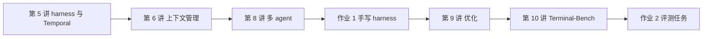
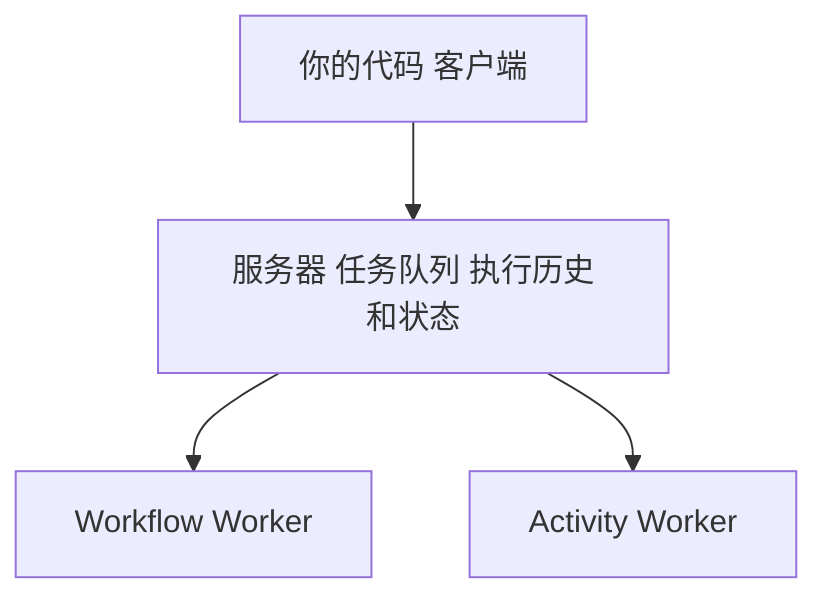
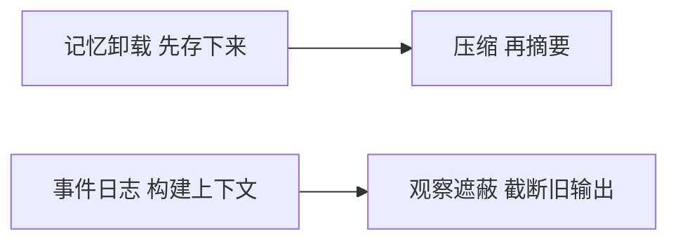

> 来源是课程主页 cs329z.stanford.edu（Fall 2026，日程标注为暂定），以及我读到的第 5、6、8、9、10 讲课件、两个作业仓库和作业 handout。快照是 2026-11-14（东京时间）。
> 课件的图和代码截图读不到，只核对了文字。读不到或没核对的，标「未核实」；「推断」是我的判断。

## 先看结论

整学期课不用全学。按你的方向，先看第 5、6、8 讲，再做作业 1；第二梯队是第 9、10 讲和作业 2。主线覆盖三件事：harness 怎么搭，长任务怎么持久化，多 agent 怎么编排。

第 6 讲把上下文管理归成五种手段：事件日志、记忆卸载、压缩、观察遮蔽、上下文隔离。第 8 讲给出的建议是先用强的单 agent 基线，再按测量结果加 agent。

作业 1 要求不用任何 agent 框架，只用一个聊天补全调用自己写。这和你手工给多个 bot 分工的现状最近。已核实

## 机制

主线解决「怎么搭」，第二梯队解决「怎么改进、怎么测」。

## 讲解：这门课怎么组织

这一节只讲课程本身。机制细节在后面按讲座拆开。

### 课程的定位

课程主页说，这门课教学生做 [[cs-compound|复合 AI 系统]]，范围从简单的 LLM 流水线到自主 agent。已核实

学生先从零写 RAG、工具调用和 agent 循环，再学 DSPy 这类框架怎么抽象它们。

### 讲座按周排

日程从 9 月 23 日排到 12 月 9 日的 Demo Day。前三周先讲基础：agent 的构成、LLM 内部、RAG、工具调用。从 10 月 7 日的框架与编排起是你要的部分：设计模式、记忆、多 agent、优化。

之后是评测、数据、安全、coding agent 和个人 agent。已核实

### 公开了多少

快照时，第 1 到 13 讲和第 15 讲的课件 PDF 能打开。视频链接只有第 1 到 5 讲。已核实

第 6 讲起只有课件，没有视频。11 月 16 日之后的讲座课件当时还没放出，所以没读。

## 讲解：第 5 讲，开源 harness 与 Temporal

### 三个开源 harness 的取舍

第 5 讲把 harness 的差别归成工具、记忆、上下文管理和执行四类设计选择。三个例子各走一个极端。已核实

mini-SWE-agent 只有 bash 一个工具，历史完全线性，每个动作用 subprocess.run 独立执行。

OpenHands 把每一步存成一个事件，一个事件一个 JSON 文件，发给模型的消息每步重建。它用 tmux 保持终端，cd 和环境变量能延续。同一动作和结果重复 4 次，检测器会让它停下。

Pi 只有 read、write、edit、bash 四个工具，系统提示不到 1000 token。它没有权限系统，历史存成树，可以回到早先的消息分叉。已核实

### Temporal 的执行模型

课件的话：Activity 是可能失败的功能单元，Workflow 把 Activity 串起来。已核实

服务器那一页画了 Activity 队列、Workflow 队列、任务队列，以及执行历史和状态的存储。至于重放的内部细节，课件文字没写。未核实

### 课程代码里的 Temporal

lecture5-frameworks 仓库的笔记本里有可跑的 Temporal 部分，用本地开发服务器。已核实

它的 Workflow 用 execute_activity 包住每个可能失败的调用，配 RetryPolicy，最多 5 次。注释写明：Workflow 必须是确定性的，因为 Temporal 从记录重新运行它。

另一个例子里，Workflow 用 workflow.sleep 等一段时间再提醒。注释说一个 Workflow 一行代码就能睡几个月甚至几年。

### 为什么要编排

课件给的理由：agent 跑得久，支撑它的基础设施必须可靠；日志和可观测性帮助调试。结语是，装好评测、监控和持久执行，才算「工程化」agent。已核实

## 讲解：第 6 讲，上下文管理

### 两条原则

第 6 讲的上下文工程有两条原则：让上下文聚焦，保持连续。前者要求只留当前任务需要的东西，后者要求保住需求、目标、约束和进度，实际上也包括保住 KV cache。已核实

### 五种手段

[[cs-event-log|持久事件日志]]：历史只追加，每次调用从日志重建输入。外部观察者也能挂钩进来。

记忆卸载：把知识存进记忆或文件，上下文就能剪枝。课件的例子是 MemGPT。

[[cs-compaction|压缩]]：让 LLM 总结之前的推理、动作和观察。课件说压缩本身也可以做成 agentic 的。

[[cs-masking|观察遮蔽]]：不做摘要，直接截断旧的观察，对 coding agent 尤其有用。

[[cs-isolation|上下文隔离]]：子 agent 只拿到任务需要的东西。课件还提到渐进披露，比如 skill 文件，不必把所有工具和上下文一开始都塞进提示。

课件的意思：这些策略互相兼容。可以先卸载到记忆再压缩，也可以用事件日志构建上下文再截断观察。真实系统是其中很多种甚至全部的组合。已核实

### Pi 案例

第 6 讲末尾拆了 Pi。默认工具是 bash、read、write、edit。它没有子 agent、权限检查、plan mode、待办列表，也没有后台 bash。

它的上下文靠事件日志转输入、skill 文件渐进披露和压缩。课件的结论：Pi 没有内置安全措施，可以当作永远在自动模式。已核实

## 讲解：第 8 讲，多 agent

### 先用单 agent

课件列出多 agent 的好处：并行、专业化、聚焦的上下文、更广的探索。代价也列了：协调开销、交接丢信息、动作冲突、错误传播、工程复杂度。

课件的建议：先用强的单 agent 基线，有目的地加 agent，并测量收益是否超过协调成本。已核实

### 四种编排

课件分了四种编排模式，对照在「参考」。核心取舍：

中心化方案监督简单，但编排者可能成为瓶颈。去中心化方案适合大规模独立探索。混合方案要有清晰的职责和信息共享规则。

### 交接与 agent-as-tool

交接（handoff）时控制权转移，接手的 agent 变为活跃，上下文跟着走，适合专家直接面对用户。

agent-as-tool 时调用方保留控制权，给专家一个有边界的请求和挑选过的上下文，结果回来后调用方继续。已核实

### 协调基础设施

[[cs-task-ledger|任务账本]]记录目标、计划、分工、依赖、进度和阻塞，并用当前状态决定下一步，停滞时也能据此改计划或重试。

[[cs-worktree-isolation|worktree 隔离]]解决多个 agent 改同一个工作目录的问题。

课件里的一个群体案例（Carlini，2026）：任务文件夹用 Git 同步，每个 agent 自己挑任务，在独立 clone 里工作，再经 Git 合并。已核实

### 为什么会失败

课件引用 Cemri 等人的论文，把多 agent 轨迹里的失败归成一个分类。「失败总结」那页的三大类是：通用失败（系统设计、agent 之间、验证），协调失败（期望、承诺、沟通），行为失败（缺乏多样性、敌对的冲突解决）。

分类里每一类的细项和比例在课件图里，文字读不到。未核实

CooperBench（课件引用 Khatua 等人）有 600 个协作编码任务，覆盖 12 个库、4 种语言。结论是单个 agent 同时解两个任务，比两个 agent 协调着解更好。已核实

## 讲解：第 9 讲，优化

### 提示还是权重

课件的总结：提示优化比 RL 样本效率高得多，权重优化更吃数据，但能随成千上万的样本继续增长。有时最好的顺序是先提示、再权重、再提示。

课件给了判断依据：只有强模型的 API 访问、需要经常快速重跑、环境交互昂贵时，用上下文优化。上下文优化失败（小模型的指令遵循太弱）、有强教师想蒸馏成便宜模型、上下文太长时，用权重优化。已核实

### GEPA

GEPA 的做法是跑任务、反思该改什么、写进提示，并按帕累托前沿演化提示。课件说它在各任务上优于基线。

课件还讲了 on-policy 蒸馏：效率比 RL 高，模型也更好。已核实

## 讲解：第 10 讲，Terminal-Bench

### 嘉宾讲座

10 月 26 日的嘉宾讲座由 Terminal-Bench 的两位共同作者讲，Ryan Marten 和 Alex Shaw。主题是在终端环境里评测 agent。

课件的核心观点：bash 是那个万能工具，评测是新的事实源。一个任务是 instruction.md 加 task.toml 加环境和测试。已核实

## 参考

### 讲座与课件

课件均在 web.stanford.edu/class/cs329z/slides/ 下，文件名 lectureNN.pdf。

| 周 | 日期 | 讲座 | 课件 | 视频 |
| --- | --- | --- | --- | --- |
| 3 | 10 月 7 日 | 框架与编排（含 Temporal、harness 导读） | [第 5 讲](https://web.stanford.edu/class/cs329z/slides/lecture05.pdf) | [有](https://youtu.be/q0Q-Hy8TTps) |
| 4 | 10 月 12 日 | 设计模式与脚手架（含 Pi 案例） | [第 6 讲](https://web.stanford.edu/class/cs329z/slides/lecture06.pdf) | 无 |
| 4 | 10 月 14 日 | 记忆架构 | [第 7 讲](https://web.stanford.edu/class/cs329z/slides/lecture07.pdf) | 无 |
| 5 | 10 月 19 日 | 多 agent 系统 | [第 8 讲](https://web.stanford.edu/class/cs329z/slides/lecture08.pdf) | 无 |
| 5 | 10 月 21 日 | 优化（GEPA、RL） | [第 9 讲](https://web.stanford.edu/class/cs329z/slides/lecture09.pdf) | 无 |
| 6 | 10 月 26 日 | 嘉宾：Terminal-Bench | [第 10 讲](https://web.stanford.edu/class/cs329z/slides/lecture10.pdf) | 无 |
| 7 | 11 月 4 日 | 评测基础与基准设计 | [第 13 讲](https://web.stanford.edu/class/cs329z/slides/lecture13.pdf) | 无 |
| 8 | 11 月 11 日 | LLM-as-Judge 与评测基础设施 | [第 15 讲](https://web.stanford.edu/class/cs329z/slides/lecture15.pdf) | 无 |

第 7 讲记忆和第 13、15 讲评测，我只核对了日程里的描述，没有读课件正文。

还没放课件的：11 月 16 日 SWE-bench 嘉宾、11 月 18 日安全、11 月 30 日 coding agent、12 月 2 日个人 agent。

### 作业

| 作业 | 内容 | 仓库 | 许可 |
| --- | --- | --- | --- |
| 作业 1 | 不用框架从零写 agent harness，共 118 分 | [assignment1-harness](https://github.com/cs329z/assignment1-harness) | MIT |
| 作业 2 | 设计评测任务，用 Harbor 框架，共 100 分 | [assignment2-evals](https://github.com/cs329z/assignment2-evals) | MIT |

日程页上作业 2 的链接写的是 assignment2-harness，访问会跳转，实际仓库名是 assignment2-evals。两个仓库的 LICENSE 文件和 README 都写了 MIT。已核实

### 作业 1 的题目与分值

作业 1 分两部分。第一部分是 LLM 流水线，第二部分是 Cardinal Agent。

| 题 | 内容 | 分 |
| --- | --- | --- |
| 1 priority | 邮件优先级 | 3 |
| 2 daily_digest | 每日摘要 | 4 |
| 3 bm25 | 从零实现 BM25 | 8 |
| 4 email_qa | 邮件上的多跳问答 | 8 |
| 5 tool_registry | 工具注册表 | 3 |
| 6 tool_protocol | 工具调用协议 | 4 |
| 7 agent_loop | 工具调用循环 | 8 |
| 8 cardinal | 组装工具集 | 2 |
| 9 search_docs | 文档检索 | 5 |
| 10 terminal | 给 agent 一个终端 | 6 |
| 11 compaction | 上下文压缩 | 8 |
| 12 memory | 跨会话持久记忆 | 8 |
| 13 interactive | 模式、审批与插话 | 7 |
| 14 guardrails | 拒绝规则与提示注入 | 4 |
| 15 sim_eval | 模拟用户评测 | 10 |
| 16 field_notes | 自己用一遍 agent 的写作 | 10 |
| 17 design_memo | harness 设计备忘录 | 20 |

自动评分 88 分，写作 30 分。确定性测试不调用 LLM，占 88 分里的 48 分。已核实

### 多 agent 编排四种模式

课件的四种模式和各自的取舍，原话意思照录：

| 模式 | 结构 | 取舍 |
| --- | --- | --- |
| 独立 | agent 各干各的，最后一步汇总 | 能并行，但不能用彼此的中间发现调整 |
| 中心化 | 一个编排者对每个 worker | 监督简单，编排者可能成为瓶颈 |
| 去中心化（swarm） | 所有 agent 通过共享消息板互相通信 | 适合大规模独立探索 |
| 混合 | 编排者加 worker 之间有限的直接通信 | 要有清晰的职责与信息共享规则 |

### 课程日期

作业 1 发布于 10 月 5 日，截止 10 月 30 日。作业 2 发布于 11 月 1 日，任务提交截止 11 月 23 日。这些是在读学生的截止日，对你只当参考。

## 用在自己的项目

### 多 agent orchestrator

第 8 讲的任务账本和编排者模式，直接对应你给 Grok Bot 群分工的那一层。你现在是手工分工，账本就是把分工、依赖、进度和阻塞写成显式状态。

课件的两条建议可以当设计检查：先有强的单 agent 基线；交接要带够上下文，避免信息丢失。

### 长任务控制和持久化

第 5 讲的 Activity 和 Workflow 划分，可以对照你现有的长任务。哪些步骤会失败，就放进 Activity，配重试。Workflow 本身保持确定性。

第 6 讲的事件日志对应「从日志重建输入」。这和已有的另外两篇笔记是同一条线：Agent Loop 那篇讲单个会话内核，Super-agent 那篇讲会话之间。

### 小模型微调

第 9 讲给了提示和权重的取舍表。你想微调小模型时，先对照这张表：上下文优化失败，或有强教师可以蒸馏，才轮到权重。推断

### 交易自动化

作业 1 的第 13、14 题（审批和拒绝规则）可以搬到下单类工具上。顺序是：注册表校验、拒绝规则、审批、执行。

Pi 的例子提醒：没有权限系统的 harness，等于永远在自动模式。

### 内容创作

课程主页和我读到的课件，没有直接讲内容创作。这一条不硬接。推断

## 动手练习

### 练习 1. 作业 1 的最小闭环

在 assignment1-harness 里做第 5、6、7 题：工具注册表、工具调用协议、工具调用循环。先跑确定性测试，不调用 LLM。

完成标准：

- 第 5、6、7 题的确定性测试通过。
- 没有加任何 agent 框架依赖，pyproject.toml 没有改。
- 写下你的工具调用文本格式，以及模型回复格式不对时怎么处理。

### 练习 2. 压缩与记忆

在练习 1 的基础上做第 11、12 题：上下文压缩和跨会话记忆。

完成标准：

- 第 11、12 题的确定性测试通过。
- 写下你的压缩策略：什么时候触发，先丢什么，摘要必须保留什么。
- 写下你的记忆策略：存什么，新会话一开始加载什么。

### 练习 3. 跑一遍课程的 Temporal 演示

clone lecture5-frameworks，按 README 跑笔记本里的 Temporal 部分，再改 RetryPolicy 的最大次数，看结果怎么变。

完成标准：

- 笔记本的 Temporal 部分能跑通，本地能打开 Temporal UI。
- 改过 RetryPolicy 的最大次数，并写下结果的变化，或写明没观察到变化。

作业 1 的实时测试要真实调用模型，需要自己的 OpenRouter key。handout 估算，参考解答把除评测外的实时测试跑一遍花 0.05 美元，评测另加 0.18 美元。这是课程的估算，你的实现会不同。

## 自测

先写一句，或勾选「已经想过」。这两件事都没做，答案打不开。你写的句子留在这台浏览器里。

### 第 6 讲的上下文管理有哪五种手段？它们是互斥的吗？

  <label class="try-label" for="try-context-five">你的回答</label>
  <textarea id="try-context-five" data-try-input rows="4"></textarea>
  <label class="try-thought"><input type="checkbox" data-try-thought /> 我已经想过，直接看答案</label>
  <button type="button" data-try-reveal disabled>看答案</button>
  

    
持久事件日志、记忆卸载、压缩、观察遮蔽、上下文隔离。它们不互斥：课件说这些策略互相兼容，真实系统是其中很多种甚至全部的组合。

  

### 压缩和观察遮蔽的区别是什么？观察遮蔽对哪类 agent 尤其有用？

  <label class="try-label" for="try-compact-vs-mask">你的回答</label>
  <textarea id="try-compact-vs-mask" data-try-input rows="4"></textarea>
  <label class="try-thought"><input type="checkbox" data-try-thought /> 我已经想过，直接看答案</label>
  <button type="button" data-try-reveal disabled>看答案</button>
  

    
压缩让 LLM 总结之前的推理、动作和观察，用更少的 token 表示历史。观察遮蔽不做摘要，直接把旧的工具输出截断或隐藏。观察很长的 coding agent 尤其受益。

  

### Temporal 里 Activity 和 Workflow 各是什么？为什么 Workflow 必须是确定性的？

  <label class="try-label" for="try-temporal-model">你的回答</label>
  <textarea id="try-temporal-model" data-try-input rows="4"></textarea>
  <label class="try-thought"><input type="checkbox" data-try-thought /> 我已经想过，直接看答案</label>
  <button type="button" data-try-reveal disabled>看答案</button>
  

    
Activity 是可能失败的功能单元，Workflow 把 Activity 串起来。笔记本里的注释写明：Workflow 必须是确定性的，因为 Temporal 从记录重新运行它，所以 LLM 调用和 I/O 要放进 Activity。重放的内部细节课件文字没写，这部分未核实。

  

### 课件对「该不该上多 agent」的建议是什么？举出两个多 agent 的代价。

  <label class="try-label" for="try-mas-advice">你的回答</label>
  <textarea id="try-mas-advice" data-try-input rows="4"></textarea>
  <label class="try-thought"><input type="checkbox" data-try-thought /> 我已经想过，直接看答案</label>
  <button type="button" data-try-reveal disabled>看答案</button>
  

    
先用强的单 agent 基线，有目的地加 agent，并测量收益是否超过协调成本。代价有：协调开销、交接丢信息、动作冲突、错误传播、工程复杂度，任选两个。CooperBench 的结论是单个 agent 同时解两个任务，比两个 agent 协调着解更好。

  

### 作业 1 的限制是什么？为什么说它适合你现在做的事？

  <label class="try-label" for="try-hw1-rule">你的回答</label>
  <textarea id="try-hw1-rule" data-try-input rows="4"></textarea>
  <label class="try-thought"><input type="checkbox" data-try-thought /> 我已经想过，直接看答案</label>
  <button type="button" data-try-reveal disabled>看答案</button>
  

    
不能用 agent 或 LLM 框架库，也不能往 pyproject.toml 加依赖；课程给的 LM 封装只有一个聊天补全调用，工具怎么告诉模型、回复怎么解析都要自己写。适合你，是因为它要你自己做工具注册表、循环、压缩、记忆、审批和拒绝规则，正好是 orchestrator 的内核。最后一句是我的判断，属推断。

  

## 原文链接

- 课程主页：[CS 329Z: Engineering AI Agents](https://cs329z.stanford.edu/)
- 日程与讲座：[Schedule](https://cs329z.stanford.edu/#schedule)
- 课程说明：[Logistics](https://cs329z.stanford.edu/logistics.html)
- 课程项目：[Project](https://cs329z.stanford.edu/project.html)
- 讲座代码：[lecture5-frameworks](https://github.com/cs329z/lecture5-frameworks)
- 作业 1：[assignment1-harness](https://github.com/cs329z/assignment1-harness)
- 作业 2：[assignment2-evals](https://github.com/cs329z/assignment2-evals)
- 课件：[第 5 讲](https://web.stanford.edu/class/cs329z/slides/lecture05.pdf)、[第 6 讲](https://web.stanford.edu/class/cs329z/slides/lecture06.pdf)、[第 8 讲](https://web.stanford.edu/class/cs329z/slides/lecture08.pdf)、[第 9 讲](https://web.stanford.edu/class/cs329z/slides/lecture09.pdf)、[第 10 讲](https://web.stanford.edu/class/cs329z/slides/lecture10.pdf)
- 视频：[第 5 讲](https://youtu.be/q0Q-Hy8TTps)
